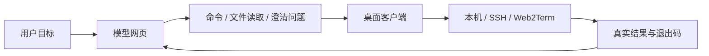
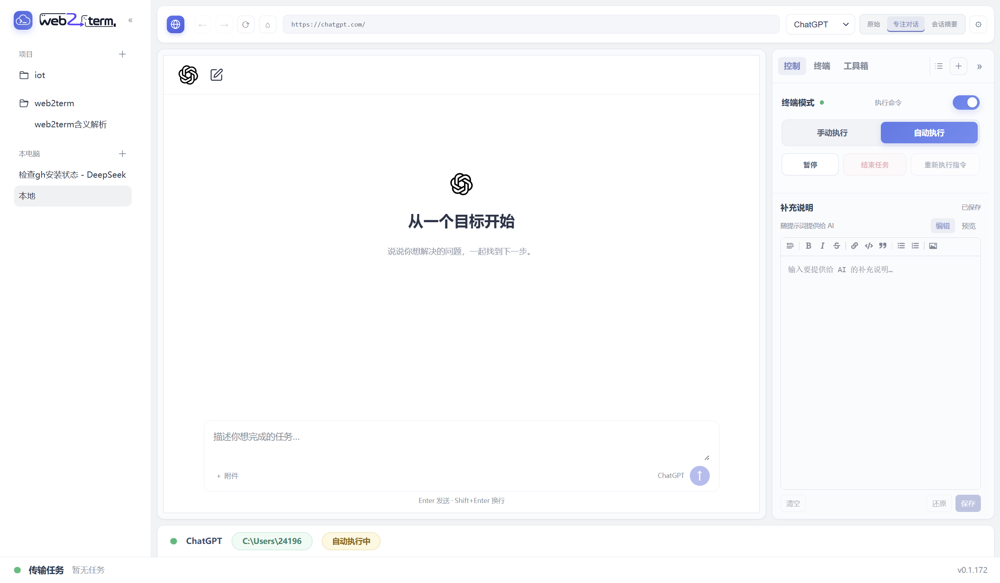

# Web2Term

[中文](#中文) · [English](#english) · [下载 / Downloads](https://github.com/naledao/Web2Term/releases/latest)

## 中文

Web2Term 把模型网页、项目对话和本机／远程终端放进同一个桌面工作区。使用 ChatGPT、DeepSeek、Claude 或 Gemini 的网页账号描述目标，由模型提出命令，客户端执行并把真实输出、退出码和工作目录回传，继续下一步。

仓库包含两个面向使用者的程序：

| 程序 | 用途 | 当前发布目标 |
| --- | --- | --- |
| Web2Term 桌面客户端 | 管理项目与对话、嵌入模型网页、执行命令、使用工具箱和连接远程设备。 | Windows x64 安装包、macOS Apple Silicon DMG。 |
| `web2term` 小工具 | 在 Linux 设备上保持后端连接，供桌面客户端打开远程终端；无需设备运行 sshd。 | Linux x86_64（amd64）单文件程序。 |

客户端直接使用模型网站，不需要配置模型 API Key；模型账号、可用功能和附件额度由相应网站决定。仅使用本机或 SSH 终端时，无需登录 Web2Term 后端。本文描述当前仓库实现，已发布安装包包含的功能以对应版本为准。

### 下载与安装

从 [GitHub Releases](https://github.com/naledao/Web2Term/releases/latest) 下载：

| 平台 | 文件 | 安装方式 |
| --- | --- | --- |
| Windows x64 | [Web2Term Windows 安装包](https://github.com/naledao/Web2Term/releases/latest/download/Web2Term-Setup.exe) | 运行安装程序，可选择安装目录。 |
| macOS Apple Silicon | [Web2Term macOS DMG](https://github.com/naledao/Web2Term/releases/latest/download/Web2Term.dmg) | 打开 DMG，将应用拖入“应用程序”。 |
| Linux 设备小工具 | [web2term-linux-amd64](https://github.com/naledao/Web2Term/releases/latest/download/web2term-linux-amd64) 和 [SHA-256 校验文件](https://github.com/naledao/Web2Term/releases/latest/download/web2term-linux-amd64.sha256) | 下载、校验并安装到 Linux 的 `PATH`，见下文。 |

使用桌面安装包无需另装 Node.js 或 npm；执行 Git、GitHub CLI 或其他外部工具时，仍需在实际执行机器上安装对应程序。

macOS 包目前使用 **ad-hoc 签名，没有 Developer ID 签名或 Apple 公证**。首次打开遇到开发者验证或“已损坏”提示时，按 [macOS 安装说明](build/macos-installation.md) 处理。当前发布工作流不提供 Intel Mac 或 Linux 桌面安装包；Linux 小工具是独立的设备端程序。

Windows 支持应用内检查、下载和安装更新；macOS 检查到更新后在浏览器下载 DMG，退出应用后手动覆盖安装。Linux 小工具需替换二进制并重启其进程。

### 开始使用客户端

1. 从左侧“本电脑”或项目旁的 **＋** 新建对话，选择“本地终端”“SSH 连接”或“web2term”。项目可设置本机目录，项目中新建的本机会话从该目录开始。
2. 选择 ChatGPT、DeepSeek、Claude 或 Gemini，在嵌入网页中登录对应账号。
3. 在右侧“执行控制”确认 **终端模式** 和 **提示词注入** 已开启，检查终端绑定的机器和当前目录。
4. 选择 **手动执行** 或 **自动执行**，向模型描述目标。手动模式下，待处理请求需点击“运行”或“读取”；执行结果同样会回传到模型。
5. 自动执行可暂停和恢复；“结束任务”停止当前模型生成、前台命令和后续自动执行。后台进程有独立生命周期，见“后台任务”。





截图用于展示工作区形态，具体布局和入口以当前版本为准。模型网页需要可用的网络和登录态。

### 项目、对话与视图

- **项目分组**：创建、编辑和移除项目，将对话移动到项目；移除项目后，对话保留并移到“本电脑”列表。项目目录用于新建本机会话，不会把 SSH／Web2Term 目录改成本机路径。
- **会话持久化**：保存对话名称、模型平台、对话地址、执行记录和远程设备绑定。切换模型保留当前终端及连接；任务执行中限制切换，避免把结果发到其他对话。
- **三种视图**：“原始”显示模型网站；“专注对话”在本地界面组织消息、思考／检索过程和执行记录；“会话摘要”查看本地保存的对话内容。
- **补充说明**：在终端的“说明”中编辑 Markdown。项目中的对话共享同一份说明；未归属项目的对话按机器和当前目录保存，子目录不自动继承。保存后随启用的提示词注入提供给模型。
- **提示词预览**：“查看系统提示词”和“查看工具提示词”分别展示执行环境、补充说明和工具协议，支持复制与查找。

平台开放范围按当前代码列示：

| 能力 | ChatGPT | DeepSeek | Claude | Gemini |
| --- | --- | --- | --- | --- |
| 原始网页、终端命令与结果回传 | 支持 | 支持 | 支持 | 支持 |
| 本地会话摘要 | 支持 | 支持 | 支持 | 支持 |
| 专注对话 | 支持 | 支持 | — | — |
| 侧边聊天、选区追问 | 支持 | 支持 | 支持 | 支持 |
| `read_files` 完整附件回传（本机／SSH） | 已接入 | 已接入 | 已接入 | 已接入，自动回传待用户验收 |
| `background: true` 后台任务 | 支持 | 支持 | 支持 | 支持 |

专注对话仍通过原模型网页发送消息和读取答复，沿用其账号与登录态；支持添加附件和粘贴截图。第三方页面变化可能影响适配。

右侧页签栏的 **＋** 可添加“终端”“后台任务”“GitHub 仓库管理”或“侧边聊天”。新增终端是用户独立操作的 Shell，不把其输出自动发送给模型。每次新建侧边聊天会替换原侧边实例；选区追问从本地已保存的对话生成上下文 Markdown，发到同平台的新聊天中，侧边聊天不执行终端命令。

### 本机、SSH 与 Web2Term

| 项目 | 本机 | SSH | Web2Term |
| --- | --- | --- | --- |
| 连接要求 | 当前电脑的系统 Shell。 | 可访问的 SSH 服务及登录凭据。 | 桌面端和 Linux 小工具连接同一后端、登录同一账号。 |
| Shell | Windows PowerShell；macOS `/bin/zsh`。 | 手动交互 PTY 与模型命令使用独立 Shell。 | 每个工作区一个 PTY，手动输入和模型命令共用 Shell。 |
| 附加终端 | 独立本机 Shell。 | 同一主机上的独立命令通道。 | 同一设备上的额外 PTY，占终端名额。 |
| 文件浏览与传输 | 模型可读取本机文件并上传附件。 | 远程目录浏览、上传、下载、PDF 预览；模型可经 SFTP 读取文件。 | 当前仅接入终端，未接入文件面板及 `read_files`。 |
| Git 面板 | 查看本机仓库。 | 通过 SSH 查看远端仓库。 | 未接入，可在设备终端执行 Git 命令。 |

本机 Shell 持续保留当前目录、变量和函数。macOS 使用非交互登录 zsh，命令标准输入为空；仅放在 `~/.zshrc` 的交互配置不保证加载，额外 `PATH` 建议放在 `~/.zprofile`，修改后重置终端。需要密码输入的 `sudo` 或交互式程序，应在合适的交互终端中操作。

SSH 两个 Shell 的环境变量和交互状态不共享，应用会尝试从交互终端提示符同步目录。SSH 文件传输入口位于终端目录栏，所有会话的上传、下载进度集中显示在窗口底部，支持取消。

### 后台任务

长时间运行、持续输出或需要等待外部事件的非交互任务，可以交给软件启动并监控。模型使用以下命令格式：

```json
{"command":"npm run build","description":"构建项目","background":true,"timeout_seconds":30}
```

软件负责启动独立进程、取得 PID、创建 stdout／stderr 日志和退出码文件，并登记任务；`timeout_seconds` 只约束启动阶段，最多 30 秒。后台任务关闭标准输入，不提供 TTY 交互，不需要模型另套 `nohup`、`&` 或 `Start-Process`。

- 任务启动后自动打开“后台任务”页签，可查看状态、PID、日志路径和持续输出，主终端仍可执行其他命令。
- 向原模型对话发送一次“后台任务已创建”，完成后再发送一次“后台任务执行结果”；过程由软件观察，无需模型轮询。
- 页面正在生成、有文字／附件草稿、执行已暂停或目标对话不在前台时，通知等待可发送条件，不覆盖草稿。
- 关闭页签保留观察；重启客户端后恢复任务列表，本机继续观察，远程任务在重新连接原主机或设备后继续观察。
- “结束任务”取消该轮后台任务的自动回传，后台进程继续运行。当前面板不提供停止或重启后台进程的操作。
- Web2Term 的后台观察通道也占一个设备终端名额；同一工作区的多个后台任务共用该通道。

### AI 读取文件

`read_files` 把当前执行机器上的完整文件作为附件上传到当前模型对话，支持源码、文本、图片和文档。SSH 会话读取绑定主机的文件；相对路径以请求检测时的终端工作目录为准。

```json
{
  "type": "read_files",
  "files": [{"path": "src/main/index.ts"}],
  "description": "读取主进程入口"
}
```

每次 1–3 个非空普通文件，单文件最多 20 MiB，合计最多 25 MiB；网站还可能有额外的类型或额度限制。软件上传完整原文件的快照，不改动源文件，不将文件正文拼入消息文本。已有网页草稿时保留草稿，可稍后“重试回传”；提交结果未确认时不会自动重复发送。Web2Term 当前不提供此工具。

实现、限额和诊断说明见 [AI 自主读取文件](docs/ai-file-reading.md)。

### 工具箱与 GitHub 仓库管理

“工具箱”中的工具以可最小化、恢复的工具窗口打开：

| 工具 | 当前能力 |
| --- | --- |
| Git 管理 | 本机及 SSH 远端仓库的分支、提交历史、改动文件、增删行数与统一／并排 diff；面板只读，提交和切分支通过终端执行。 |
| MySQL 连接 | 保存多连接，搜索表名／注释，浏览数据、字段注释和 DDL；创建／删除表、导出数据库表结构，按主键编辑字段及单条／批量删除记录；执行单条 SQL，查询最多展示 200 行。 |
| Redis 连接 | 单机 Redis，支持用户名、密码、DB 和 TLS；键名搜索、分批加载、TTL，以及 String、Hash、List、Set、ZSet、Stream 的只读浏览。 |
| Nacos 连接 | 保存控制台地址及可选命名空间，嵌入真实控制台网页，提供地址栏、前进、后退、刷新和停止加载。 |

MySQL 操作会直接修改所连接的数据库；其查询行数限制不限制写入 SQL 的影响范围。MySQL、Redis 和 Nacos 的连接配置保存在本机并按工作环境区分，MySQL／Redis 密码通过系统加密保存。

**MySQL、Redis、Nacos 的网络连接均从运行客户端的电脑发出，不自动经过 SSH 隧道或 Web2Term。** 填写 `127.0.0.1` 指向客户端电脑；SSH Git 面板通过远端命令通道读取仓库。

右侧 **＋ → GitHub 仓库管理** 使用本机安装的 GitHub CLI（`gh`）及其当前 `github.com` 账号，支持检测登录状态、让当前 AI 协助登录、退出账号、搜索仓库、按归属／可见性筛选和排序，以及选择本机目录克隆并查看进度。AI 协助登录需当前终端处于本机，且终端模式和提示词注入已开启；仓库列表和克隆使用本机账号及本机目录。

### Web2Term 小工具：安装与连接

桌面端、小工具端和后端的关系：


两端都主动连接后端，Linux 设备不需要对桌面端开放 SSH 端口。后端负责账号认证、设备归属和终端消息路由。

#### 1. 安装 Linux 小工具

在 Linux x86_64 主机上下载并校验：

```bash
curl -fLO https://github.com/naledao/Web2Term/releases/latest/download/web2term-linux-amd64
curl -fLO https://github.com/naledao/Web2Term/releases/latest/download/web2term-linux-amd64.sha256
sha256sum -c web2term-linux-amd64.sha256
sudo install -m 0755 web2term-linux-amd64 /usr/local/bin/web2term
web2term --help
```

也可在客户端 **设置 → web2term 设备 → Linux 设备工具 → 下载**，程序下载时会校验 SHA-256；下载完成后，需自行把文件传到 Linux 设备安装。小工具资产在桌面版本发布完成后的独立工作流中上传；新版本刚发布时若暂时下载不到，可稍后重试。

#### 2. 配置后端并登录

客户端在 **设置 → 后端服务** 确认基础地址，用邮箱和 6 位验证码登录。在 Linux 上用准备运行终端的用户执行：

```bash
web2term set server
web2term login
web2term run
web2term status
```

`set server` 在交互提示中接收地址，不把地址作为命令参数。当前代码的默认地址为 `http://frp.kangnasi.xyz:8082`；使用自建后端时，两端填写同一地址。地址必须包含 `http://` 或 `https://`，可包含端口和部署路径，例如 `https://example.com/backend`；不要追加 API 路径、WebSocket 路径、查询参数或 Token。`https://` 自动对应 `wss://`，部署路径保留。

`run` 启动独立后台进程后返回，不需要 `&` 或 `nohup`，关闭终端或断开启动它的 SSH 后仍继续运行。**只有 `status` 显示“设备已在线，服务端已确认心跳”，才表示设备已成功上线。** 重复 `run` 不会另开一份进程。

#### 3. 从客户端选择设备

在左侧 **＋ → web2term**，或终端的 **切换 → web2term** 中打开“我的设备”，刷新后选择在线且已启用的设备。等待设备终端就绪后即可手动操作或让模型执行命令。**设置 → web2term 设备** 可查看设备列表并修改显示名称。

模型网站登录、Web2Term 后端登录和 GitHub CLI 登录分别维护；桌面端与 Linux 小工具必须使用相同后端和同一账号。

#### 4. 可选：开机自启

已安装新版小工具、完成登录，并使用 systemd 的 Linux 主机，可用同一个 Linux 用户执行：

```bash
web2term autostart enable   # 安装并启用系统服务，立即启动
web2term autostart status   # 查看自启及服务状态
web2term status             # 确认设备在线与心跳
web2term autostart disable  # 关闭自启并停止系统服务
```

直接运行 `web2term autostart enable`，**不要在命令前另加 `sudo`**。工具按需调用 sudo 请求权限，服务仍以原用户运行，沿用原配置和设备 ID；每个用户对应 `/etc/systemd/system/web2term-<UID>.service`。首次从手动后台进程转为服务托管会关闭现有远程终端，需在客户端重新连接。

`web2term stop` 只停止本次运行，保留开机自启设置；要关闭后续开机启动，使用 `autostart disable`。OpenRC、未启用 systemd 的 WSL 和普通容器不能使用这组自启命令。服务不会自动继承当前终端临时设置的所有环境变量。

#### 运行边界与升级

- **3 个终端名额**：每台设备最多同时 3 个 PTY，创建中和关闭中的终端也计数；模型终端、附加终端、后台观察通道共享上限。
- **单设备连接**：客户端当前只维护一条 Web2Term 后端连接，同设备的多个会话共用；选择另一台设备会替换连接并断开原设备终端。
- **重连**：小工具对可恢复的网络故障自动重连；原 PTY／Shell 不恢复，客户端需重新连接并创建终端。连接成功不等于终端已就绪。
- **凭据到期**：重新 `web2term login`。手动后台模式执行 `stop` 后 `run`；自启模式执行 `autostart enable` 恢复服务托管。更换后端或更新凭据后也需重启进程读取配置。
- **升级二进制**：先以原运行用户 `web2term stop`，替换文件，再以同一用户 `run` 或 `autostart enable`。只替换磁盘文件不会升级已运行进程。
- **执行权限**：终端命令以运行小工具的 Linux 用户身份执行。安装时使用 sudo 不表示日常登录、运行也要使用 sudo。

小工具的配置位于 `$XDG_CONFIG_HOME/web2term/config.json`，默认 `~/.config/web2term/config.json`；目录权限 `0700`，配置权限 `0600`。Token 存在此配置文件中，验证码不保存；切换运行用户会切换配置和设备身份。

详细说明见 [Linux 小工具 README](agents/linux/README.md)、[终端协议 v1](agents/linux/docs/terminal_protocol.md) 和 [桌面连接说明](docs/web2term-desktop-connection.md)。

### 设置、数据与排查

设置包含外观、对话、后端服务、web2term 设备、网络代理、应用更新和浏览器登录态。可分别配置模型网页、SSH、更新下载所用代理；Linux 小工具下载沿用更新代理。网页登录遇到限制时，可使用支持的平台登录态导入入口。

客户端在 Electron 用户数据目录的 `conversations.db` 中保存项目、对话、执行记录、任务、连接配置与设置；模型网页和 Nacos 使用持久网页分区保存各自登录态。数据库密码等凭据通过 Electron `safeStorage` 加密，导入的网页登录凭据仍需按密码保护。

| 问题 | 先检查 |
| --- | --- |
| 模型网页无法加载／登录 | 当前网络、网页代理、网站登录状态；真实页面行为由用户操作确认。 |
| 设备列表为空 | 两端后端地址和账号是否一致；在设备运行 `web2term status`，确认心跳已获服务端确认。 |
| 设备在线但终端不可用 | 设备是否启用、是否被其他客户端占用、3 个终端名额是否已满，以及终端是否真正创建成功。 |
| 数据库地址可从远端访问、客户端却连不上 | 数据库工具从客户端电脑发起连接，检查该电脑到服务的网络路径。 |
| 新版本小工具功能未生效 | 是否已替换二进制并重启旧后台进程／系统服务。 |

客户端登录、连接及附件诊断日志写入系统临时目录的 `gpt-login-diag/`，Windows 为 `%TEMP%\gpt-login-diag\`，macOS 通常为 `$TMPDIR/gpt-login-diag/`；错误界面会给出具体路径。小工具登录时直接打印日志位置，运行日志通过 `web2term status` 查询，Linux 通常位于 `/tmp` 或 `TMPDIR` 指定目录。排查时提供相关日志，无需提供含 Token 的 `config.json`。

客户端可选运行日志通过 `DSH_APP_LOG=1` 开启，写入用户数据目录的 `logs/`；日志可能包含工作路径或对话片段，分享前需检查内容。现有诊断工具的用途见 [诊断说明](tools/diag/README.md)。

### 源码开发与构建

桌面客户端的发布工作流使用 Node.js 22 和 npm。在仓库根目录执行：

```bash
npm ci
npm run dev
```

**开发运行统一使用 `npm run dev`**，由 electron-vite 启动 Vite 与 Electron。

| 命令 | 用途 |
| --- | --- |
| `npm run dev` | 开发模式及热更新。 |
| `npm run typecheck` | 主进程／preload 和渲染层的类型检查。 |
| `npm run build` | 类型检查并构建 main、preload、renderer，输出到 `out/`，不启动客户端。 |
| `npm run dist:win` | 构建 Windows x64 NSIS 安装包，输出到 `release/`。 |
| `npm run dist:mac` | 在 macOS 上构建 Apple Silicon DMG，输出到 `release/`。 |
| `npm run dist:linux` | 仓库保留的 Linux 桌面 AppImage 打包入口，当前自动发布流程未包含它。 |

Linux 小工具按 [go.mod](agents/linux/go.mod) 要求使用 Go 1.27.0 或以上版本，在 Linux／macOS Shell 中构建：

```bash
cd agents/linux
GOOS=linux GOARCH=amd64 CGO_ENABLED=0 go build -trimpath -o dist/linux-amd64/web2term ./cmd/web2term
```

Windows PowerShell 交叉编译方式见 [小工具构建说明](agents/linux/README.md#构建与安装)。

**测试由用户运行，智能体写代码并读取日志。** 智能体不启动 Electron 做功能测试，不自动访问真实模型登录／会话；构建检查使用 `npm run build`。交付状态为“构建通过，等待测试”，构建通过不等于真实登录、附件回传、远程终端或开机自启已验收。具体协作规则见 [AGENTS.md](AGENTS.md)。

### 技术与目录

桌面端使用 Electron 44、React 19、TypeScript 和 electron-vite；模型网页通过 `WebContentsView` 嵌入，不使用 iframe。渲染层经 preload 暴露的类型化 `window.api` 调用主进程，主窗口启用 `contextIsolation`、关闭 `nodeIntegration`。SQLite 保存本地状态，`ssh2`、`ws`、`mysql2`、`ioredis` 分别处理 SSH、Web2Term、MySQL 和 Redis。Linux 小工具使用 Go、WebSocket 与 PTY。

```text
src/
  main/                 主进程、网页适配、执行循环、SSH/Web2Term、后台任务与工具箱
  preload/              contextBridge 与 window.api
  shared/               类型、平台描述、提示词与工具协议
  renderer/src/         React 工作区、项目导航、对话视图与工具窗口
agents/linux/           web2term Linux 小工具、systemd 自启与终端协议
backend/                Web2Term 后端、账号接口与设备／终端消息路由
website/                项目展示网站，独立于桌面客户端
build/                  安装包资源与 macOS 安装说明
docs/                   功能说明、协议补充与截图
tests/                  客户端回归用例，由用户运行
tools/diag/             用户驱动的诊断工具与说明
.github/workflows/      桌面发布、小工具发布及其他服务工作流
```

当前 SSH 接受未知 host key，尚未提供 `known_hosts` 校验界面。模型网页适配依赖第三方 DOM、登录与网络策略；Google 登录另有 User-Agent 兼容处理，策略变化时可能需要更新适配或导入登录态。命令按会话和消息记录去重，恢复历史记录不代表应再次执行历史命令。

### 许可证

MIT

---

## English

Web2Term brings model websites, project conversations, and local or remote terminals into one desktop workspace. Describe a goal in ChatGPT, DeepSeek, Claude, or Gemini; the model proposes a command, the client runs it on the selected machine, and the actual output, exit code, and working directory return to the conversation.

The repository contains the Web2Term desktop client and a separate Linux device tool, `web2term`. The client uses your model website accounts without requiring model API keys. Web2Term backend login is needed for device connections; local and SSH use do not require it. This README describes the current source; features in a published installer depend on its release version.

### Downloads and installation

Download from [GitHub Releases](https://github.com/naledao/Web2Term/releases/latest):

| Program | Release target | Download |
| --- | --- | --- |
| Web2Term desktop client | Windows x64, NSIS installer | [Web2Term Windows installer](https://github.com/naledao/Web2Term/releases/latest/download/Web2Term-Setup.exe) |
| Web2Term desktop client | macOS Apple Silicon, arm64 DMG | [Web2Term macOS DMG](https://github.com/naledao/Web2Term/releases/latest/download/Web2Term.dmg) |
| Linux device tool | Linux x86_64 / amd64 | [Binary](https://github.com/naledao/Web2Term/releases/latest/download/web2term-linux-amd64), [SHA-256 checksum](https://github.com/naledao/Web2Term/releases/latest/download/web2term-linux-amd64.sha256) |

The desktop installer includes its runtime; Node.js and npm are needed for source development. External programs such as Git and GitHub CLI must be installed on the machine where they run.

On macOS, drag the app into Applications. The package uses **ad-hoc signing without a Developer ID or Apple notarization**; see the [macOS installation guide](build/macos-installation.md) for first-launch issues. The release workflow currently provides neither an Intel Mac installer nor a Linux desktop installer. Windows supports downloading and installing updates in the app; macOS updates require downloading a DMG and replacing the app manually.

### Desktop workflow

1. Use **＋** beside “本电脑” or a project to create a local, SSH, or Web2Term conversation. A project's optional local directory becomes the starting directory for new local sessions.
2. Choose a model platform and sign in on its embedded website.
3. In “执行控制”, enable terminal mode and prompt injection, then check the target machine and directory.
4. Choose manual or automatic execution. Manual requests wait for “运行” or “读取”; both modes return results to the model.
5. Pause and resume automatic execution as needed. Ending a task stops generation, the foreground command, and further automation. Background processes have their own lifecycle.

Projects group conversations and share supplementary Markdown instructions. Removing a project preserves its conversations under “本电脑”. Conversations outside projects store instructions per machine and working directory, without automatic inheritance by subdirectories.

| Feature | ChatGPT | DeepSeek | Claude | Gemini |
| --- | --- | --- | --- | --- |
| Original website, terminal execution, result delivery | Yes | Yes | Yes | Yes |
| Locally saved conversation summary | Yes | Yes | Yes | Yes |
| Focus conversation view | Yes | Yes | — | — |
| Side chat and questions about selected answer text | Yes | Yes | Yes | Yes |
| Full-file attachments through `read_files`, local / SSH | Integrated | Integrated | Integrated | Integrated; automatic delivery awaits user acceptance |
| Managed background commands | Yes | Yes | Yes | Yes |

The focus view presents messages, reasoning/search activity, and execution records in the client's UI while still using the original website account. It supports attachments and pasted screenshots. Side chats use the same platform login, open separate conversations, and do not execute terminal commands. Selection questions attach context exported from locally saved messages.

The right panel's **＋** menu adds personal terminals, background tasks, GitHub repository management, or a side chat. Personal terminals are independent shells whose output is not automatically sent to the model.

### Terminals, files, and tools

- **Local:** persistent Windows PowerShell or macOS `/bin/zsh`, retaining directory, variables, and functions. macOS uses a non-interactive login shell with empty stdin; put additional login `PATH` configuration in `~/.zprofile` and reset the terminal afterward.
- **SSH:** separate shells for manual interaction and model commands, with directory synchronization where possible. Includes SFTP browsing, upload/download, PDF preview, full-file model attachments, and remote Git inspection.
- **Web2Term:** one PTY per workspace, shared by manual input and model commands. File browsing, `read_files`, and the Git panel are not integrated for this transport.

The `read_files` tool uploads complete snapshots of 1–3 non-empty files, at most 20 MiB each and 25 MiB combined, subject to the website's own restrictions. Relative paths use the command terminal's directory. Existing website drafts are preserved; uncertain submissions are not automatically sent again. See [file-reading details](docs/ai-file-reading.md).

For long-running non-interactive work, the model sets `background: true` in its command JSON. The software starts the process, records its PID, creates stdout/stderr logs and an exit-code file, and monitors completion. Startup timeout is at most 30 seconds; it does not limit the full job. The original conversation receives a creation notice and a final result when delivery conditions allow. Closing the tab preserves observation; restarting the client restores records and resumes observation once the original execution target is available. Ending the task cancels automatic delivery while leaving background processes running. The panel currently provides no process stop/restart action.

The toolbox opens minimizable tool windows:

| Tool | Current scope |
| --- | --- |
| Git | Read-only local and SSH repository inspection, history, file statistics, unified and side-by-side diffs. Use the terminal for writes. |
| MySQL | Saved connections, table search, data/comments/DDL, table creation/deletion, schema export, primary-key-based field edits and row deletion, and single-statement SQL. Queries display at most 200 rows; writes directly affect the database. |
| Redis | Read-only standalone Redis browsing with credentials, DB selection, TLS, key search, pagination, TTL, and common data types. |
| Nacos | Embedded console with saved URLs/namespaces and browser navigation controls. |

**MySQL, Redis, and Nacos connect from the desktop computer**, without an automatic SSH or Web2Term tunnel. `127.0.0.1` refers to that computer. Database passwords use system-backed encryption.

**＋ → GitHub 仓库管理** uses the locally installed `gh` and its active `github.com` account. It supports account checks, AI-assisted login, logout, repository search/filtering/sorting, and cloning into a selected local directory with progress. AI-assisted login requires a local terminal with terminal mode and prompt injection enabled.

### Linux device tool setup

Install on Linux x86_64:

```bash
curl -fLO https://github.com/naledao/Web2Term/releases/latest/download/web2term-linux-amd64
curl -fLO https://github.com/naledao/Web2Term/releases/latest/download/web2term-linux-amd64.sha256
sha256sum -c web2term-linux-amd64.sha256
sudo install -m 0755 web2term-linux-amd64 /usr/local/bin/web2term
```

The desktop client also offers a checksum-verified download under **设置 → web2term 设备**. Device assets are uploaded by a separate workflow after the desktop release, so they may appear later.

Sign in under **设置 → 后端服务** on the desktop. With the Linux user who should own the terminal, run:

```bash
web2term set server
web2term login
web2term run
web2term status
```

Enter the backend address at the interactive prompt. Both programs currently default to `http://frp.kangnasi.xyz:8082`; use the same backend and account on both sides. Custom HTTP/HTTPS base URLs may include a port and deployment path. Do not append API endpoints, WebSocket paths, query parameters, or credentials. The client connects to `/ws/desktop`, the device to `/ws/agent`; deployment paths are preserved.

`run` starts an independent background process and returns, surviving shell or SSH disconnection. Confirm that `status` reports a heartbeat acknowledged by the server before selecting the device from **＋ → web2term**. The desktop's device settings also support renaming devices.

For boot startup on a systemd Linux host, run as the same user:

```bash
web2term autostart enable
web2term autostart status
web2term status
web2term autostart disable
```

Do not prefix `autostart enable` with sudo: the tool requests elevation when needed and installs a `web2term-<UID>.service` that runs as the original user with the original configuration and device ID. Initial migration from a manually started daemon closes active terminals. `stop` stops the current process while preserving boot startup; `autostart disable` disables startup and stops the service. OpenRC, WSL without systemd, and ordinary containers are outside this feature's scope.

Each device allows **3 PTYs**, shared by workspace terminals, additional terminals, and background observation channels. The desktop currently maintains one Web2Term device connection; selecting another device disconnects the previous device's terminals. Recoverable device network failures reconnect automatically, but old shells are not restored. Reconnect from the desktop to create a new terminal.

After changing credentials or backend settings, restart the process. For upgrades, stop the old process as its original user, replace the binary, then use `run` or `autostart enable` to resume. Configuration is stored at `$XDG_CONFIG_HOME/web2term/config.json`, defaulting to `~/.config/web2term/config.json`, with `0600` permissions; it contains the access token. Model website login, backend login, and GitHub CLI login are separate.

See the [Linux tool README](agents/linux/README.md) and [terminal protocol](agents/linux/docs/terminal_protocol.md) for details. Device login prints its diagnostic log path; `status` reports runtime log paths. Desktop connection and attachment diagnostics are under the system temporary directory's `gpt-login-diag/`. Share relevant logs instead of token-bearing configuration files.

### Development and validation

The desktop release workflow uses Node.js 22 and npm:

```bash
npm ci
npm run dev
```

Use `npm run dev` to run the client. `npm run build` performs type checks and builds main/preload/renderer into `out/` without starting the application. `npm run dist:win` and `npm run dist:mac` produce installers in `release/`; `npm run dist:linux` remains an AppImage packaging option outside the current automatic release workflow.

The Linux tool requires Go 1.27.0 or later, as declared in its module:

```bash
cd agents/linux
GOOS=linux GOARCH=amd64 CGO_ENABLED=0 go build -trimpath -o dist/linux-amd64/web2term ./cmd/web2term
```

The desktop uses Electron 44, React 19, TypeScript, `WebContentsView`, typed preload IPC, and SQLite. The Go tool uses WebSocket and PTYs. `backend/` contains Web2Term authentication/device routing, and `website/` is the separate project website.

Under this repository's [agent instructions](AGENTS.md), users run tests and real interactions; agents implement changes and inspect logs. Agents use `npm run build` for build validation and do not launch Electron to test real accounts. **Build passed, awaiting user testing** is the delivery standard; it does not establish that login, attachments, remote terminals, or systemd startup have passed acceptance.

SSH currently accepts unknown host keys without a `known_hosts` verification UI. Website adapters depend on third-party DOM and authentication behavior; Google login includes a User-Agent compatibility workaround. Locally persisted data and logs may contain paths, conversation content, or credentials and should be handled accordingly.

### License

MIT
