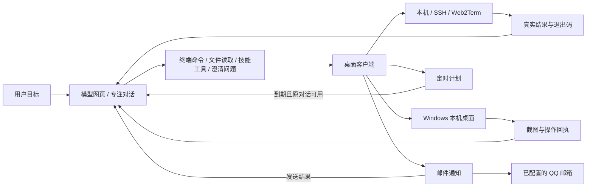
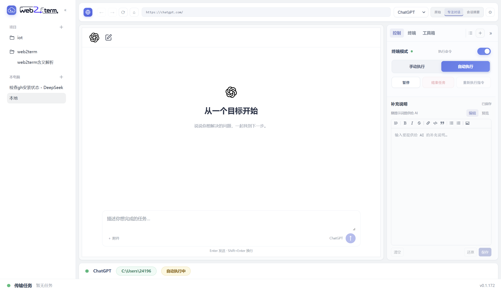

# Web2Term

[中文](#中文) · [English](#english) · [下载 / Downloads](https://github.com/naledao/Web2Term/releases/latest)

## 中文

Web2Term 把模型网页、项目对话和本机／远程终端放进同一个桌面工作区。使用 ChatGPT、DeepSeek、Gemini 或 Claude 的网页账号描述目标，由模型提出命令，客户端执行并把真实输出、退出码和工作目录回传，继续下一步。Windows x64 本机会话还可启用 **Computer Use**，让 ChatGPT 或 DeepSeek 通过截图和键鼠动作操作桌面应用。

四个平台全部支持默认的**专注对话**视图，保留原网页账号与登录态，提供**多账号管理与隔离**、**额度标记**、输入框 `//` **按需技能**、**会话压缩**、**任务交接文档导出**、**跨账号交接**、有序**发送队列**、**HTML 实时预览**、Mermaid 图表与 KaTeX 公式；还可以创建**定时任务**，配置 QQ 邮箱让模型调用**邮件通知**工具，并在 SSH 会话中直接通过 SFTP 编辑远端文本文件。

仓库包含两个面向使用者的程序：

| 程序 | 用途 | 当前发布目标 |
| --- | --- | --- |
| Web2Term 桌面客户端 | 管理项目与对话、嵌入模型网页、提供专注对话与多账号管理、执行命令、使用工具箱和连接远程设备；Windows x64 另支持 Computer Use。 | Windows x64 安装包、macOS Apple Silicon DMG。 |
| `web2term` 小工具 | 在 Linux 设备上保持后端连接，供桌面客户端打开远程终端；无需设备运行 sshd。 | Linux x86_64（amd64）单文件程序。 |

Windows 客户端还可在设备设置中开启“本机远程终端”，将这台电脑作为 PowerShell 远程设备，供同一账号的其他客户端连接，最多同时运行 3 个终端。详见 [Windows 本机远程终端与验收说明](docs/windows-agent.md)。

客户端直接使用模型网站，不需要配置模型 API Key；模型账号、可用功能和附件额度由相应网站决定。仅使用本机或 SSH 终端时，无需登录 Web2Term 后端。本文描述当前仓库实现，已发布安装包包含的功能以对应版本为准。

### 下载与安装

从 [GitHub Releases](https://github.com/naledao/Web2Term/releases/latest) 下载：

| 平台 | 文件 | 安装方式 |
| --- | --- | --- |
| Windows x64 | [Web2Term Windows 安装包](https://github.com/naledao/Web2Term/releases/latest/download/Web2Term-Setup.exe) | 运行安装程序，可选择安装目录。 |
| macOS Apple Silicon | [Web2Term macOS DMG](https://github.com/naledao/Web2Term/releases/latest/download/Web2Term.dmg) | 打开 DMG，将应用拖入“应用程序”。 |
| Linux 设备小工具 | [web2term-linux-amd64](https://github.com/naledao/Web2Term/releases/latest/download/web2term-linux-amd64) 和 [SHA-256 校验文件](https://github.com/naledao/Web2Term/releases/latest/download/web2term-linux-amd64.sha256) | 下载、校验并安装到 Linux 的 `PATH`，见下文。 |

使用桌面安装包无需另装 Node.js 或 npm；执行 Git、GitHub CLI 或其他外部工具时，仍需在实际执行机器上安装对应程序。

macOS 包目前使用 **ad-hoc 签名，没有 Developer ID 签名或 Apple 公证**。首次打开遇到开发者验证或“已损坏”提示时，按 [macOS 安装说明](build/macos-installation.md) 处理。当前发布工作流不提供 Intel Mac 或 Linux 桌面安装包；Linux 小工具是独立的设备端程序。

Windows 支持应用内检查、下载和安装更新；macOS 检查到更新后在浏览器下载 DMG，退出应用后手动覆盖安装。Linux 小工具需替换二进制并重启其进程。

### 开始使用客户端

1. 从左侧“本电脑”或项目旁的 **＋** 新建对话，选择“本地终端”“SSH 连接”或“web2term”。项目可设置本机目录，项目中新建的本机会话从该目录开始。
2. 选择 ChatGPT、DeepSeek、Gemini 或 Claude，切到“原始”视图登录对应账号；也可在专注对话顶部账号选择器添加并登录多个隔离账号。
3. 在右侧“控制”页签确认 **终端模式** 和 **提示词注入** 已开启，检查终端绑定的机器和当前目录。
4. 选择 **手动执行** 或 **自动执行**，向模型描述目标。手动模式下，待处理请求需点击“运行”或“读取”；执行结果同样会回传到模型。专注对话的消息按序进入输入框上方的 **发送队列**。
5. 自动执行可暂停和恢复；“结束任务”停止当前模型生成、前台命令和后续自动执行。后台进程有独立生命周期，见“后台任务”。





截图用于展示工作区形态，具体布局和入口以当前版本为准。模型网页需要可用的网络和登录态。

### 项目、对话与视图

- **项目分组**：创建、编辑和移除项目，将对话拖拽或移动到项目；移除项目后，对话保留并移到“本电脑”列表。项目目录用于新建本机会话，不会把 SSH／Web2Term 目录改成本机路径。
- **会话持久化**：保存对话名称、模型平台、账号绑定、对话地址、执行记录和远程设备绑定。切换模型保留当前终端及连接；任务执行中限制切换，避免把结果发到其他对话。
- **三种视图**：“专注对话”（默认视图）在本地界面组织消息、思考／检索过程、执行记录与工具调用卡片；“原始”显示模型网站；“会话摘要”查看本地保存的对话内容。可在 **设置 → 对话** 中修改默认模型和默认对话视图。
- **多账号管理、隔离与额度**：ChatGPT、DeepSeek、Gemini 和 Claude 均可在专注对话顶部打开账号管理弹窗，添加带备注的新账号、切换账号或删除非默认账号。每个账号使用独立的 Electron 浏览器分区（`persist:<platform>-<id>`），登录态与会话地址互不干扰；还可将账号标记为“有额度”或“无额度”，供跨账号交接使用。
- **历史指令**：右侧「控制」面板可查看最近三条命令、问题和工具指令。文件读取支持在原主机重新读取并回传，其他新增的工具指令支持复制原始内容。
- **专注对话增强**：
  - **模型与回答设置**：ChatGPT（模型与推理强度 Instant / Medium / High）、Gemini（模型与思考等级 低 / 中 / 高）和 Claude（模型含更多模型子菜单与思考强度）支持在专注对话顶部读取与切换；DeepSeek 顶部展示固定模型信息，并在附件旁提供“深度思考”和“智能搜索”开关。
  - **Gemini 模式与用量**：新会话可在输入框切换「对话」和「任务」。任务模式隐藏思考强度。专注对话顶部显示当前账号的当前用量、每周限额和重置时间，支持手动刷新。
  - **有序发送队列**：输入框上方停靠“发送队列”，序列化发送用户消息、工具结果、定时任务投递与问题回复，显示等待原因（如等待页面空闲或网页输入框）和尝试次数；等待中的用户消息可编辑、删除或在空输入框按 `↑` 取回，发送中支持二次点击确认取消，队首未确认时可核对后跳过或恢复草稿。
  - **富媒体与交互**：支持添加最多 3 个附件与粘贴图片；渲染 KaTeX 数学公式、Mermaid 图表（图表／源码切换）、HTML 代码块独立沙箱窗口“运行预览”（桌面宽度、390px 手机宽度、源码查看与重新运行，单次上限 200 万字符）；顶部显示上下文估算明细与完整提示词注入倒计时。ChatGPT 另支持内联消息编辑、单选／多题智能交互卡片、原生柱状／折线图表、引用来源浮层与原生文件预览。
- **补充说明与提示词预览**：在右侧“控制”面板的“说明”中编辑 Markdown，项目中的对话共享同一份说明，未归属项目的对话按机器和当前目录保存（子目录不自动继承）。“查看系统提示词”展示执行环境、补充说明和自动目录；“查看工具提示词”管理常驻自动目录中的 **文件读取（`read_files`）** 和 **后台任务（`background: true`）**。

平台开放范围按当前代码列示：

| 能力 | ChatGPT | DeepSeek | Gemini | Claude |
| --- | --- | --- | --- | --- |
| 原始网页、终端命令与结果回传 | 支持 | 支持 | 支持 | 支持 |
| 本地会话摘要 | 支持 | 支持 | 支持 | 支持 |
| 专注对话（默认视图） | 支持 | 支持 | 支持 | 支持 |
| 多账号管理与隔离、额度标记 | 支持 | 支持 | 支持 | 支持 |
| 专注视图模型／思考控制 | 切换模型与推理强度 | 固定展示 + 深度思考／智能搜索开关 | 切换模型与思考等级 | 切换模型与思考强度 |
| 会话压缩、交接导出与跨账号交接（`//`） | 支持 | 支持 | 支持 | 支持 |
| 内联编辑、智能单选卡片、原生图表、引用浮层 | 支持 | — | — | — |
| Computer Use（Windows x64 本机） | 支持 | 支持 | — | — |
| 侧边聊天、选区追问（`询问 AI`） | 支持 | 支持 | 支持 | 支持 |
| `read_files` 完整附件回传（本机／SSH） | 已接入 | 已接入 | 已接入，自动回传待用户验收 | 已接入 |
| `background: true` 后台任务 | 支持 | 支持 | 支持 | 支持 |
| `scheduled_task` 定时任务（`//` 按需技能） | 已接入 | 已接入 | 已接入 | 已接入 |
| `send_email` 邮件通知（`//` 按需技能） | 已接入 | 已接入 | 已接入 | 已接入 |

专注对话仍通过原模型网页发送消息和读取答复，沿用对应账号与登录态。第三方页面变化可能影响适配。

右侧页签栏的 **＋** 可添加“终端”“后台任务”“定时任务”“GitHub 仓库管理”或“侧边聊天”。新增终端是用户独立操作的 Shell，不把其输出自动发送给模型。每次新建侧边聊天会替换原侧边实例；选区追问（“询问 AI”）从本地已保存的对话生成上下文 Markdown，发到同平台的新聊天中，侧边聊天不执行终端命令。

#### 按需技能、会话压缩与跨账号交接（`//`）

在四个平台的**专注对话**输入框开头或新一行输入 `//`（支持中英文关键词过滤、上下键与 Enter 选择、Esc 关闭，输入法选字回车不误触），可使用以下技能：

1. **按需工具技能（定时任务 / 邮件通知 / 电脑操作）**：
   - 新对话中默认启用，不再常驻占用每次系统提示词；选择后会作为可移除标签附在本次输入框上方，可组合选择。
   - 发送后随本次用户消息附带激活说明，由模型调用 `read_tool_prompt` 读取最新完整说明（以及电脑操作的实时步骤令牌）。
   - 点击标签右侧的**滑杆按钮**，可按对话开启或关闭该能力、查看与复制完整提示词；“电脑操作”的滑杆设置还可配置动作返回后的结果回传间隔（`0–600` 秒）。
2. **压缩会话**（[详细说明](docs/conversation-compaction.md)）：
   - 需要当前会话已有网页地址，且模型回答、发送和工具处理均已结束。
   - 软件整理当前有效历史与必要执行结果保存为 `source.md`，校验上下文预算（当前上下文不少于 1000 估算 token，摘要加导入开销不超过原上下文 70%），通过同平台独立页面生成 `summary.md` 再导入新的承接聊天。
   - 完成后保留原侧栏入口、名称、项目、终端连接、滚动位置与本地展示历史链，在旧历史与新消息之间显示“✓ 会话已压缩”；旧历史可回看但不重发给模型，承接聊天等待用户新消息。
3. **生成任务交接文档**：
   - 选择任意受支持平台（多账号平台可同时指定生成账号），在后台基于 `source.md` 生成独立交接文档，结束后点击 **导出 Markdown** 保存到本地文件（`任务交接-*.md`）。
4. **交给下一个号工作**：
   - 当当前账号额度紧张时，自动选择同平台下一个标为“有额度”的账号在后台生成交接文档并打开承接会话，将原账号尚未发出的输入草稿、已选技能和待发附件迁移到新账号，并在原工作区无缝切到新账号继续对话，历史中插入“已交接至「账号名」继续会话”提示。

后台交接与压缩任务会在左侧会话栏显示状态徽标，输入框上方提供进度和“取消”；失败或暂停时可“重试”，必要时点击“处理问题”打开原生处理页完成登录、验证或通过“复制补全提示词”补全摘要。切换会话或平台时后台任务继续推进，结果确认前不覆盖正在查看的其他聊天；文件保存在用户数据目录的 `exports/compactions/<任务编号>/`。

### Computer Use

Computer Use 让模型在对话中发现和启动应用、查看真实窗口，并执行点击、输入、按键、滚动与拖拽。截图直接作为图片发送给当前网页端模型，操作回执与后续观察回到同一段对话，无需额外配置视觉模型 API Key。

**当前支持 Windows x64 上的 ChatGPT、DeepSeek 本机会话。** macOS、SSH／Web2Term 远程会话及 Claude、Gemini 尚未接入这组桌面动作；它们仍可使用原有终端能力。Windows 安装包包含桌面执行器，源码开发的构建要求见下文。

#### 开启与使用

1. 新建或选择一个**本机会话**，切换到 ChatGPT 或 DeepSeek 并登录模型网页。
2. 在右侧“控制”页签确认终端模式与提示词注入已开启。
3. 在专注对话输入框输入 `//` 选择 **电脑操作**（新对话默认启用；需要开关或修改结果回传间隔 `0–600` 秒时，点击 `电脑操作` 标签上的滑杆图标即可）。
4. 描述目标并发送，例如“打开 PowerPoint，新建一页标题为项目进度的幻灯片”。模型可发现应用、观察窗口，再按实际界面执行后续步骤；屏幕顶部居中任务浮层会显示目标、当前动作、步骤数与完成提示。

| 能力 | 当前范围 |
| --- | --- |
| 应用与窗口 | 发现和启动应用，打开文件、目录或网页，查找并激活业务窗口，识别关联菜单与弹窗。 |
| 界面观察 | 获取单屏概览、窗口或区域截图；按需读取 Windows 可访问性控件树、焦点及支持的文字选区。 |
| 键鼠操作 | 单击／双击、文字输入、按键／组合键、滚动，以及同一窗口内的鼠标拖拽。 |
| 拖动选区 | 通过按住鼠标、沿路径移动再松开，在支持的应用中选中文字、拉框选择对象或操作画布；是否选中需核对操作后的界面。 |
| 等待与任务推进 | 等待窗口、文字、控件或已登记后台任务的条件，保留任务目标、执行步骤与实际回执。 |

拖拽使用最近窗口截图上的坐标，路径需位于同一窗口的可见内容区域内；不支持跨窗口拖拽或跨多次调用持续按住鼠标。区域截图可按矩形坐标裁剪，但尚未提供让用户手动拉框后将选区交给 AI 的专门入口。输入成功只表示动作已发出，保存、发送、拖放等业务结果仍需核对。

#### 停止与恢复

- **连续来回晃动鼠标可触发全局急停。** 在 Computer Use 控制期间，快速左右或上下来回晃动数次，会中断所有会话中的 Computer Use 桌面操作，并释放本次 helper 按下的键鼠；顶部浮层显示急停状态 6 秒。终端命令、普通会话发送、会话压缩、定时任务投递及后台工作不受影响。当前识别条件为 1.2 秒内至少 4 次反向，每次反向移动至少 40 个物理像素。普通单向移动、轻微抖动及程序注入的移动不计入手势。
- **结束任务** 只停止当前会话。普通物理键鼠干预可能中断当前步骤，连续干预会暂停 Computer Use；因用户输入暂停的任务，可在同一对话发送新消息继续，继续时先重新观察。

### 本机、SSH 与 Web2Term

| 项目 | 本机 | SSH | Web2Term |
| --- | --- | --- | --- |
| 连接要求 | 当前电脑的系统 Shell。 | 可访问的 SSH 服务及登录凭据。 | 桌面端和 Linux 小工具（或 Windows 本机远程终端）连接同一后端、登录同一账号。 |
| Shell | Windows PowerShell；macOS `/bin/zsh`。 | 手动交互 PTY 与模型命令使用独立 Shell。 | 每个工作区一个 PTY，手动输入和模型命令共用 Shell。 |
| 附加终端 | 独立本机 Shell。 | 同一主机上的独立命令通道。 | 同一设备上的额外 PTY，占终端名额。 |
| 文件浏览、编辑与传输 | 模型可读取本机文件并上传附件。 | 远程目录浏览、上传、下载、PDF 预览、**SFTP 文本文件直接编辑**；模型可经 SFTP 读取文件。 | 当前仅接入终端，未接入文件面板及 `read_files`。 |
| Git 面板 | 查看本机仓库。 | 通过 SSH 查看远端仓库。 | 未接入，可在设备终端执行 Git 命令。 |

本机 Shell 持续保留当前目录、变量和函数。macOS 使用非交互登录 zsh，命令标准输入为空；仅放在 `~/.zshrc` 的交互配置不保证加载，额外 `PATH` 建议放在 `~/.zprofile`，修改后重置终端。需要密码输入的 `sudo` 或交互式程序，应在合适的交互终端中操作。

默认 SSH 终端使用独立的手动交互通道和模型执行通道，应用会尝试从交互终端提示符同步两边的目录。连接 SSH 后，右侧通过「+」新建的编号终端各有自己的 PTY，使用与固定终端相同的逐行输出和命令输入框。新建标签会继承创建时的工作目录，可双击目录或输入 `cd` 切换。

SSH 文件浏览器入口位于终端菜单，所有会话的上传、下载进度集中显示在窗口底部，支持取消。在 SSH 远程文件列表中可点击“编辑”直接打开内置 CodeMirror 编辑器修改远端 UTF-8 文本文件（最大 1 MB），支持 JSON／SQL 高亮、自动换行、`Ctrl+S` 保存，保留原 BOM 与换行符格式（LF／CRLF／CR），并通过 SHA-256 冲突校验和 SFTP 原子替换避免并发覆盖。

### Windows 本机远程终端

Windows 客户端可以在设备设置中把本机变成一台 PowerShell 远程设备，供同一后端、同一账号下的其他客户端连接，无需安装 sshd 或额外工具。

- **开启**：进入 **设置 → web2term 设备**，打开本机远程终端。首次开启生成绑定当前后端和账号的设备 ID，重启与重连保留同一 ID。
- **连接**：在另一台运行 Web2Term 的电脑登录同一后端和账号，刷新设备列表，选择这台 Windows 电脑并连接。
- **运行环境**：PowerShell 由 ConPTY 承载，优先使用 PowerShell 7，未安装时使用系统自带的 PowerShell 5.1。每台设备最多 3 个终端，各自保留独立的目录、变量和输出。
- **权限与边界**：功能默认关闭；开启后以运行客户端的 Windows 用户权限执行。客户端隐藏到托盘后保持在线，完全退出、关闭开关、登录过期或更换登录凭据会回收终端。开启记录绑定后端和用户 ID，切换后端或账号需要重新开启。
- **版本要求**：设备端与连接端都需要包含 PowerShell 协议适配的版本，旧客户端只支持远程 POSIX Shell。
- **日志与自启**：运行日志位于 `%TEMP%\gpt-login-diag\web2term-windows-agent-*.log`，路径显示在设备设置中。本版随客户端启动，不注册 Windows 服务，也不修改登录启动项。

详见 [Windows 本机远程终端与验收说明](docs/windows-agent.md)。

### 后台任务

长时间运行、持续输出或需要等待外部事件的非交互任务，可以交给软件启动并监控。模型使用以下命令格式：

```json
{"command":"npm run build","description":"构建项目","background":true,"timeout_seconds":30}
```

软件负责启动独立进程、取得 PID、创建 stdout／stderr 日志和退出码文件，并登记任务；`timeout_seconds` 只约束启动阶段，最多 30 秒。后台任务关闭标准输入，不提供 TTY 交互，不需要模型另套 `nohup`、`&` 或 `Start-Process`。

- 任务启动后自动打开“后台任务”页签，可查看状态、PID、日志路径和持续输出，主终端仍可执行其他命令。
- 向原模型对话发送一次“后台任务已创建”，完成后再发送一次“后台任务执行结果”；过程由软件观察，无需模型轮询。
- 页面正在生成、有文字／附件草稿、执行已暂停或目标对话不在前台时，通知等待可发送条件，不覆盖草稿。
- 关闭页签保留观察；重启客户端后恢复任务列表，本机继续观察，远程任务在重新连接原主机或设备后继续观察。
- “结束任务”取消该轮后台任务的自动回传，后台进程继续运行。当前面板不提供停止或重启后台进程的操作。
- Web2Term 的后台观察通道也占一个设备终端名额；同一工作区的多个后台任务共用该通道。

### 定时任务

保存执行周期和自然语言任务描述，到期后由客户端向创建时绑定的 AI 对话提交一次新任务。可以从右侧 **＋ → 定时任务** 创建，或在专注对话输入 `//` 选择 **定时任务** 技能标签后告诉模型：“每 30 分钟检查当前项目的服务状态，发现异常时分析原因。”

支持固定分钟／小时／天间隔、每天、工作日、每周，以及带时区的五段 Cron 表达式。固定间隔至少 1 分钟，创建计划后从下一个周期开始，不立即执行。AI 使用 `scheduled_task`：

```json
{"type":"scheduled_task","schedule":{"kind":"interval","minutes":30},"prompt":"检查当前项目的后台服务状态，发现异常时分析原因。"}
```

可以直接让 AI 查询、修改或删除当前对话的已有计划，例如“把刚才的任务改为每 6 分钟检查一次，并在邮件里列出新增用户”。AI 查询真实任务编号和版本后修改原计划，不需要删除重建。管理页可暂停、恢复、编辑、删除、立即运行和查看最近运行记录。计划与每次投递记录保存在本机，关闭页签保留计划，重启客户端后恢复。

- **客户端需保持运行。** 退出或休眠期间无法准时投递；重新启动或唤醒后，错过的多个周期合并为最近一次。
- **投递绑定原工作区、平台、对话、执行主机和目录。** 回到原上下文并启用终端模式、提示词注入及定时任务工具后才可投递；断线、忙碌、未发送草稿或暂停时等待。全局急停只中断 Computer Use，不暂停定时任务投递。
- **“已投递”表示任务消息已发送。** AI 的实际执行结果在原对话中查看；提交结果不确定时标记为需要核对，不自动重发。

周期、运行记录和投递条件详见 [定时任务说明](docs/scheduled-tasks.md)。

### 邮件通知

AI 可调用 `send_email`，向预先配置好的 QQ 邮箱发送任务结果或提醒。它只提供标题和纯文本正文，客户端读取已保存的收发邮箱及 SMTP 授权码完成发送。

1. 在 **设置 → 邮件通知** 保存“接收通知的 QQ 邮箱”，以及发件邮箱和 QQ 邮箱的 SMTP 授权码。收发地址均支持个人 `@qq.com` 邮箱，可以使用同一个地址；两部分独立保存和清除。
2. 在专注对话输入 `//` 选择 **邮件通知** 技能标签（新对话默认开启，可点标签滑杆开关），并保持终端模式和提示词注入开启。此工具不依赖 Computer Use。
3. 描述需求并发送，例如：“任务完成后，用邮件通知工具把处理结果发给我。”首次试用也可直接要求发送一封指定标题和正文的测试邮件。

```json
{"type":"send_email","subject":"任务完成通知","body":"任务已完成。\n请查看项目中的报告。"}
```

标题最多 200 字符且不能换行，正文最多 20000 字符；当前发送纯文本，不提供附件或自定义收件人参数。授权码通过系统安全存储加密，AI 不会收到授权码。无论终端绑定本机、SSH 还是 Web2Term 设备，发信连接都从运行客户端的电脑发起。

发送结果回到原 AI 对话，终端也保留一条结果提示。同一次调用持久化去重，历史回复不会重新触发发信；发送中断、无法确认结果时不自动重发。**SMTP 服务器接受邮件不代表已送达收件箱**，实际送达请检查收件箱及垃圾邮件箱。

定时任务也可以配合邮件通知，例如同时选用 `定时任务` 与 `邮件通知` 技能发送：“每个工作日早上 9 点检查服务，发现异常时用邮件通知我。”需同时满足定时任务的投递条件，并配置、开启邮件通知工具。

配置、结果状态和用户测试步骤详见 [邮件通知说明](docs/qq-mail-settings.md)。

### AI 读取文件

`read_files` 把当前执行机器上的完整文件作为附件上传到当前模型对话，支持源码、文本、图片和文档。SSH 会话读取绑定主机的文件；相对路径以请求检测时的终端工作目录为准。

```json
{
  "type": "read_files",
  "files": [{"path": "src/main/index.ts"}],
  "description": "读取主进程入口"
}
```

每次 1–3 个非空普通文件，单文件最多 20 MiB，合计最多 25 MiB；网站还可能有额外的类型或额度限制。软件上传完整原文件的快照，不改动源文件，不将文件正文拼入消息文本。已有网页草稿时保留草稿，可稍后“重试回传”；提交结果未确认时不会自动重复发送。Web2Term 当前不提供此工具。

实现、限额和诊断说明见 [AI 自主读取文件](docs/ai-file-reading.md)。

### 工具箱与 GitHub 仓库管理

“工具箱”中的工具以可最小化、恢复的工具窗口打开：

| 工具 | 当前能力 |
| --- | --- |
| Git 管理 | 本机及 SSH 远端仓库的分支、提交历史、改动文件、增删行数与统一／并排 diff；面板只读，提交和切分支通过终端执行。 |
| MySQL 连接 | 保存多连接，搜索表名／注释，浏览数据、字段注释和 DDL；创建／删除表、导出数据库表结构，按主键编辑字段及单条／批量删除记录；执行单条 SQL，查询最多展示 200 行。 |
| Redis 连接 | 单机 Redis，支持用户名、密码、DB 和 TLS；键名搜索、分批加载、TTL，以及 String、Hash、List、Set、ZSet、Stream 的只读浏览与 JSON 格式化预览。 |
| Nacos 连接 | 保存控制台地址及可选命名空间，嵌入真实控制台网页，提供地址栏、前进、后退、刷新和停止加载。 |

MySQL 操作会直接修改所连接的数据库；其查询行数限制不限制写入 SQL 的影响范围。MySQL、Redis 和 Nacos 的连接配置保存在本机并按工作环境区分，MySQL／Redis 密码通过系统加密保存。

**MySQL、Redis、Nacos 的网络连接均从运行客户端的电脑发出，不自动经过 SSH 隧道或 Web2Term。** 填写 `127.0.0.1` 指向客户端电脑；SSH Git 面板通过远端命令通道读取仓库。

右侧 **＋ → GitHub 仓库管理** 使用本机安装的 GitHub CLI（`gh`）及其当前 `github.com` 账号，支持检测登录状态、让当前 AI 协助登录、退出账号、搜索仓库、按归属／可见性筛选和排序，以及选择本机目录克隆并查看进度。AI 协助登录需当前终端处于本机，且终端模式和提示词注入已开启；仓库列表和克隆使用本机账号及本机目录。

### Web2Term 小工具：安装与连接

桌面端、小工具端和后端的关系：


两端都主动连接后端，Linux 设备不需要对桌面端开放 SSH 端口。后端负责账号认证、设备归属和终端消息路由。

#### 1. 安装 Linux 小工具

在 Linux x86_64 主机上下载并校验：

```bash
curl -fLO https://github.com/naledao/Web2Term/releases/latest/download/web2term-linux-amd64
curl -fLO https://github.com/naledao/Web2Term/releases/latest/download/web2term-linux-amd64.sha256
sha256sum -c web2term-linux-amd64.sha256
sudo install -m 0755 web2term-linux-amd64 /usr/local/bin/web2term
web2term --help
```

也可在客户端 **设置 → web2term 设备 → Linux 设备工具 → 下载**，程序下载时会校验 SHA-256；下载完成后，需自行把文件传到 Linux 设备安装。小工具资产在桌面版本发布完成后的独立工作流中上传；新版本刚发布时若暂时下载不到，可稍后重试。

#### 2. 配置后端并登录

客户端在 **设置 → 后端服务** 确认基础地址，用邮箱和 6 位验证码登录（默认登录令牌有效 120 年）。在 Linux 上用准备运行终端的用户执行：

```bash
web2term set server
web2term login
web2term run
web2term status
```

`set server` 在交互提示中接收地址，不把地址作为命令参数。默认地址为 `https://web2term.kangnasi.xyz`。桌面端默认开启“强制覆盖后端地址”，启动时会覆盖以前保存的地址；使用自建后端前，在设置中将此选项设为“否”并保存，再让两端填写同一地址。地址必须包含 `http://` 或 `https://`，可包含端口和部署路径，例如 `https://example.com/backend`；不要追加 API 路径、WebSocket 路径、查询参数或 Token。`https://` 自动对应 `wss://`，部署路径保留。

`run` 启动独立后台进程后返回，不需要 `&` 或 `nohup`，关闭终端或断开启动它的 SSH 后仍继续运行。**只有 `status` 显示“设备已在线，服务端已确认心跳”，才表示设备已成功上线。** 重复 `run` 不会另开一份进程。

#### 3. 从客户端选择设备

在左侧 **＋ → web2term**，或终端的 **切换 → web2term** 中打开“我的设备”，刷新后选择在线且已启用的设备。等待设备终端就绪后即可手动操作或让模型执行命令。**设置 → web2term 设备** 可查看设备列表并修改显示名称。

模型网站登录、Web2Term 后端登录和 GitHub CLI 登录分别维护；桌面端与 Linux 小工具必须使用相同后端和同一账号。

#### 4. 可选：开机自启

已安装新版小工具、完成登录，并使用 systemd 的 Linux 主机，可用同一个 Linux 用户执行：

```bash
web2term autostart enable   # 安装并启用系统服务，立即启动
web2term autostart status   # 查看自启及服务状态
web2term status             # 确认设备在线与心跳
web2term autostart disable  # 关闭自启并停止系统服务
```

直接运行 `web2term autostart enable`，**不要在命令前另加 `sudo`**。工具按需调用 sudo 请求权限，服务仍以原用户运行，沿用原配置和设备 ID；每个用户对应 `/etc/systemd/system/web2term-<UID>.service`。首次从手动后台进程转为服务托管会关闭现有远程终端，需在客户端重新连接。

`web2term stop` 只停止本次运行，保留开机自启设置；要关闭后续开机启动，使用 `autostart disable`。OpenRC、未启用 systemd 的 WSL 和普通容器不能使用这组自启命令。服务不会自动继承当前终端临时设置的所有环境变量。

#### 运行边界与升级

- **3 个终端名额**：每台设备最多同时 3 个 PTY，创建中和关闭中的终端也计数；模型终端、附加终端、后台观察通道共享上限。
- **单设备连接**：客户端当前只维护一条 Web2Term 后端连接，同设备的多个会话共用；选择另一台设备会替换连接并断开原设备终端。
- **重连**：小工具对可恢复的网络故障自动重连；原 PTY／Shell 不恢复，客户端需重新连接并创建终端。连接成功不等于终端已就绪。
- **凭据到期**：重新 `web2term login`。手动后台模式执行 `stop` 后 `run`；自启模式执行 `autostart enable` 恢复服务托管。更换后端或更新凭据后也需重启进程读取配置。
- **升级二进制**：先以原运行用户 `web2term stop`，替换文件，再以同一用户 `run` 或 `autostart enable`。只替换磁盘文件不会升级已运行进程。
- **执行权限**：终端命令以运行小工具的 Linux 用户身份执行。安装时使用 sudo 不表示日常登录、运行也要使用 sudo。

小工具的配置位于 `$XDG_CONFIG_HOME/web2term/config.json`，默认 `~/.config/web2term/config.json`；目录权限 `0700`，配置权限 `0600`。Token 存在此配置文件中，验证码不保存；切换运行用户会切换配置和设备身份。

详细说明见 [Linux 小工具 README](agents/linux/README.md)、[终端协议 v1](agents/linux/docs/terminal_protocol.md) 和 [桌面连接说明](docs/web2term-desktop-connection.md)。

### 设置、数据与排查

桌面端标题栏右侧提供 **版本更新说明** 入口及未读角标（`99+`）。打开面板可查看各版本说明，也可点 **全部已读** 将本机的所有未读说明标为已读。点击标题栏的 **反馈**，登录 Web2Term 账号后即可提交问题或建议，并在 **我的反馈** 中查看处理进度。反馈的联系邮箱自动使用登录邮箱。后端配置了 SMTP 时，每条新反馈都会邮件提醒所有启用中的管理员。管理员账号可通过标题栏的 **管理后台** 处理反馈、维护更新说明和管理账号。

应用设置包含 **外观**（浅／深色主题、头像裁切）、**对话**（默认模型、默认对话视图）、**后端服务**、**web2term 设备**、**邮件通知**、**网络代理**、**应用更新** 和 **浏览器登录态**。模型网页、SSH 和更新下载可分别配置代理。未设置软件代理时，后端请求和 Linux 小工具下载默认直连。网页登录遇到限制时，可使用支持的平台登录态导入入口。

客户端在 Electron 用户数据目录的 `conversations.db` 中保存项目、对话、执行记录、任务、连接配置与设置；各平台与多账号使用持久网页分区保存各自登录态，Nacos 另用独立网页分区。数据库密码和邮箱授权码等凭据通过 Electron `safeStorage` 加密，导入的网页登录凭据仍需按密码保护。

| 问题 | 先检查 |
| --- | --- |
| 模型网页无法加载／登录 | 当前网络、网页代理、对应账号分区的登录状态；真实页面行为由用户操作确认。 |
| Computer Use 不可用 | 是否为 Windows x64、本机会话与 ChatGPT／DeepSeek；在专注对话 `//` 选用“电脑操作”并确认标签滑杆内的开关、终端模式与提示词注入已开启，且桌面执行器就绪。 |
| 设备列表为空 | 两端后端地址和账号是否一致；在设备运行 `web2term status`，确认心跳已获服务端确认。 |
| 设备在线但终端不可用 | 设备是否启用、是否被其他客户端占用、3 个终端名额是否已满，以及终端是否真正创建成功。 |
| 数据库地址可从远端访问、客户端却连不上 | 数据库工具从客户端电脑发起连接，检查该电脑到服务的网络路径。 |
| 新版本小工具功能未生效 | 是否已替换二进制并重启旧后台进程／系统服务。 |
| 定时任务到期未投递 | 客户端是否运行，是否已选中原工作区、平台、账号和对话并恢复原主机与目录；是否存在草稿、忙碌或暂停；查看运行记录中的等待原因。 |
| 邮件通知未完成 | 收发 QQ 邮箱与 SMTP 授权码是否已保存，是否在任务中启用并选择邮件通知；查看终端结果，并检查收件箱及垃圾邮件箱。结果不确定时先核对邮箱。 |

客户端登录、连接及附件诊断日志写入系统临时目录的 `gpt-login-diag/`，Windows 为 `%TEMP%\gpt-login-diag\`，macOS 通常为 `$TMPDIR/gpt-login-diag/`；错误界面会给出具体路径。小工具登录时直接打印日志位置，运行日志通过 `web2term status` 查询，Linux 通常位于 `/tmp` 或 `TMPDIR` 指定目录。排查时提供相关日志，无需提供含 Token 的 `config.json`。

客户端可选运行日志通过 `DSH_APP_LOG=1` 开启，写入用户数据目录的 `logs/`；日志可能包含工作路径或对话片段，分享前需检查内容。现有诊断工具的用途见 [诊断说明](tools/diag/README.md)。

### 源码开发与构建

桌面客户端的发布工作流使用 Node.js 22 和 npm。在仓库根目录执行：

```bash
npm ci
npm run dev
```

**开发运行统一使用 `npm run dev`**，由 electron-vite 启动 Vite 与 Electron。

启动前会补齐 Electron 运行时：优先使用 `HTTP_PROXY`／`HTTPS_PROXY`（也支持小写及 npm 代理配置）；未配置时，仅在本机 `127.0.0.1:7897` 端口可连接的情况下使用该代理，否则直连。代理设置只传给安装进程。默认从 npmmirror 下载，失败后尝试 GitHub 官方源；已安装完整且版本匹配时直接复用，不访问网络。可通过 `ELECTRON_MIRROR` 指定其他源。镜像默认值在 `package.json` 的 `config` 中，不再使用 npm 11 警告的自定义 `.npmrc` 键。

安装失败时，终端会显示下载源及底层网络错误。安装流程的离线回归测试由开发者手动运行 `node --test tests/electron-install.test.mjs`，测试不会启动 Electron 或访问网络。

| 命令 | 用途 |
| --- | --- |
| `npm run dev` | 开发模式及热更新。 |
| `npm run typecheck` | 主进程／preload 和渲染层的类型检查。 |
| `npm run build` | 类型检查并构建 main、preload、renderer，输出到 `out/`，不启动客户端。 |
| `npm run helper:restore` | 联网恢复 Windows helper 的 NuGet 依赖（含 .NET 自包含运行时包）；仅打包前需要，`npm run build` 与 helper 发布本身不联网。 |
| `npm run dist:win` | 构建 Windows x64 NSIS 安装包，输出到 `release/`；安装包内含自包含 helper，终端用户无需另装 .NET。需本机 .NET 8+ SDK，首次先运行 `npm run helper:restore`。 |
| `npm run dist:mac` | 在 macOS 上构建 Apple Silicon DMG，输出到 `release/`。 |
| `npm run dist:linux` | 仓库保留的 Linux 桌面 AppImage 打包入口，当前自动发布流程未包含它。 |

Linux 小工具按 [go.mod](agents/linux/go.mod) 要求使用 Go 1.27.0 或以上版本，在 Linux／macOS Shell 中构建：

```bash
cd agents/linux
GOOS=linux GOARCH=amd64 CGO_ENABLED=0 go build -trimpath -o dist/linux-amd64/web2term ./cmd/web2term
```

Windows PowerShell 交叉编译方式见 [小工具构建说明](agents/linux/README.md#构建与安装)。

**测试由用户运行，智能体写代码并读取日志。** 智能体不启动 Electron 做功能测试，不自动访问真实模型登录／会话；构建检查使用 `npm run build`。交付状态为“构建通过，等待测试”，构建通过不等于真实登录、附件回传、定时投递、邮件送达、远程终端或开机自启已验收。具体协作规则见 [AGENTS.md](AGENTS.md)。

### 技术与目录

桌面端使用 Electron 44、React 19、TypeScript 和 electron-vite；模型网页通过 `WebContentsView` 嵌入，不使用 iframe。渲染层经 preload 暴露的类型化 `window.api` 调用主进程，主窗口启用 `contextIsolation`、关闭 `nodeIntegration`。SQLite 保存本地状态，`ssh2`、`ws`、`mysql2`、`ioredis` 分别处理 SSH、Web2Term、MySQL 和 Redis；内置 CodeMirror、KaTeX、Mermaid、PDFium 与 ripgrep。Linux 小工具使用 Go、WebSocket 与 PTY。

```text
src/
  main/                 主进程、网页适配、多账号与压缩交接、执行循环、SSH/Web2Term、后台任务与工具箱
  preload/              contextBridge 与 window.api
  shared/               类型、平台描述、按需技能、提示词与工具协议
  renderer/src/         React 工作区、项目导航、专注对话视图、远程编辑器与工具窗口
agents/linux/           web2term Linux 小工具、systemd 自启与终端协议
backend/                Go 1.26+ & SQLite 后端、账号／设备／终端路由、更新说明与 MCP（见 backend/README.md）
website/                Next.js 15 + React 19 项目展示网站，独立于桌面客户端
build/                  安装包资源与 macOS 安装说明
docs/                   功能说明、协议补充与截图
tests/                  客户端回归用例，由用户运行
tools/diag/             用户驱动的诊断工具与说明
.github/workflows/      桌面发布、小工具发布、后端部署与网站工作流
```

当前 SSH 接受未知 host key，尚未提供 `known_hosts` 校验界面。模型网页适配依赖第三方 DOM、登录与网络策略；Google 登录另有 User-Agent 兼容处理，策略变化时可能需要更新适配或导入登录态。命令按会话和消息记录去重，恢复历史记录不代表应再次执行历史命令。

### 友情链接

- [LINUX DO — 新的理想型社区](https://linux.do/)

### 许可证

MIT

---

## English

Web2Term brings model websites, project conversations, and local or remote terminals into one desktop workspace. Describe a goal in ChatGPT, DeepSeek, Gemini, or Claude; the model proposes a command, the client runs it on the selected machine, and the actual output, exit code, and working directory return to the conversation. Local Windows x64 sessions can also enable **Computer Use**, allowing ChatGPT or DeepSeek to operate desktop applications through screenshots and mouse/keyboard actions.

All four platforms support the default **Focus conversation view** while retaining their own embedded web login state, alongside **multi-account isolation & quota tracking**, **`//` on-demand skills**, **conversation compaction**, **handoff document export**, **cross-account handoff**, a serialized **outbound send queue**, **HTML live preview**, Mermaid diagrams, and KaTeX math. **Scheduled tasks**, **QQ Mail notifications**, **managed background tasks**, **`read_files` full-file attachments**, and **SFTP remote text editing** are built in.

The repository contains the Web2Term desktop client and a separate Linux device tool, `web2term`. The client uses your model website accounts without requiring model API keys. Web2Term backend login is needed for device connections; local and SSH use do not require it. This README describes the current source; features in a published installer depend on its release version.

### Downloads and installation

Download from [GitHub Releases](https://github.com/naledao/Web2Term/releases/latest):

| Program | Release target | Download |
| --- | --- | --- |
| Web2Term desktop client | Windows x64, NSIS installer | [Web2Term Windows installer](https://github.com/naledao/Web2Term/releases/latest/download/Web2Term-Setup.exe) |
| Web2Term desktop client | macOS Apple Silicon, arm64 DMG | [Web2Term macOS DMG](https://github.com/naledao/Web2Term/releases/latest/download/Web2Term.dmg) |
| Linux device tool | Linux x86_64 / amd64 | [Binary](https://github.com/naledao/Web2Term/releases/latest/download/web2term-linux-amd64), [SHA-256 checksum](https://github.com/naledao/Web2Term/releases/latest/download/web2term-linux-amd64.sha256) |

The desktop installer includes its runtime; Node.js and npm are needed for source development. External programs such as Git and GitHub CLI must be installed on the machine where they run.

On macOS, drag the app into Applications. The package uses **ad-hoc signing without a Developer ID or Apple notarization**; see the [macOS installation guide](build/macos-installation.md) for first-launch issues. The release workflow currently provides neither an Intel Mac installer nor a Linux desktop installer. Windows supports downloading and installing updates in the app; macOS updates require downloading a DMG and replacing the app manually.

### Desktop workflow

1. Use **＋** beside “本电脑” or a project to create a local, SSH, or Web2Term conversation. A project's optional local directory becomes the starting directory for new local sessions.
2. Choose ChatGPT, DeepSeek, Gemini, or Claude; switch to Original view to sign in, or add isolated extra accounts via the Focus view's account picker.
3. In the right “控制” tab, enable terminal mode and prompt injection, then check the target machine and directory.
4. Choose manual or automatic execution. Manual requests wait for “运行” or “读取”; both modes return results to the model. Focus-view messages flow through the serialized **send queue** docked above the composer.
5. Pause and resume automatic execution as needed. Ending a task stops generation, the foreground command, and further automation. Background processes have their own lifecycle.

Projects group conversations and share supplementary Markdown instructions. Removing a project preserves its conversations under “本电脑”. Conversations outside projects store instructions per machine and working directory, without automatic inheritance by subdirectories.

### Views, accounts, and skills

- **Three chat views:** **Focus view** (default), **Original** (embedded website), and **Local summary** (configured under **Settings → 对话**).
- **Multi-account management & isolation:** ChatGPT, DeepSeek, Gemini, and Claude each support adding labeled accounts (`1–40` characters) in Focus view. Each account uses an isolated Electron partition (`persist:<platform>-<id>`) with separate login cookies and session URLs, supports **有额度 / 无额度** (quota) tagging, and allows removing non-default accounts (wiping local storage/cache/auth).
- **Instruction history:** The Control panel lists the three most recent commands, questions, and tool requests. File reads can be run again on the original host and sent back to the model. Other newly supported tool requests can be copied.
- **Focus-view model & composer tools:** ChatGPT (model & reasoning effort Instant / Medium / High), Gemini (model & thinking level), and Claude (model incl. More models & effort) can be read and switched in the Focus header; DeepSeek shows fixed model info plus **深度思考** and **智能搜索** toggles beside the attachment button.
- **Gemini modes and usage:** In a new conversation, switch between Chat and Tasks in the composer. Tasks hides the thinking-level control. The Focus header shows the active account’s current and weekly usage, with reset times and manual refresh.
- **Outbound send queue & rich rendering:** The send queue shows the active send, retry reason, and numbered waiting messages (waiting user items can be edited, deleted, or pulled back with `↑` in an empty composer; active sends take a two-click cancel). Answers render KaTeX math, Mermaid diagrams (diagram/source toggle), and an isolated sandbox **HTML live preview** window (`运行预览`: desktop, 390px mobile, source view, re-run; up to 2M characters), plus context token breakdown and full-prompt injection countdown. ChatGPT also supports inline message editing, single/multi-question interactive Smart UI radio cards, native charts, citation popovers, and native file previews.
- **Selection questions & side chats:** Side chats open a separate conversation on the same platform without executing terminal commands. Selection questions (“询问 AI”) attach context exported from locally saved messages across all four platforms.

| Feature | ChatGPT | DeepSeek | Gemini | Claude |
| --- | --- | --- | --- | --- |
| Original website, terminal execution, result delivery | Yes | Yes | Yes | Yes |
| Locally saved conversation summary | Yes | Yes | Yes | Yes |
| Focus conversation view (default) | Yes | Yes | Yes | Yes |
| Multi-account isolation & quota flags | Yes | Yes | Yes | Yes |
| Focus-view model / thinking controls | Model & effort | Fixed info + DeepThink / Search toggles | Model & thinking level | Model & effort |
| Compaction, handoff export, account handoff (`//`) | Yes | Yes | Yes | Yes |
| Inline message edit, Smart UI cards, native charts, citations | Yes | — | — | — |
| Computer Use, local Windows x64 sessions | Yes | Yes | — | — |
| Side chat & selection questions (`询问 AI`) | Yes | Yes | Yes | Yes |
| Full-file attachments through `read_files`, local / SSH | Integrated | Integrated | Integrated; automatic delivery awaits user acceptance | Integrated |
| Managed background commands | Yes | Yes | Yes | Yes |
| Scheduled tasks through `scheduled_task` (`//` skill) | Integrated | Integrated | Integrated | Integrated |
| Email notifications through `send_email` (`//` skill) | Integrated | Integrated | Integrated | Integrated |

The right panel's **＋** menu adds personal terminals, background tasks, scheduled tasks, GitHub repository management, or a side chat. Personal terminals are independent shells whose output is not automatically sent to the model.

“查看工具提示词” manages the always-available catalog: **file reading (`read_files`)** and **background tasks (`background: true`)**.

#### On-demand skills, compaction, and account handoff (`//`)

In **Focus view** on any of the four platforms, type `//` at the start of the composer or on a new line to open the skill picker:

1. **On-demand tool skills (`定时任务`, `邮件通知`, `电脑操作`):** Enabled by default for new conversations without occupying every system prompt. Selecting them attaches removable chips to the current message; on send, the model calls `read_tool_prompt` to fetch the latest definition (and live Computer Use `step_token`s). Click the slider button on any chip to toggle that tool per conversation, inspect/copy its full prompt, or set Computer Use's result delivery delay (`0–600` seconds).
2. **Compact conversation (`压缩会话`):** Available once the chat has a website URL and no active response/send/tool is running. Exports `source.md`, checks the context budget (at least 1,000 estimated tokens and net savings; summary + handoff overhead ≤ 70% of current context), generates `summary.md` on an isolated background page, and imports it into a continuation chat while preserving the workspace entry, terminal connection, scroll position, and local display history chain with a `✓ 会话已压缩` divider. Files live under `exports/compactions/<job-id>/`. See [conversation compaction details](docs/conversation-compaction.md).
3. **Export task handoff (`生成任务交接文档`):** Pick any supported platform (and specific account on multi-account platforms) to generate an independent Markdown handoff document and export it locally (`任务交接-*.md`).
4. **Handoff to next account (`交给下一个号工作`):** Uses the next account marked **有额度** on the same platform to summarize and open a continuation chat on that account, migrating unsent drafts, skills, and pending attachments into the same workspace and inserting an account-handoff divider.

### Computer Use on Windows

Computer Use discovers and launches applications, observes real windows, and performs clicks, text entry, key combinations, scrolling, and dragging. Screenshots are uploaded as images to the current model website; operation receipts and subsequent observations return to the same conversation. No separate vision-model API key is required.

**Desktop actions currently support ChatGPT and DeepSeek in local Windows x64 sessions.** They are not available on macOS, through SSH or Web2Term device connections, or with Claude and Gemini. Existing terminal features remain available on those platforms and connections. Windows installers include the desktop helper.

1. Open a **local session**, select ChatGPT or DeepSeek, and sign in to the model website.
2. Enable terminal mode and prompt injection in “控制”.
3. In Focus view, type `//` and select **电脑操作** (enabled by default for new local sessions; click the slider button on its chip to toggle per conversation or configure result delivery delay `0–600` seconds).
4. Describe a goal, such as opening PowerPoint and creating a slide. The model can discover the application, inspect its window, and operate the current interface while the top-center desktop overlay tracks goal, current action, step count, and completion.

| Capability | Current scope |
| --- | --- |
| Applications and windows | Discover/launch applications, open files, folders or URLs, find/focus windows, and inspect associated menus and dialogs. |
| Observation | Single-display, window, or cropped-region screenshots; optional Windows accessibility controls, focus, and supported text selections. |
| Mouse and keyboard | Single/double clicks, text entry, keys and key combinations, scrolling, and bounded dragging within one visible application window. |
| Selection through dragging | Hold, move, and release the mouse to select text, draw a selection rectangle, or operate a canvas in applications that support it. Check the resulting interface to confirm selection. |
| Waiting and progress | Wait for window, text, control, or registered background-task conditions while retaining the task goal, steps, and actual receipts. |

Drag coordinates refer to the latest window screenshot. Cross-window paths and holding a button across separate requests are not supported. Region screenshots accept rectangle coordinates, but there is no dedicated user-operated drag-to-crop entry point. Successful input delivery alone does not establish that a file was saved, a message sent, or a drop accepted.

**To emergency-stop Computer Use, shake the mouse back and forth repeatedly while it controls the desktop.** The gesture interrupts desktop operations across all sessions and releases keys or mouse buttons held by the helper; the top overlay shows the stop state for six seconds. Detection requires at least four direction reversals within 1.2 seconds, with at least 40 physical pixels per reversal. Ordinary one-way movement, small jitter, and injected pointer movement do not contribute.

Emergency stop interrupts Computer Use desktop operations across sessions and releases helper-held input, while leaving terminal commands, conversation sends, compaction, scheduled deliveries, and background work running. “结束任务” stops the current session task. Repeated ordinary keyboard/mouse interference can pause Computer Use; a new message in the same conversation continues a task paused by user input, starting with a fresh observation.

### Terminals, files, and tools

- **Local:** persistent Windows PowerShell or macOS `/bin/zsh`, retaining directory, variables, and functions. macOS uses a non-interactive login shell with empty stdin; put additional login `PATH` configuration in `~/.zprofile` and reset the terminal afterward.
- **SSH:** separate shells for manual interaction and model commands, with directory synchronization where possible. Includes SFTP browsing, upload/download, PDF preview, **built-in CodeMirror remote text editing** (UTF-8 files up to 1 MB, JSON/SQL highlighting, line wrap, `Ctrl+S` save, BOM & LF/CRLF/CR preservation, SHA-256 conflict detection, atomic replacement), full-file model attachments, and remote Git inspection.
- **Web2Term:** one PTY per workspace, shared by manual input and model commands. File browsing, `read_files`, and the Git panel are not integrated for this transport.

The `read_files` tool uploads complete snapshots of 1–3 non-empty files, at most 20 MiB each and 25 MiB combined, subject to the website's own restrictions. Relative paths use the command terminal's directory. Existing website drafts are preserved; uncertain submissions are not automatically sent again. See [file-reading details](docs/ai-file-reading.md).

For long-running non-interactive work, the model sets `background: true` in its command JSON. The software starts the process, records its PID, creates stdout/stderr logs and an exit-code file, and monitors completion. Startup timeout is at most 30 seconds; it does not limit the full job. The original conversation receives a creation notice and a final result when delivery conditions allow. Closing the tab preserves observation; restarting the client restores records and resumes observation once the original execution target is available. Ending the task cancels automatic delivery while leaving background processes running. The panel currently provides no process stop/restart action.

The toolbox opens minimizable tool windows:

| Tool | Current scope |
| --- | --- |
| Git | Read-only local and SSH repository inspection, history, file statistics, unified and side-by-side diffs. Use the terminal for writes. |
| MySQL | Saved connections, table search, data/comments/DDL, table creation/deletion, schema export, primary-key-based field edits and row deletion, and single-statement SQL. Queries display at most 200 rows; writes directly affect the database. |
| Redis | Read-only standalone Redis browsing with credentials, DB selection, TLS, key search, pagination, TTL, common data types, and JSON formatting for strings. |
| Nacos | Embedded console with saved URLs/namespaces and browser navigation controls. |

**MySQL, Redis, and Nacos connect from the desktop computer**, without an automatic SSH or Web2Term tunnel. `127.0.0.1` refers to that computer. Database passwords use system-backed encryption.

**＋ → GitHub 仓库管理** uses the locally installed `gh` and its active `github.com` account. It supports account checks, AI-assisted login, logout, repository search/filtering/sorting, and cloning into a selected local directory with progress. AI-assisted login requires a local terminal with terminal mode and prompt injection enabled.

### Windows remote terminal

Any Windows client can expose itself as a PowerShell remote device for other clients signed in to the same backend and account, without installing sshd or extra tools.

- **Enable:** open **Settings → web2term devices** and turn on the local remote terminal. The first enable creates a device ID bound to the current backend and account; restarts and reconnects keep the same ID.
- **Connect:** sign in to the same backend and account from another Web2Term client, refresh the device list, and connect to this Windows machine.
- **Runtime:** PowerShell runs under ConPTY, preferring PowerShell 7 and falling back to the built-in PowerShell 5.1. Each device supports up to 3 terminals, each keeping its own directory, variables, and output.
- **Scope:** off by default. Once enabled, remote terminals run with the Windows user privileges of the client. The client stays online while minimized to the tray; quitting the app, disabling the switch, an expired login, or switching credentials revokes terminals. The record is bound to the backend and user ID, so switching backend or account requires enabling it again.
- **Versions:** both the device and the connecting client need the build with PowerShell protocol support; older clients only speak remote POSIX shell.
- **Logs:** runtime logs live in `%TEMP%\gpt-login-diag\web2term-windows-agent-*.log` and the path appears in device settings. This build starts with the client and registers no Windows service or login startup item.

See [Windows remote terminal and validation](docs/windows-agent.md) for details.

### Scheduled tasks

Open **＋ → 定时任务** to save a schedule and a natural-language task, or select the `定时任务` skill chip via `//` and ask the model to create one. Supported schedules include minute/hour/day intervals, daily, weekdays, weekly, and five-field Cron expressions with a timezone. Fixed intervals are at least one minute; creating a plan does not execute it immediately.

```json
{"type":"scheduled_task","schedule":{"kind":"interval","minutes":30},"prompt":"Check the project's background services and investigate any failures."}
```

The AI can list, inspect, update, and delete existing plans in the current conversation. It uses the saved plan ID and revision to update the original plan without recreating it. The management tab supports pause/resume, editing, deletion, running immediately, and recent delivery records. Plans and delivery history persist locally across client restarts.

- Keep the client running. After exit or sleep, missed occurrences merge into the latest one when the client resumes.
- Delivery requires the original workspace, model platform, conversation, execution machine, and directory. Terminal mode, prompt injection, and the scheduled-task tool must be enabled. Busy pages, drafts, disconnections, and pauses hold delivery. A global emergency stop only interrupts Computer Use and does not hold scheduled task delivery.
- A sent occurrence confirms delivery of the task message. Check the original conversation for the AI's actual work; uncertain submissions require review and are not automatically sent again.

See the [scheduled-task guide](docs/scheduled-tasks.md) for calendar schedules, management, and delivery conditions.

### Email notifications

Under **设置 → 邮件通知**, save the receiving QQ Mail address, the sender's QQ Mail address, and its SMTP authorization code. Both addresses use personal `@qq.com` mailboxes and may be the same; sender and recipient settings are independent. Enable **邮件通知** (default on for new conversations) and select its `//` skill chip in Focus view with terminal mode and prompt injection enabled. Computer Use is not required.

Ask the model to email a result or reminder. The `send_email` tool accepts only a subject and a plain-text body; the client supplies saved addresses and credentials:

```json
{"type":"send_email","subject":"Task completed","body":"The task is complete.\nPlease review the project report."}
```

Subjects are limited to 200 characters without line breaks; bodies to 20,000 characters. Attachments and recipient overrides are not supported. The SMTP authorization code is encrypted with system-backed storage and is not provided to the AI. Email is sent from the desktop computer, including in SSH and Web2Term device workspaces.

Results return to the original AI conversation and appear in the terminal. Each call is durably deduplicated; historical replies do not trigger delivery again. Uncertain sends are not automatically retried. **SMTP acceptance does not prove inbox delivery**; check the inbox and spam folder.

Combine skills by selecting both `定时任务` and `邮件通知` via `//` and asking, for example, “Every weekday at 9 a.m., check the services and email me if there is a problem.” The scheduled-task delivery conditions still apply, and email must be configured and enabled. See the [email-notification guide](docs/qq-mail-settings.md) for setup and user-run checks.

### Linux device tool setup

Install on Linux x86_64:

```bash
curl -fLO https://github.com/naledao/Web2Term/releases/latest/download/web2term-linux-amd64
curl -fLO https://github.com/naledao/Web2Term/releases/latest/download/web2term-linux-amd64.sha256
sha256sum -c web2term-linux-amd64.sha256
sudo install -m 0755 web2term-linux-amd64 /usr/local/bin/web2term
```

The desktop client also offers a checksum-verified download under **设置 → web2term 设备**. Device assets are uploaded by a separate workflow after the desktop release, so they may appear later.

Sign in under **设置 → 后端服务** on the desktop (issued backend JWTs are valid for 120 years). With the Linux user who should own the terminal, run:

```bash
web2term set server
web2term login
web2term run
web2term status
```

Enter the backend address at the interactive prompt. Both programs default to `https://web2term.kangnasi.xyz`. The desktop enables forced default-backend overrides on startup; turn off this option in Backend settings and save before using a custom server. Use the same backend and account on both sides. Custom HTTP/HTTPS base URLs may include a port and deployment path. Do not append API endpoints, WebSocket paths, query parameters, or credentials. The client connects to `/ws/desktop`, the device to `/ws/agent`; deployment paths are preserved.

`run` starts an independent background process and returns, surviving shell or SSH disconnection. Confirm that `status` reports a heartbeat acknowledged by the server before selecting the device from **＋ → web2term**. The desktop's device settings also support renaming devices.

For boot startup on a systemd Linux host, run as the same user:

```bash
web2term autostart enable
web2term autostart status
web2term status
web2term autostart disable
```

Do not prefix `autostart enable` with sudo: the tool requests elevation when needed and installs a `web2term-<UID>.service` that runs as the original user with the original configuration and device ID. Initial migration from a manually started daemon closes active terminals. `stop` stops the current process while preserving boot startup; `autostart disable` disables startup and stops the service. OpenRC, WSL without systemd, and ordinary containers are outside this feature's scope.

Each device allows **3 PTYs**, shared by workspace terminals, additional terminals, and background observation channels. The desktop currently maintains one Web2Term device connection; selecting another device disconnects the previous device's terminals. Recoverable device network failures reconnect automatically, but old shells are not restored. Reconnect from the desktop to create a new terminal.

After changing credentials or backend settings, restart the process. For upgrades, stop the old process as its original user, replace the binary, then use `run` or `autostart enable` to resume. Configuration is stored at `$XDG_CONFIG_HOME/web2term/config.json`, defaulting to `~/.config/web2term/config.json`, with `0600` permissions; it contains the access token. Model website login, backend login, and GitHub CLI login are separate.

See the [Linux tool README](agents/linux/README.md) and [terminal protocol](agents/linux/docs/terminal_protocol.md) for details. Device login prints its diagnostic log path; `status` reports runtime log paths. Desktop connection and attachment diagnostics are under the system temporary directory's `gpt-login-diag/`. Share relevant logs instead of token-bearing configuration files.

### Settings, release notes, and diagnostics

The titlebar displays a **版本更新说明** (release notes) button with an unread count badge (`99+`). Open it and select **全部已读** (mark all as read) to clear the unread count for this machine. Select **反馈** (feedback) and sign in to Web2Term to report a problem, suggest an improvement, or track your submissions. Web2Term uses your sign-in email as the contact address for feedback. When the backend has SMTP configured, each new submission is emailed to every enabled administrator. Accounts with administrator access can open **管理后台** (admin console) to manage feedback, release notes, and accounts.

Application Settings cover **外观** (light/dark theme, avatar cropping), **对话** (default model & default chat view), **后端服务**, **web2term 设备**, **邮件通知**, **网络代理** (web, SSH, software, and update download proxies), **应用更新**, and **浏览器登录态** (session cookie import/inspection). With no software proxy configured, the app connects directly to the backend and downloads the Linux tool directly.

### Development and validation

The desktop release workflow uses Node.js 22 and npm:

```bash
npm ci
npm run dev
```

Use `npm run dev` to run the client. `npm run build` performs type checks and builds main/preload/renderer into `out/` without starting the application. `npm run dist:win` and `npm run dist:mac` produce installers in `release/`; the Windows installer embeds a self-contained computer use helper and needs a one-time networked `npm run helper:restore` on the build machine; `npm run dist:linux` remains an AppImage packaging option outside the current automatic release workflow.

Before development starts, the runtime installer honors HTTP(S) proxy environment variables (including lowercase and npm settings). Without explicit settings, it uses `127.0.0.1:7897` only if that local port accepts connections, otherwise it connects directly. These settings apply only to the installer. The default npmmirror source falls back to GitHub; a complete matching installation skips network access. Set `ELECTRON_MIRROR` to override the source. Mirror defaults live in `package.json` under `config`, avoiding unsupported npm 11 `.npmrc` keys. Installation failures include the source and underlying network error. Developers can run the offline regression suite with `node --test tests/electron-install.test.mjs`; it does not launch Electron or access the network.

The Linux tool requires Go 1.27.0 or later, as declared in its module:

```bash
cd agents/linux
GOOS=linux GOARCH=amd64 CGO_ENABLED=0 go build -trimpath -o dist/linux-amd64/web2term ./cmd/web2term
```

The desktop uses Electron 44, React 19, TypeScript, `WebContentsView`, typed preload IPC, CodeMirror, KaTeX, Mermaid, PDFium, ripgrep, and SQLite. The Go tool uses WebSocket and PTYs. `backend/` is the Go 1.26+ & SQLite service for Web2Term authentication, device routing, and release notes (with an accompanying stdio MCP server); see the [backend guide](backend/README.md) for configuration and migration. `website/` is the separate Next.js 15 + React 19 project website.

Under this repository's [agent instructions](AGENTS.md), users run tests and real interactions; agents implement changes and inspect logs. Agents use `npm run build` for build validation and do not launch Electron to test real accounts. **Build passed, awaiting user testing** is the delivery standard; it does not establish that login, attachments, remote terminals, or systemd startup have passed acceptance.

SSH currently accepts unknown host keys without a `known_hosts` verification UI. Website adapters depend on third-party DOM and authentication behavior; Google login includes a User-Agent compatibility workaround. Locally persisted data and logs may contain paths, conversation content, or credentials and should be handled accordingly.

### Friendly links

- [LINUX DO](https://linux.do/)

### License

MIT
