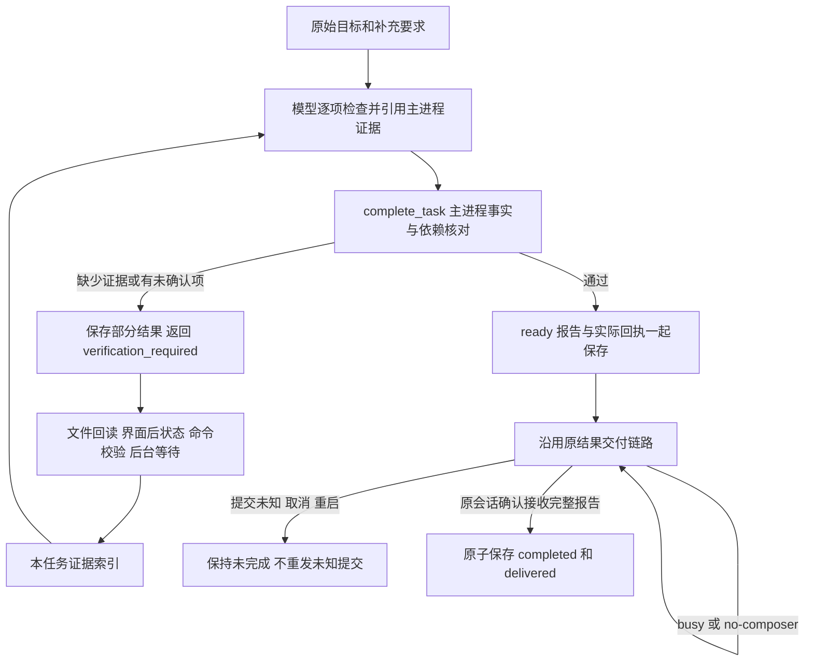

# 第 35 项：结果验证、任务完成与产物交付

本项为现有 computer 工具增加主进程动作 `complete_task`。DeepSeek 仍使用原有系统提示词、助手角色、终端／文件／后台工具和确认规则；本项仅追加 computer 工具定义和实际结果元数据，不增加规划模型或用户逐步核对流程。

用户只布置任务。模型完成实际操作后，继续读取产物、观察界面或检查命令输出，按原始要求和补充要求逐项判断是否满足。主进程检查这些判断引用的真实证据、文件快照、必要依赖和结果交付状态。两部分通过，并且核对报告确认发回原 DeepSeek 会话后，任务才变为 `completed`。

## 证据与语义判断

主进程为本任务实际取得的证据分配 `ev_…` 编号，并在 `task_completion_context` 返回编号、来源步骤、事实摘要和交付状态。证据只属于当前任务和代次，不从历史记录恢复执行授权。

| 来源 | 主进程记录的事实 | 不能单独据此认定的事情 |
| --- | --- | --- |
| `read_files` | 成功准备的原文件路径、大小、SHA-256；附件确认交付后可引用 | 内容符合用户要求、文件由本任务生成、下载已经完整结束 |
| `observe`／输入后观察 | 已验证的实际图像或 UIA 后状态编号、窗口身份、图像散列、控件完整性及限制 | 截图上传成功即业务完成、部分控件树能证明目标不存在 |
| 普通本机命令 | 已返回且成功的非空实际输出摘要及全文散列；没有超时、中断、拒绝或会话丢失；结果确认交付后可引用 | 退出码 0 即目标完成、输出中的一条“成功”文字就是文件或业务事实 |
| 后台 `wait_for` | 当前同归属监控结果中实际满足的 `background_ready` 或 `background_finished` 条件 | 后台启动登记即作业完成、服务就绪即所有业务要求满足 |

打开／启动已派发、发现列表、空命令、输入回执、单独退出码以及附件上传成功均不会自动生成可用于完成的业务证据。普通命令若本身执行了写入，模型应根据目标补充适当的文件回读、真实界面观察或只读校验；不能为了刷新证据盲目重做写入命令。

主进程不能凭自然语言或散列自动判定任意业务要求。标题、正文、数据、排版、界面含义和其他目标语义由 DeepSeek 结合实际附件／控件／图像／校验输出判断，并在报告中注明判断依据。报告的 `basis` 固定为 `model-assessment-with-tool-evidence`，界面将其显示为“模型核对”，并单列文件快照复核事实。

## `complete_task` 参数

沿用原 computer 请求外层、协议版本、当前 `step_token`、回答归属、去重和单步调度。新动作不调用 Windows helper，也不启动 shell。

```json
{
  "type": "computer",
  "version": 1,
  "action": "complete_task",
  "step_token": "cu_当前真实令牌",
  "summary": "报告已保存，回读后核对了标题和正文。",
  "requirements": [
    {
      "input_id": "task_completion_context 中的真实输入编号",
      "checks": [
        {
          "criterion": "标题、正文、保存位置符合该条要求",
          "evidence_ids": ["ev_主进程返回的真实证据编号"],
          "status": "passed",
          "assessment": "根据回读附件逐项核对了标题、正文与要求。"
        }
      ]
    }
  ],
  "artifacts": [{ "evidence_id": "ev_实际文件回读证据编号", "label": "最终报告" }],
  "no_artifact_reason": "",
  "unconfirmed": []
}
```

示例中的编号为说明占位符，不可直接执行。所有原始／补充输入必须各有一项 `requirements`，每项再细分内容、位置及约束检查。检查状态为 `passed`、`failed` 或 `unconfirmed`，每条检查引用 1～8 个证据。模型不能传入报告状态、完成标志、文件路径、散列或执行授权，主进程拒绝额外字段。

`artifacts` 只引用实际文件证据，并且该文件必须被至少一条业务检查引用；主进程填写真实源路径、大小和散列。读取的输入材料可作为验证依据，不要求把全部输入材料作为输出产物交付。无文件产物时，用 `no_artifact_reason` 说明目标为什么只需界面状态或处理结果。存在 `unconfirmed` 或任一未通过检查时保存部分结果、返回 `verification_required`，任务不完成。

换路径后可以可选传入 `superseded_backgrounds: [{background_id,evidence_ids,reason}]`，说明已结束的失败／停止作业为何不再是必要依赖。替代证据必须已经交付，并同时用于当前目标检查，仍须通过文件／后状态复核；旧作业必须确认已结束且其必要结果已交付或被已返回的等待结果接替。运行中、退出未知、发送未知或尚未交付的后台工作不能据此忽略。报告保留替代说明及旧失败事实，不重启进程。

首版有明确预算：每次最多 64 条输入、每条最多 16 项检查、最多 32 个产物，完整参数最多 60,000 字符，仍受既有协议的 64,000 字符、节点和嵌套限制约束。不得通过裁剪要求来假装覆盖全部输入。报告最多 128,000 字符；超过预算返回明确的未完成原因。

## 主进程完成门槛

1. 请求属于当前任务／代次、原会话、当前正在执行的 `complete_task` 步骤；不处于取消、暂停、运行上限或未决恢复门槛。
2. 检查覆盖当前任务全部输入编号，没有未知或重复输入；每项检查通过，且不存在未确认事项。
3. 引用证据存在于本任务索引，并且其原结果已确认交付。新任务、恢复代次和打开历史不会借用旧任务证据。
4. 界面／命令后状态证据与当前操作修订一致，采集不超过两分钟。新输入、启动、打开、焦点切换或本机命令推进修订，旧后状态须重新核对；只读观察和完成检查不会自行制造新业务进展。
5. 所有被引用的文件都再次核对原路径、普通文件身份、大小和 SHA-256；对读取前后状态及路径替换作检查，不返回新文件正文。缺失、锁定、变化、符号链接／重解析路径、超过原文件预算或 `.crdownload`／`.part`／`.partial`／`.download`／`.tmp` 文件不能作为已确认产物。沿用 `read_files` 的 20 MiB 上限；该复核不替代模型的内容核对。下载完整性仍须由模型结合实际下载状态、文件内容／格式及目标要求判断。
6. 汇总当前任务显式后台依赖的最新条件，必须满足，或有符合上述约束的显式替代说明。作业须有最终成功状态和结果交付；需要保持运行的服务须真实就绪且其必要结果已交付。由 `wait_for` 接替的独立通知，只有其等待结果本身已确认交付，才可视为必要信息已交付。其他任务／机器的后台结果不能代用。
7. 调度器只在前一步正常收敛后接纳完成请求；未决上传／发送、未知提交和中断步骤不会被另一完成请求绕过。

复核记录的是检查时刻的事实，不冻结外部应用或文件。报告保留 `checkedAt`、证据时间和模型判断，不能将文件散列相同解释为任意业务语义已被程序证明。

## 持久化与交付

`AutonomousTask.completion` 保存有界证据、操作修订和核对报告。它与任务原有数据一起存入 SQLite 的 `autonomous_tasks.payload`；其中 `report.artifacts` 是实际产物索引，不另建可执行历史或保存图像字节。



- `ready` 表示核对报告已形成，任务仍为 `recorded`。回传正文包含逐项判断、真实产物位置、快照信息和未确认事项，不只是一句“已完成”。
- 报告及证据先随真实回执保存；报告确认交付时，与对应 `computer_actions` 的 `sent` 状态同事务写入 `completed`／`delivered`，撤销旧令牌，不激活下一步。
- 页面忙碌只重试同一份已保存正文，不重执行动作、文件读取或核对。提交未知停止重发，不宣布成功。完整报告不能序列化或超预算时，仅发送明确的未完成反馈，保留原回执。
- 等待交付期间新增要求会撤销待完成报告；必要后台状态发生变化会重新检查并撤销待完成资格。若原报告已进入交付，确认交付后另发一次新的核对反馈，模型继续处理，旧报告不会让任务完成。
- 启动恢复保留已确认完成的历史；未确认报告保持未完成，不重放动作或结果，不恢复旧证据授权。恢复新代次仍需按实际状态重新取得证据。
- 自主任务里的空 `command` 只保存为未执行，沿用已有结果交付通道反馈完成核对要求。普通完成文字不能触发当前目标的成功通知；没有自主任务上下文的旧终端完成行为保持兼容。
- 任务概况展示报告、逐项模型判断、实际路径、文件快照复核和未确认／阻塞原因；完成通知只在当前目标确实完成后触发一次。完整进度与产物交互入口仍属于第 40 项。

## 文件与测试

核心实现为 `src/shared/task-completion.ts`、`src/main/task-completion.ts`，任务接纳／事务在 `TaskCoordinator`，交付状态在 `TaskProgression`，真实旧工具收据由 `CommandRunner` 和文件连续性索引接入。页面仍走原请求识别和主进程协议校验。

已编写 `tests/task-completion.test.mjs`，并为现有工具协作用例追加自主任务空命令场景；复用真实内存 SQLite、实际任务协调／交付代码及合成证据／文件验证函数，覆盖输入覆盖、证据归属与交付、命令输出、部分 UIA、文件变化、后台依赖、完成报告确认、busy、未知提交、恢复、追加要求、依赖变化和换路径后的失败作业替代。测试不启动 Electron、helper、桌面、真实 shell 或访问用户产物。

按仓库规定由用户运行，例如：

```powershell
node --test tests/task-completion.test.mjs tests/task-tool-collaboration.test.mjs tests/task-progression.test.mjs tests/task-continuity.test.mjs tests/computer-diagnostics.test.mjs tests/computer-progress.test.mjs tests/computer-recovery.test.mjs tests/computer-action-states.test.mjs tests/computer-action-dedup.test.mjs tests/computer-use-capabilities.test.mjs tests/computer-use-protocol.test.mjs
```

实际下载、附件内容理解、UIA／截图核对、文件替换竞争及 DeepSeek 的真实工具选择仍需要用户运行后验收。智能体只做静态检查和 `npm run build`；交付标准为 **构建通过，等待测试**。
