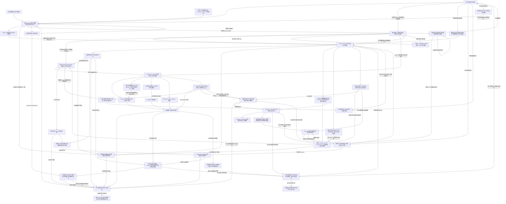

## 最终要实现的效果

用户在 Web2Term 的 DeepSeek 会话中，只需用自然语言布置一个任务，说明目标、必要条件和预期结果，DeepSeek 根据自身已有的理解和规划能力，自主选择 computer use、终端、文件和后台任务工具，连续完成跨应用的整个流程。需要操作界面时，模型调用 computer use 发现并启动软件、定位和切换窗口，通过截图与控件信息理解界面，完成点击、输入、滚动、拖拽和对话框处理；适合命令、脚本或文件处理的步骤继续使用现有工具。执行中遇到常见错误时，AI 根据工具返回的真实结果观察、诊断、调整方法并继续；完成后根据真实产物和实际状态验证结果，向用户交付文件或处理结果，说明保存位置与验证情况。

实现边界：computer use 是现有工具体系中的一个新增工具。保持现有系统提示词正文、助手角色、任务路由、工作协议和确认规则不变，通过现有工具说明通道补充 computer use 的用途、可用动作、参数、调用格式、返回结果和实际可用状态；现有终端、文件及后台任务工具的说明与调用规则保持原样。规划和工具选择仍由当前 DeepSeek 网页中的模型完成，不新增规划模型、独立规划器或强制规划输出格式。软件负责工具请求识别、校验、执行、任务归属、结果回传与连续调度。

例如，用户只需说：“从这个网址下载本月报表，整理成 Excel，保存到指定目录，再打开检查。”AI 应自行打开浏览器、找到并下载报表、确认下载完成、整理数据、生成 Excel、打开表格应用核对内容，最后返回产物位置和检查结果。用户无需提前打开软件、选择窗口、拆解步骤、发送中间结果或逐条点击运行；用户可以随时查看进度、补充要求、暂停或终止任务，正常执行不依赖用户逐步参与。首版先在 Windows x64 本机环境和 DeepSeek 网页上实现这一完整体验。

## 架构图

## 功能清单
7
| 功能点 | 技术栈 | 实现概要 | 业务规则 | 实现情况 |
| --- | --- | --- | --- | --- |
| 01. 适配范围与能力配置 | React、TypeScript、Electron IPC、现有设置存储 | 增加 computer use 工具启用与桌面控制配置，按模型平台、客户端操作系统和执行环境提供工具；通过现有工具说明通道声明 computer use 的实际可用能力，保持现有系统提示词正文不变。 | 配置仅作用于 computer use 及其任务上下文，其他工具和现有自动／手动执行规则保持原样；首版支持 DeepSeek 网页、Windows x64、本机执行环境；DeepSeek 网页视觉能力已由用户确认，无需再次确认或配置视觉模型 API Key；SSH／Web2Term 远程会话暂不提供本机桌面工具；未接入的桌面动作不能声明为可调用。 | 已实现配置持久化、设置界面、范围判定及能力声明；已将工具开关命名为 computerUseEnabled，兼容旧配置，界面与能力说明限定为 computer use；构建通过，等待测试。已由第 08—23 项接入 list_apps 应用发现、launch_app 应用启动、open 资源打开、list_windows 窗口发现、focus_window 激活／恢复及 observe 截图及控件／焦点读取、validate_observation 观察复核、click 点击／双击、type_text 文字输入、press_key 按键／组合键、scroll 滚动、drag 拖拽、inspect_interactions 交互发现及 wait_for 条件等待，后续动作按实际接入声明。 |
| 02. 自然语言任务入口 | React、现有对话发送链路、TypeScript、TaskCoordinator | 用户发送目标后创建任务，保存完整原始要求（含用户提出的必要条件与预期产物）、执行机器、会话归属和任务代次，用于工具调用、结果回传、取消和恢复时关联上下文。 | 启用 computer use 后，用户通过现有对话入口提交要求；不要求提前打开软件、选择窗口、提供应用标识、拆分步骤或逐条点击运行；创建任务不依赖模型先输出规划或结构化提取结果。 | 已接入原始／专注对话的发送确认、任务编号与递增代次、SQLite 持久化、本机与会话归属、首条消息会话 ID 补绑及任务概况展示；工具结果不建任务，澄清回答归入原任务，历史恢复不自动执行。条件与产物完整保留在用户原文中，已移除强制等待提取的 intent 字段并兼容旧记录；构建通过，等待测试。 |
| 03. computer use 工具接入与自主选择 | DeepSeek 网页、现有工具说明通道、TypeScript 工具分发 | 在现有工具体系中增加 computer use 的能力说明，提供用途、可用动作、参数、调用格式和返回结果；由 DeepSeek 根据任务需要和实际结果，自主选择 computer use，并与现有终端、文件和后台任务工具组合使用。 | 保持现有系统提示词、助手角色、任务路由、工作协议、确认规则及其他工具规则不变；全过程使用当前 DeepSeek 网页账号；不新增规划模型、独立规划器或强制规划输出格式；不强制所有工作通过鼠标完成。 | 已实现工具用途说明、动作与参数元数据、按实际注册动作生成的调用格式及返回结果说明、动态能力刷新和独立主进程分发入口；现有系统提示词与其他工具说明保持原样。第 08—23 项已注册 list_apps 真实应用发现、launch_app 应用启动、open 资源打开、list_windows 窗口发现、focus_window 激活／恢复及 observe 截图及控件／焦点观察及 validate_observation 观察复核，仅在 helper 握手就绪并声明支持后发布调用说明与当前步骤令牌；网页识别、严格协议校验与 helper 运行管理已由第 05—07 项接入，click 点击／双击、type_text 文字输入、press_key 按键／组合键、scroll 区域滚动及 drag 拖拽已由第 17—21 项注册，其他桌面输入动作待后续条目注册；构建通过，等待测试。 第 22 项新增 inspect_interactions 只读关联发现与动态能力说明。 第 23 项已接入 wait_for 固定条件与有界本地等待，不将等待结束当作目标完成。 |
| 04. 任务自动推进 | TaskCoordinator、TaskProgression、异步状态机、现有页面回复监听、SQLite | 复用现有工具调用与回复链路，将新增 computer use 请求、执行结果、后续回复和验证步骤绑定到同一任务与代次；先保存执行状态和结果，再自动回传原 DeepSeek 对话，由模型判断下一步。 | 每轮最多执行一个可观察的工具步骤，同一回复不能重复执行，整项任务可以连续多轮推进；软件负责执行与回传，不替模型编排固定业务流程；页面忙碌时等待并仅重试回传，发送状态不确定时阻止自动重发；等待模型和工具属于正常运行，不要求用户重复发送目标或点击继续；模型回复不直接等于任务已验证完成。 | 已实现主进程自动推进状态机、内部请求入口、单步串行与消息去重、任务／代次／原对话归属、文字结果落盘与自动回传、忙碌等待及发送不确定时阻止重发、沿用现有暂停控制、停止／换目标／换会话时作废旧调用、后续回复与澄清关联及进度展示；历史恢复不会重放动作或自动补发。现有系统提示词与其他工具的调用、执行规则保持原样。第 05—06 项已连通网页识别、主进程严格校验、单次步骤令牌和执行／文字结果回传；校验错误以 not_executed 自动回传供模型修正；第 07 项已接入 Windows helper 生命周期与私有管道，第 08—12 项已接入 list_apps 发现、launch_app 启动、open 文件／目录／网页打开、list_windows 窗口查询／身份引用、focus_window 激活／恢复／焦点核对及文字回传，第 13—14 项已接入 observe 截图、控件／焦点及文字／单图同消息回传，第 15 项已接入观察失效复核、单次刷新及错误结果携带新截图回传，第 17—21 项已接入 click 单／双击、type_text 文字输入、press_key 按键／组合键、scroll 区域滚动、drag 拖拽、操作后观察及输入结果不确定时不重放；其他输入与全工具统一交付仍待后续条目；构建通过，等待测试。 第 22 项已沿用该链路回传交互引用及菜单操作后的来源提示，模型按新观察自主继续，不自动确认弹窗。 第 23 项 wait_for 在本地等待并一次回传条件证据／新观察，页面忙碌只重发已保存结果，不重做等待。 第 24 项已将 command／read_files 的真实来源、步骤状态和结果接入同一任务，补齐与桌面步骤的发送确认衔接。 |
| 05. DeepSeek 工具请求识别 | 页面注入脚本、DOM 观察、现有 DeepSeek 页面适配器、TypeScript 页面事件桥接、TaskCoordinator | 从最终回答正文识别独立的 computer JSON，保留代码中的原始转义与字段，使用专用事件上报，与 command、read_files、questions 分支明确区分；将识别结果关联原任务，交给后续协议校验入口。 | 仅处理当前任务实际发送后的新回答；排除思考区和引用，沿用生成／截断判断并再次确认正文稳定；历史恢复和手动继续旧命令不得将历史 computer 请求变为实时请求；同一轮只上报一次，不同轮相同 JSON 使用不同识别编号；混合或多请求不降级为 Shell；用户已确认的视觉能力不设置固定自检轮次。 | 已实现 DeepSeek 独立识别开关、最终回答与代码原文读取、思考／引用排除、发送前虚拟行基线、真实发送来源与页面代次／路径关联、生成及截断过滤、二次稳定读取、单轮去重、格式问题分类、专用主进程事件校验、原任务归属与接收记录持久化，以及不含正文的诊断元数据；已补充离线测试，构建通过，等待测试。识别结果保留原始 JSON，第 06 项已接入网页与主进程独立校验；有效请求进入第 04 项，错误请求生成未执行结果并回传，不转交终端；第 07 项已接入 helper 运行管理，第 08—23 项已接入 list_apps、launch_app、open、list_windows、focus_window、observe、validate_observation、click、type_text、press_key、scroll、drag、inspect_interactions 和 wait_for，其他桌面动作仍待后续条目。 |
| 06. 工具协议与主进程校验 | TypeScript 联合类型、共享严格 JSON 解析器、Electron 主进程、单次步骤令牌 | 定义 type=computer、version、action、step_token 及各动作专属字段；网页与主进程独立解析，主进程依据实际注册动作、当前任务及实时状态复核，通过后交给第 04 项串行执行与回传。 | 拒绝未知动作、解码后的重复字段、危险对象字段、混合／多请求、冲突定位方式及不合规参数；只接受当前任务的一次性令牌，结果确认回传后下一令牌才生效；格式错误以 execution=not_executed 返回给 AI 自主修正；页面声明不能代替主进程校验，桌面请求不能降级成 Shell，原始字段不能覆盖会话、任务、权限或执行环境。 | 已实现请求／结果联合类型、页面与主进程共用的严格解析器、嵌套与转义重复键检测、JSON 数值精度与资源上限、实际动作白名单、必填／类型／数值范围／长度／枚举及完整互斥定位组校验、执行器派发前复核；已实现主进程签发并绑定任务代次的 step_token、执行前持久化占用、next_step_token 随结果回传且确认发送后激活、重复／过期／换目标／中断／重启失效，以及协议错误自动回传与后续修正链路。令牌仅通过 computer use 工具说明和工具结果提供，现有系统提示词与其他工具规则保持原样；已补充离线测试，构建通过，等待测试。第 07 项已接入 helper 运行管理与能力状态联动；第 08—23 项已注册 list_apps 真实应用发现、launch_app 应用启动、open 资源打开、list_windows 窗口发现、focus_window 激活／恢复与 observe 截图及控件／焦点读取、validate_observation 观察复核能力；第 17—21 项已接入 click 点击／双击、type_text 文字输入、press_key 按键／组合键、scroll 区域滚动及 drag 拖拽，其他动作仅在实际接入后声明。 第 22 项已接入 inspect_interactions 的严格参数、owner 链／菜单模式／短期引用独立校验。 第 23 项已接入 wait_for 固定条件与有界本地等待，不将等待结束当作目标完成。 |
| 07. Windows helper 运行管理 | C#、.NET 8、Node.js child_process、stdio、协议版本握手 | 由主进程按需启动隐藏窗口的独立 helper，通过专用管道传输结构化请求、结果和取消信号；UIA 使用独立 MTA 工作线程。 | helper 不申请提权，继承 Web2Term 的权限（管理员身份运行时同样可用）；不开放本地 HTTP 服务；不执行模型提交的任意脚本；父进程或管道结束时退出；阻塞、超时和崩溃不得卡住客户端界面。 | 已实现 C# WinExe helper、asInvoker 启动、继承父进程权限（管理员态不再拒绝）、父进程句柄监督／管道 EOF 退出、独立 MTA／COM 工作线程、私有 UTF-8 JSON Lines 与帧／字段边界校验、版本／随机握手／PID／架构核对、请求编号与进程代次关联、独立心跳／取消／停止控制、单动作串行、有界超时及强制终止、每分钟最多三次启动与故障有界重启；已接入全应用共享管理器、会话／平台／连接／设置的需求释放、退出清理和能力状态实时更新。已加入 npm run build 的开发态离线编译，未启动 helper 或 Electron；已补充模拟管道／时钟测试，构建通过，等待测试。第 08—23 项已注册 list_apps、launch_app、open、list_windows、focus_window、observe、validate_observation、click、type_text、press_key、scroll、drag、inspect_interactions 和 wait_for，Shell 启动使用独立 STA，窗口生命周期事件使用独立消息循环，元数据、UIA 控件／焦点与 WGC 截图在 MTA；其他动作随后续条目逐项接入，自包含安装包与 CI 待第 44 项。 |
| 08. 应用发现（list_apps） | Windows Shell、Applications 虚拟目录、开始菜单快捷方式、App Paths、C# 应用目录服务 | 汇总已安装应用和运行进程，生成 app_id、名称、核实后的启动引用及关联窗口；支持按任务需要查询候选应用。 | 由 AI 自主选择应用；不能要求用户先选软件；目录未覆盖便携应用时，AI 可借助现有文件／终端工具查找真实路径，经主进程核实后登记，不能猜测可执行文件位置。 | 已实现 Applications 虚拟目录／AppUserModelID、用户及公共开始菜单、HKCU／HKLM 32／64 位 App Paths、运行进程与窗口概况采集；按真实身份合并来源／别名并区分同名应用与独立快捷方式用途，生成 app_id 和仅由核实来源产生的启动引用。已接入 query／limit／cursor／refresh、快照绑定分页与过期处理、采集／字段／结果预算及部分失败状态；已接入 register_path，由主进程解析实际路径并读取 PE 文件头，helper 再核实后临时登记便携 exe。已在主进程与 helper 双侧注册 list_apps，沿用第 04—06 项任务／令牌／回传链路，仅对实际就绪能力发布说明；主进程独立校验结果并清理旧快照／旧 helper 引用，不猜测路径，不要求用户预选应用，不改现有系统提示词与其他工具规则。已补充模拟 IO 和原生目录测试，构建及原生测试源码编译通过，等待用户测试；未运行测试或启动 Electron／helper。第 09—10 项已接入应用启动及指定应用打开资源，第 11—12 项已提供独立窗口查询、身份引用与激活／恢复，第 17—21 项已接入点击／双击、文字、按键／组合键、区域滚动及拖拽，其他输入仍待后续条目。 |
| 09. 应用启动（launch_app） | C#、ShellExecuteEx、IApplicationActivationManager、现有应用目录 | 根据已登记引用启动传统桌面或打包应用，返回派发状态和候选窗口，再通过新观察关联实际业务界面。 | 应用未打开时由 AI 自主启动；启动是首版必需能力；兼容单实例复用和代理进程，不能只凭启动成功或 PID 就认定已找到目标窗口或任务完成。 | 已在主进程与 helper 双侧注册 launch_app，沿用现有任务／步骤令牌／自动回传链路，仅在实际就绪后发布说明，不改现有系统提示词和其他工具规则。仅接受已发现的 app_id／launch_reference_id 及有界 wait_ms；主进程注入可信目录并绑定 helper 代次，native 复核两分钟内快照及实际文件／Shell 身份，快捷方式绑定源文件 SHA-256、目标与已有参数，拒绝模型传入路径、命令和额外参数。传统应用／快捷方式／Shell 应用项使用独立 STA 派发，已注册打包应用通过进程外激活管理器启动；每次最多派发一次，不降级重试。已接入派发前后有界窗口观察、PID 与创建时间及匹配依据，兼容单实例复用、代理进程和无返回 PID；候选窗口始终标记未确认，不能据此认定目标完成，不产生可操作 window_id。执行结果区分 not_executed／executed／unknown，取消及故障保留派发事实，旧任务与旧 helper 结果隔离。已补充模拟 IO 与原生纯逻辑用例；构建及原生测试源码编译通过，等待用户测试，未运行测试或实际启动应用。第 11—12 项已接入独立窗口查询、身份引用及激活／恢复；第 13 项已接入 observe 截图及文字／单图回传。 |
| 10. 文件、目录与网页打开（open） | C#、Windows Shell 文件关联、结构化路径和 URL 处理 | 使用系统关联或已发现的应用打开任务所需文件、目录及 http(s) URL，回传应用和窗口变化。 | AI 根据目标自主打开资源；核对路径、URL 与执行机器；业务网页使用独立业务窗口，不能导航掉承担任务决策的 DeepSeek 控制对话。 | 已在主进程与 helper 双侧注册 open，沿用任务／令牌／单步派发／结果回传链路，不改现有系统提示词和其他工具。已接入 kind=file／directory／url、target、成对可选应用引用及有界 wait_ms；仅支持已启用的本机 DeepSeek 环境。主进程通过真实路径与 stat 核实文件／目录，helper 再检查最终路径、卷／文件编号和实际类型并在派发前复核；URL 仅接受规范化 HTTP(S)，拒绝凭据、自定义协议、远程／设备路径及命令／额外参数。默认通过 STA 上的 Windows 系统关联打开，网页位于控制对话之外的外部浏览器，可复用外部业务窗口，不导航控制页；已加入自身应用处理器拦截。指定应用复用真实目录引用，桌面应用仅接收一个编码后的资源参数，打包应用使用文件／协议激活；带预置参数的引用不支持此入口，可改用系统关联或无预置参数引用。已返回资源、关联查询／指定引用来源的应用线索、派发状态、错误及候选窗口，始终标记内容／窗口／任务未验证；取消和故障保留派发事实，不自动换程序或重开。已补充模拟 IO 与原生纯逻辑用例；项目构建及原生测试源码编译通过，等待用户测试，未运行测试或实际打开资源。第 11—12 项已接入独立窗口查询、身份引用及激活／恢复；第 13 项已接入 observe 截图及文字／单图回传。 |
| 11. 窗口发现与身份管理（list_windows） | Win32 窗口枚举、WinEvent 生命周期事件、C#、进程元数据 | 返回标题、所属应用、可见和最小化状态、前台标记、owner 关系及窗口引用，组合进程创建身份防止句柄复用。 | 支持多个应用及同一应用的多个窗口；AI 根据环境和内容自行定位；同名窗口先观察核对，不直接要求用户选择；不得使用失效引用输入。 | 已在主进程与 helper 双侧注册 list_windows，沿用现有任务／步骤令牌／结果回传，不改现有系统提示词和其他工具。已接入 query／pid／include_hidden／limit／cursor，返回顶层窗口标题、真实进程／应用信息、可见／最小化／前台／启用／cloaked 状态、owner 关系及独立 window_id；同名及同应用多窗口不合并，未核实身份的窗口仅保留元数据且引用为空。引用绑定 HWND、PID、进程创建时间、线程、窗口类及创建／销毁事件代次，已提供 native Resolve 在后续动作入口重新读取实际身份，拒绝失效、复用或无法核实的引用，不把裸句柄当成操作引用。主进程按真实 TaskLease、工具注册及 helper 代次隔离，采用私有任务作用域，独立校验结果并阻止旧任务／迟到结果污染新引用；新查询、过期、注销与 helper 变化使旧引用不可用。已实现两分钟快照与分页、采集／字段／页字节预算、有界事件记录与任务快照缓存、部分失败和取消处理。已补充主进程模拟 IO 及原生合成窗口用例，项目构建与原生测试源码编译通过，等待用户测试；未运行测试、真实窗口枚举或 Electron／helper。第 12 项已在恢复／激活入口调用 native Resolve 并核对实时焦点；第 13—14 项已接入截图与有界控件／焦点读取，输入前观察失效仍待第 15 项，窗口发现不等于业务目标已确认。 第 22 项新增关联发现，不刷新原 list_windows 批次；返回有界且短期的菜单／对话框引用。 第 23 项可在等待中登记新的普通窗口引用并保留原批次，引用仍受原身份与期限约束。 |
| 12. 窗口激活与恢复（focus_window） | Win32 SetForegroundWindow、窗口显示状态 API、UIA 焦点检查 | 激活或恢复 AI 选定的窗口，检查真实前台状态与焦点，并在输入前再次核对目标。 | AI 正常切换应用后自动继续；Windows 拒绝激活时返回真实结果并有界恢复，不能向错误窗口输入；Web2Term 不在前台不等于任务暂停。 | 已在主进程与 helper 双侧注册 focus_window，沿用任务／步骤令牌／自动回传，不改现有系统提示词和其他工具。仅接受当前已发现的 window_id、restore 与有界 wait_ms；主进程核实真实任务及 helper 代次并注入私有作用域，native 在恢复／激活前及观察后调用 Resolve 复核完整窗口身份。已接入 ShowWindowAsync 恢复最小化／显示隐藏窗口和 SetForegroundWindow 激活，每次最多恢复一次、激活两次，未知结果停止重放；返回禁用、cloaked、弹窗线索、需要恢复、Windows 拒绝及焦点未确认等真实状态，不自动改选目标。已读取实际前台、GetGUIThreadInfo 键盘路由及 MTA 上的 UIA 当前焦点、焦点属性与有界祖先根窗口，核对一致才报告 focus_confirmed；API 成功回执不能代替焦点证据。返回逐次回执、新窗口状态及独立观察，主进程复核身份、字段、结果码和执行状态；取消与迟到结果保留派发事实并隔离新任务。始终标记 input_ready=false／goal_verified=false，后续输入仍须实时核对；未增加客户端失去前台即暂停的规则。已补充主进程模拟 IO 和原生合成焦点用例，项目构建与原生测试源码编译通过，等待用户测试；未运行测试或实际恢复／激活窗口。第 13—14 项已接入截图与有界控件／焦点读取，第 15 项已接入观察绑定、失效复核和单次刷新；实际输入仍待后续条目。 第 22 项的菜单引用只观察／点击／窗口级按键，不单独激活；普通对话框继续按本项激活规则处理。 |
| 13. 桌面概览、窗口与区域截图（observe） | Windows.Graphics.Capture、C# 图像处理、Electron 附件链路 | 按需捕获显示器概览、指定窗口或裁剪区域，记录图像尺寸、采集时间、来源边界和变换信息，生成观察编号。 | AI 自主决定观察范围；优先发送当前步骤需要的画面，不固定上传全部屏幕；截图必须关联当前任务；截图成功仅代表获取到观察，不代表业务目标已完成。 | 已在主进程与 helper 双侧注册 observe，仅在真实能力就绪后发布。支持 target=desktop／window／region，桌面默认只截主屏，可按返回的 monitor_id 选择其他显示器；窗口只接受当前任务 list_windows 已发现的 window_id，区域参数为来源原始像素中的完整矩形。采用 Windows Graphics Capture CreateForWindow／CreateForMonitor、无 DispatcherQueue 的帧池及 D3D11／SoftwareBitmap，采集不激活或恢复窗口，不自动改选来源、不回退全屏抓取。已记录 observation_id、采集前／帧获取／采集后时间、物理来源边界、原始和上传尺寸、DPI、裁剪及精确变换；窗口身份、边界、显示状态、显示器拓扑和帧尺寸变化时拒绝发布。已实现有界裁剪／等比缩图／PNG 编码，最长边默认 1600（256—2560）、源图最多 3200 万像素、单图最多 8 MiB、显示器最多 16 个；主进程独立校验身份、元数据、PNG 结构／校验和／像素预算、散列和变换。截图写入主进程创建的临时目录，经任务绑定的不透明附件引用与结果文字同消息自动回传原 DeepSeek 对话；忙碌只等待同一结果，发送不确定则停止重发，不重抓截图或重放动作。已接入取消／迟到结果隔离、发送成功／取消／注销后清理及 15 分钟过期回收，不把图片字节写入数据库或日志。始终标记 content_verified=false／input_ready=false／goal_verified=false。截图要求 Windows 10 2004（19041）或更新版本，保留系统捕获边框及受保护内容限制；隐藏／最小化窗口须先由 AI 选择 focus_window，受保护或空白画面不伪报内容验证成功。已补充主进程模拟 IO、PNG／原生合成像素及回传状态机用例；构建与原生测试源码编译通过，等待用户测试，未运行测试、截图或启动 Electron／helper。第 14 项已接入可选控件树／焦点及同消息回传；第 15 项已接入观察绑定、失效复核及单次刷新；第 16 项已接入 DPI／多屏及上传图像到物理坐标转换，第 17—21 项已接入点击／双击、文字输入、按键／组合键、区域滚动、拖拽及操作后观察，其他输入继续按后续条目实现。 第 22 项允许观察 inspect_interactions 返回的短期窗口／菜单引用，WGC 不可用时可显式改 controls，不回退截取整个桌面。 |
| 14. 控件树与焦点读取 | Windows UIA3 COM、C#、Control View、属性缓存、结构化控件序列化 | 读取有上限的可见控件树，返回 element_id、role、name、enabled、focused、bounds 和支持的操作模式，按需提供选择内容。 | 控件信息与截图共同供 AI 判断；限制树深度、数量和采集耗时；UIA 不完整时由 AI 使用截图、键盘导航或其他工具继续，不要求用户手动定位控件。 | 已扩展现有 observe 工具，保持系统提示词、助手角色、任务路由与其他工具规则。target=controls 加当前已发现的 window_id 可独立读取窗口控件／焦点，不依赖截图或临时文件；window 或窗口 region 可用 include_controls=true，将 PNG、控件摘要及结果文字同消息回传原 DeepSeek 对话。采用 Windows 自带 UIA3 COM（CUIAutomation8），在现有 MTA 上使用单元素属性缓存及 Control View walker 逐节点读取，不新增 FlaUI 包。已返回本轮 element_id、parent_id、depth、control_type／role、name、enabled、focused、offscreen、selected、桌面物理 bounds、模式可用性、字段完整度及 UIA 焦点关联；编号不跨观察复用，原生对象在读取结束后释放，尚不构成输入许可。已接入 max_depth（默认 4，上限 8）、max_elements（默认 100，上限 200）、timeout_ms（默认 1200，上限 3000）及独立访问／结果预算，标记节点／深度／时间／字节截断、提供方错误、属性缺失与循环；COM 单次阻塞仍受 helper 硬期限及看门狗限制。隐藏、来源窗口外和其他顶层窗口分支不发布；密码或密码状态未知的控件屏蔽名称、不读取选区、不遍历子树；名称最多 256 字符。include_selection 默认 false，显式启用后只读取当前窗口内、已返回焦点控件的 Text 模式选区，最多 4 段／2048 字符，不读取全文或 Value；焦点改变即丢弃选区并标记变化。窗口身份和边界在读取前后复核，变化时拒绝发布；UIA 失败保留有界部分结果，明确 complete／limitations，可由 AI 选择截图或其他可用工具继续。主进程独立核对身份、树层级、编号、状态、模式、敏感字段、预算、焦点／选区关系和组合观察几何／时间；取消、旧任务与旧 helper 结果不能发布到新任务。截图与 UIA 各有采集时间，固定 snapshot_atomic=false，content_verified／input_ready／goal_verified=false。已补充主进程模拟 IO／协议及原生合成树、资源释放、密码屏蔽、截断、选区、失效和取消用例；项目构建及原生测试源码编译通过，等待用户测试，未运行测试、读取真实控件或启动 Electron／helper。第 15 项已接入观察绑定及控件实时复核／失效处理；第 16 项已接入 DPI／多屏及完整图像坐标转换，第 17—21 项已接入点击／双击、文字输入、按键／组合键、区域滚动、拖拽及操作后观察，其他输入等待后续条目。 第 22 项用同一控件读取链路提供菜单和文件对话框内容，未提供的模式、焦点或模态信息保持未知。 |
| 15. 观察绑定与失效处理 | TypeScript、C#、私有观察登记、observation_id、步骤来源／令牌摘要、任务／helper 代次、WinEvent、UIA／WGC 状态复核 | 将控件和实际上传图像坐标绑定到最近一次观察；只读复核窗口身份、布局、焦点、弹窗及来源内容，变化时作废旧引用并最多补取一次新观察；向后续输入动作提供原生派发前的实时检查入口。 | 窗口移动、缩放、显示器变化、弹窗出现、焦点变化或控件失效后不能继续使用旧定位；stale_observation 触发自主重新观察，不重放输入；截图与控件树并非原子快照，变化时拒绝发布或明确标记；复核通过不能成为后续输入的可复用许可。 | 已实现主进程与 helper 双侧的任务／会话／对话／代次隔离和观察登记，绑定已占用的来源 step_id、step_token 摘要、完整窗口身份、来源参数及 helper 进程代次；公开 binding 只含 source_step_id／expires_at，不暴露令牌摘要、原生定位或私有作用域。每个任务只使用最近一组观察，图片与组合 controls 编号共享归属；控件须来自该组，坐标须在实际上传图片内；新观察开始、过期（2 分钟）、任务变化、注销或重启后拒绝旧引用，不从历史恢复授权。已注册只读 validate_observation，支持观察编号及互斥的 element_id／x+y，purpose=inspect／pointer／keyboard；主进程严格核对字段、编号归属、步骤来源、窗口引用、helper 代次及结果事实。原生复核 HWND／PID／进程创建时间／线程／类名／生命周期、窗口状态／owner／物理边界、显示器拓扑／DPI、Win32／UIA 焦点、可见 owned 弹窗及独立 WinEvent 修订；窗口生命周期与布局／焦点修订分离，不把移动当作 HWND 重用。控件仅在 helper 内短期保存运行时身份，复核时有界重读并比较身份、属性、边界和祖先，失败不按名称猜测；图像／坐标路径重新捕获同来源、同裁剪／缩图并比较图像散列，检测滚动／画布等内容变化；纯控件路径比较已观察树范围。采集及复核前后再次比较状态，变化或无法读取则失效；保留 snapshot_atomic=false／input_ready=false，UIA 不可用不伪造焦点。私有观察绑定已接入版本握手，第 16 项将 helper 协议升至 v4；模型 computer JSON 仍为 v1。已给后续输入预留同 MTA 的 WithCurrentObservation 检查后立即派发入口，旧复核结果不能直接绕过该入口；launch_app／open／focus_window 已执行或不确定时会作废旧观察，正常应用切换仍自动推进。已知旧观察失效返回 stale_observation／原定位未执行，并最多自动重观察一次，将新文字／单图通过原回传链路交给 DeepSeek；未知或跨任务编号不自动刷新，刷新失败保留原原因与错误，不循环、不重放动作。已补充主进程模拟 IO、来源绑定、单次刷新／附件交付及原生合成状态／控件／图像／取消用例；项目构建、Node 语法检查及原生测试源码编译通过，等待用户测试；未运行测试、读取真实桌面或启动 Electron／helper。第 16 项已接入坐标转换并向此入口提供当次新坐标，第 17—21 项已接入点击／双击、文字输入、按键／组合键、区域滚动、拖拽的实际派发与后观察，其余输入继续接入。 第 22 项私有菜单上下文变化也会使旧观察失效，不把过去的关联发现当成输入许可。 |
| 16. DPI、多屏与坐标转换 | Per-Monitor V2、Win32 显示器／虚拟桌面 API、GetDpiForWindow、GetScaleFactorForMonitor、TypeScript／C# 整数坐标映射 | 以实际上传 PNG 的零起点像素作为模型坐标，依据来源物理边界、裁剪、真实缩图尺寸和内容矩形转换为桌面物理落点，核对所在显示器并计算供后续输入使用的虚拟桌面绝对坐标。 | 常见 Windows 缩放比例、混合 DPI、跨屏窗口及负坐标统一按物理几何转换，不额外乘系统 DPI；点必须位于真实图像内容和可见显示器内，不向屏幕空隙或其他显示器钳制；窗口位置、DPI 或拓扑变化后重新观察；坐标转换及复核通过不代表已执行输入。 | 已实现 TypeScript 与 C# 两套可独立核对的坐标转换，接入现有 validate_observation，不新增工具入口或规划方式。观察返回 content_bounds、pixel_mapping=nearest_floor 及 coordinate_context（Per-Monitor V2、虚拟桌面边界、真实窗口 DPI）；当前 PNG 不留边，内容矩形明确为全图，通用转换器按已核实内容矩形扣除留边并拒绝留边点，接收端拒绝与实际编码不符的伪造留边。按编码器逐轴的整数采样公式，将图像内容坐标映射到裁剪来源像素再加桌面原点；支持非整数缩图比例、负 X／Y、不同 DPI 双屏、跨屏窗口和竖屏，不对物理像素重复施加 DPI／浏览器缩放。helper 在 WGC／UIA 几何入口检查当前线程 PMv2，核对显示器物理边界合集与 SM_X／Y／CX／CYVIRTUALSCREEN；GetDpiForWindow 记录窗口 DPI，逐屏 scale_percent 来自 GetScaleFactorForMonitor，失败为 null，不使用失败回退值。已移除不适用于 PM-aware 线程的 GetDpiForMonitor，既有 dpi_x／dpi_y 在无独立可靠来源时返回 null，不将比例伪装成测得 DPI。图像定位复核成功返回 coordinate，包含原图像点、桌面物理点、显示器编号、虚拟桌面边界及 0—65535 绝对坐标；绝对坐标采用目标像素区间中心并反算核对，标明 require_virtual_desktop=true，第 17 项已接入 ABSOLUTE／VIRTUALDESK 鼠标点击。越界、部分离屏的不可见点、屏幕空隙、重叠归属歧义、几何矛盾或无法精确表示的绝对位置均拒绝，不钳制到其他像素。主进程独立检查元数据并重算全部输出，模型不能覆盖桌面坐标、DPI、显示器、留边或变换。窗口移屏、窗口 DPI／逐屏比例／拓扑变化接入第 15 项失效及单次刷新；原生派发前入口只把当次新算出的坐标交给回调，旧结果不成为输入许可，仍保留 input_ready=false／snapshot_atomic=false。私有 helper 协议升至 v4，握手拒绝 v1／v2 几何契约，模型 computer JSON 仍为 v1。已新增两端共用的 11 组坐标数据、纯几何与元数据伪造／结果核对用例，扩展 DPI／比例变化和失效刷新测试；构建、Node 语法检查及原生测试源码编译通过，等待用户测试，未运行测试、启动 Electron／helper 或操作实际桌面；第 17—21 项已接入实际点击／双击、文字输入、按键／组合键、区域滚动、拖拽及后观察。 |
| 17. 点击与双击（click） | TypeScript 严格参数／回执校验、C# UIA3 Invoke／Toggle／SelectionItem、Win32 SendInput、观察登记与 DPI 坐标映射 | 接受最新观察中的控件或图像点，选择适合的语义操作或有界鼠标序列；支持左／右／中键、单击／双击，操作后自动返回同来源的新观察。 | 控件与完整图像坐标互斥且绑定 observation_id；实际派发前核对窗口、焦点、控件、DPI 和落点归属；输入开始后不回退其他路径或自动补点；新观察失败不重放点击；派发回执不等于保存、发送、下载或任务成功。 | 已在主进程与真实 helper 双侧注册 click，并通过既有 computer use 定义、步骤令牌、单步执行与自动回传接入，系统提示词、助手角色、确认规则及其他工具保持原样。参数为 observation_id、互斥的 element_id／x+y、button（left／right／middle，默认 left）、click_count（1／2，默认 1）和 method（auto／mouse，默认 auto）；主进程与 native 均严格拒绝原生句柄、桌面坐标、脚本、修饰键、任务覆盖及越界参数，只接受已发现并观察的业务窗口，显示器概览不直接输入。native 复用第 15—16 项来源绑定、最新观察、窗口身份、状态／焦点／弹窗／DPI 复核及坐标转换；控件按原预算重新遍历并核对运行时身份、属性、边界与祖先，COM 对象仅在本次 MTA 回调持有；实际落点还需 Win32 WindowFromPoint 属于目标，控件定位需 UIA 点命中目标或其后代。auto 的左键单击对按钮／链接等选择 Invoke、复选框选择 Toggle、适合的可选择条目选择 SelectionItem.Select，模式只在只读准备确认不可用且未输入时回退鼠标；模式调用开始后无论失败或异常均不回退、不再调用。右键、中键、双击及 method=mouse 使用第 16 项物理坐标／ABSOLUTE／VIRTUALDESK；先派发一次移动并有界确认到达，随后再核对观察、焦点、控件和命中位置，悬停造成变化则不发按钮；单／双击以一次平衡的按下／释放批次提交，记录实际接收数，不把应用没有双击响应伪报为业务完成。拒绝遮挡、错误窗口、非活动桌面、用户已按住鼠标／修饰键及本软件控制窗口；不激活／恢复目标、不更改权限或释放用户修饰键。鼠标可以在已确认的前台窗口尚无键盘焦点时建立焦点，但不能因此授权键盘输入；后台窗口自身焦点修订保留，后台对话编辑不污染全局前台焦点修订。已实现近期步骤去重、输入代次失效、取消前检查、部分／异常按钮序列的必要释放尝试、not_executed／executed／unknown 事实分离，以及严格回执／物理点独立核对；强制终止等异常仍不承诺回滚或持久的恰好一次。每次有效请求后最多补取一次原来源观察，截图／控件和原点击回执通过原对话自动回传；窗口关闭／捕获受限时返回 post_observation_error，点击事实不因观察失败改写；部分输入、坏回执、迟到结果和 helper 更换不触发重放。新动作沿用私有协议 v4 的能力握手，旧 helper 未注册 click 时不声明可用，模型 JSON 仍为 v1。已补充合成窗口／控件／输入接收数、UIA 与鼠标选择、双击、悬停变化、遮挡、取消、部分释放、重复步骤、主进程坏回执和交付不重放用例；构建、Node 语法检查和原生测试源码编译通过，等待用户测试，未运行测试、启动 Electron／helper 或实际点击。 |
| 18. 文字输入（type_text） | TypeScript 严格参数／回执校验、UIA3 Value／Text、Win32 SendInput Unicode、C# 分段派发与焦点复核 | 向最新观察中已获得焦点的控件插入文字，或显式替换整个控件值；支持中文、多行、制表及非 BMP Unicode，分段核对状态并回传新观察。 | 必须绑定最近观察中的焦点 element_id；insert 保留全文并输入到光标／当前选区，replace 明确替换整个值，不混淆两种行为；文本按字面输入，不解释快捷键或脚本；输入可中断，部分／未知结果先核对，不自动重输；只有实际回读一致才报告内容正确。 | 已在主进程与 helper 双侧注册 type_text，沿用现有工具说明、任务／步骤令牌、自动推进与文字／截图回传，不修改系统提示词、助手角色、确认规则或其他工具。参数为 observation_id、element_id、text（最多 8192 UTF-16 单元）和 mode（insert／replace，默认 insert）；不接受坐标、原生句柄、按键、脚本或作用域覆盖；仅 replace 允许空串清空，拒绝未配对代理项及换行／制表之外的控制字符。主进程先核对本组真实控件、焦点关联及状态，helper 在同 MTA 重新解析控件、身份／祖先，要求实际键盘焦点、前台可用业务窗口和可编辑证据；拒绝只读／未知可编辑状态、其他桌面、用户已按住鼠标／修饰键及本软件控制窗口，不自动激活、聚焦或全选。insert 使用 KEYEVENTF_UNICODE，每段最多 32 个 UTF-16 单元且不拆代理对；CRLF／CR／LF 作为逻辑换行统一发送 Unicode CR，Tab 作为 Unicode 字符，不生成 VK_RETURN／VK_TAB 或组合键；字符如何显示或处理仍以应用响应为准。每段使用一次平衡 down/up 批次，段间核对真实焦点、目标属性／可编辑性、祖先、窗口身份／几何／DPI 与弹窗；允许本次内容／光标事件推进自身修订，不把正常输入误判为人工接管，外部并发修改仍不承诺原子隔离。replace 仅对非密码、可写且支持 Value 的控件调用一次 SetValue，明确不支持时不清空／全选／回退键盘；调用开始后失败或异常不改路径、不重输。已记录请求／来源／控件、原文长度与散列、每段偏移／长度／实际接收数、必要 Unicode up 释放尝试、输入完成及 not_executed／executed／unknown；取消停止后续段，已派发部分不回滚，近期 request 去重及旧观察失效沿用第 17 项。可用 TextPattern 时在本地有界读取最多 16384 单元的全文／单选区前后缀，按逻辑换行比较操作后全文；仅一致时 content_verified=true，否则明确 mismatched／unavailable，密码不读取、不回传全文。每次有效派发后最多补取一次原来源观察，保留输入事实及 post_observation_error；坏回执／失联仅观察，不重输，交付忙碌只重发同一结果。私有 v4／模型 v1 不变，仅真实 helper 宣布能力后发布。已补充 Unicode／代理对／多行、插入／替换、空串清空、只读／密码、焦点／弹窗／DPI、部分事件／释放、取消、去重、独立回执校验和回传不重输的合成用例；构建、Node 语法检查及原生测试源码编译通过，等待用户测试；未运行测试、启动 Electron／helper 或操作真实桌面。 |
| 19. 按键与组合键（press_key） | TypeScript／C# 严格按键解析、Win32 SendInput 虚拟键与扩展键、观察绑定、输入接收数与按键状态管理 | 将一个受支持的单键或组合键转换为平衡输入序列，支持导航、确认、取消及应用快捷键；记录实际接收数和必要释放，操作后自动返回新观察。 | 普通任务内按键由 AI 自主决定；按键绑定最新窗口观察，可选指定同组实际焦点控件；取消、异常和结束时释放本次可能按下的键，如实记录失败；不借用或释放用户原已按住的键，不绕过 UAC、安全桌面或权限限制；派发成功不等于业务成功。 | 已在主进程与 helper 双侧注册 press_key，沿用现有工具说明、任务／单次步骤令牌、自动推进及文字／截图回传，不修改系统提示词、助手角色、确认规则或其他工具。参数为 observation_id、可选 element_id 和 key（最多 80 个 ASCII 字符，如 Tab、Escape、Control+S、Control+Shift+S）；两侧独立解析并规范化 Ctrl／Esc／Return／方向键等别名及修饰键顺序，拒绝重复修饰键、多主键、脚本、原生 VK／扫描码、坐标、延时、跨轮按住与自动重复。支持 Control／Alt／Shift／Win、A-Z／0-9、F1-F24、导航／编辑键及命名数字小键盘；单个修饰键可独立按一次，Control+Alt+Delete 不受支持。按键名称大小写不自动添加 Shift，正文仍由 type_text 输入，实际字符或快捷键响应取决于应用和键盘状态。窗口级路径重新复核原图像／控件观察与 Win32 键盘路由，可在窗口截图未暴露 UIA 控件时使用；指定控件时按原预算重新解析运行时身份、属性／边界／祖先并核对真实 UIA 焦点，不要求目标可编辑。仅对已观察、已在前台、可用且焦点归属一致的业务窗口派发；拒绝非活动桌面、菜单／捕获／移动占用、用户已按住的目标键／鼠标／修饰键及本软件控制窗口，不自动切窗或聚焦。修饰键按固定顺序按下，再主键 down/up，最后逆序释放修饰键；每次调用只提交一次 SendInput 平衡批次，正确标记扩展键和 helper 来源，不在组合中间插入观察或其他业务按键。实际接收 0 明确未执行；部分或未知接收保留 unknown，依据接受前缀只尝试一次逆序 key-up 清理，未知时释放本次所有可能按下的键，不补按主键、不回退或重放。已接入取消前检查、近期 request 去重及派发后旧观察失效；完整批次正常改变焦点／打开窗口不视为失败，不因回传或截图失败再次按键。主进程从原请求独立重算规范组合、事件数、待释放键和顺序，校验来源／时间／执行事实；坏回执统一 unknown。有效调用后最多补取一次原来源观察，保留 press_key 回执与 post_observation_error，按原会话同消息回传；旧任务／旧 helper 结果隔离。沿用私有 v4／模型 v1 的实际能力握手，未注册动作不声明可用。新增两端共用按键固定数据、原生合成窗口／控件／事件前缀／释放及主进程回执／交付不重放用例；构建、Node 语法检查和原生测试源码编译通过，等待用户测试；未运行测试、启动 Electron／helper 或实际按键。第 22 项已接入菜单／弹窗发现与核实后的菜单路由，独立急停及强制退出后的全局释放仍由第 37 项实现，不承诺系统拒绝或进程硬终止时输入可回滚。 |
| 20. 区域滚动（scroll） | TypeScript／C# 严格参数与回执校验、Win32 SendInput 垂直／水平滚轮、UIA 实时命中、PMv2 物理坐标与滚轮路由核对 | 在最新业务窗口观察中的指定控件或原 PNG 像素点滚动，支持 up／down／left／right；先移动并确认落点，重新核对状态和输入路由，再提交一次有界滚轮事件，自动返回同来源新观察。 | 必须提供 observation_id，并在 element_id 与完整 x／y 中二选一；amount 默认 3、范围 1—10，单位为滚轮刻度（每刻度 120），不解释为像素或行数；不默认使用当前鼠标或桌面。落点须为可见客户端区域并属于当前前台业务窗口；路由不明确时由 AI 重新定位／聚焦／观察，不自动点击或改系统设置。实际位移、边界和嵌套区域冒泡由应用决定，必须核对后状态；取消、失效或未知结果不补滚，交付失败不重放。 | 已在主进程与 helper 双侧注册 scroll，仅在实际能力握手后发布，沿用现有工具说明、步骤令牌、自动推进和文字／截图回传，不修改系统提示词、助手角色、确认规则或其他工具。两端拒绝冲突／不完整定位、越界刻度、桌面坐标、原生句柄、脚本、修饰键、重复指令和原始 delta。图像点按原图尺寸与可信变换独立映射为物理像素；控件按同组身份／祖先／属性重新解析，移动后用新 UIA 缓存再次读取并核对真实命中。复用前台／身份／DPI／遮挡／用户按键及控制窗口隔离，禁止显示器概览授权输入。移动前后核对客户端命中和系统滚轮路由；垂直鼠标位置路由须明确为该模式，其余垂直模式及水平滚轮要求真实 focus HWND 与命中 HWND 一致，否则不滚动。水平使用 MOUSEEVENTF_HWHEEL，不模拟 Shift+滚轮；每次至多一个 wheel 事件，不自动滚到底、不切换区域。回执分开记录鼠标移动与滚轮尝试／接收数、方向／刻度／有符号 delta、落点、路由、时间与来源；主进程独立重算并拒绝矛盾回执，坏回执或失联保留 unknown，不采信“未执行”。已接入取消前检查、近期请求去重、派发后旧观察失效及最多一次同来源后观察；截图失败保留原滚轮事实，忙碌只重发同一结果。scroll_verified／goal_verified／input_ready 固定 false，接收事件不宣称实际位移或业务完成。新增方向／刻度、严格参数、路由策略、实时控件／悬停失效、零／未知接收、取消、去重、回执伪造及交付不重滚的合成用例；构建、Node 语法检查和原生测试源码编译通过，等待用户测试；未运行测试、启动 Electron／helper 或操作真实桌面。 |
| 21. 拖拽与画布输入（drag） | TypeScript／C# 严格轨迹与回执校验、Win32 SendInput、PMv2 物理坐标、前台／捕获／输入状态核对、有界分段与取消控制 | 根据最新业务窗口图像中的起终点或折线轨迹，执行一次有界鼠标按住／移动／释放，支持窗口内拖拽、范围调整及基础画布输入，操作后返回同来源新观察。 | path 为 2—33 个原 PNG 整数像素点，首点按下、末点释放；相邻点不得相同；button 默认 left，可选 right／middle；duration_ms 默认 600，范围 100—3000，为计划轨迹时长，检查耗时可增加实际时长。每段每轴最多 16 个物理像素、最多 256 段，整条路径必须属于原窗口可见客户端与显示器；不接受桌面／缩略图坐标、纯控件观察、跨窗口、修饰键、压力／触摸或跨轮按住。取消／异常停止后续移动并尝试释放本次按钮，保留已发生部分；释放失败如实记录，不能承诺硬终止或系统拒绝时释放成功。 | 已在主进程与 helper 双侧注册 drag，仅真实能力握手后发布，沿用现有工具说明、步骤令牌、自动推进和回传，不修改系统提示词、助手角色、确认规则或其他工具。两端严格校验 path、按钮、时长和未知字段；主进程独立转换原图坐标，helper 使用私有保存图像重新转换，按同一取整规则保留折线拐点、细分轨迹，并核对每个光栅像素／派发落点的窗口及显示器几何和精确绝对坐标，拒绝屏幕空隙与超限轨迹，不钳制或自行换路径。按下前复核原观察、整条客户端命中、窗口身份／前台／DPI／遮挡／输入占用，确认移动到起点后再次复核图像与全部落点，悬停失效不按下。按下只提交一个 down，确认按钮状态后按段移动；等待按不超过 25ms 的片段检查取消和 Win32 状态，逐段确认鼠标到达并复核身份、前台、几何、DPI／拓扑、捕获、客户端归属、用户其他按键及预期鼠标位置。允许目标内部正常焦点／内容变化和归属本窗口的捕获，不在按住期间调用 UIA 或采集截图。完整轨迹末尾只提交一次正常 up；零接收且未按下时不释放其他按钮，部分／未知按下、取消、异常或正常 up 未确认时通过 finally 尝试一次必要 up 清理，不补 down、不重拖、不回滚。回执分别记录起点移动、down 接收／状态确认、分段有序前缀、up 与必要释放事实；主进程独立重算轨迹、事件顺序、释放义务和 execution，矛盾回执统一 unknown。已接入近期请求去重、派发后旧观察失效、最多一次同来源后观察；截图失败保留输入事实，忙碌只重发同一结果。drag_completed 只表示轨迹输入完整接收，drag_verified／goal_verified／input_ready 固定 false，实际拖放／选区／画布效果由 DeepSeek 核对后状态。新增两端共用几何固定数据、原生合成轨迹／悬停／捕获与干扰／部分输入／取消／释放／去重／严格协议，以及主进程坏回执与交付不重拖用例；构建、Node 语法检查与原生测试源码编译通过，等待用户测试；未运行测试、启动 Electron／helper 或操作真实桌面。独立全局急停及进程强制退出后的释放仍待第 37 项，不承诺桌面原子性或应用一定响应。 |
| 22. 菜单、弹窗与文件对话框处理 | Windows UIA3 COM 模态属性、Win32 owner／前台／菜单／捕获关系、可信短期窗口引用、现有截图／控件及通用输入动作 | 新增只读 inspect_interactions，发现已知业务窗口关联的对话框、owned 窗口及活动菜单，保留来源窗口引用并返回可供观察／操作的新引用；由 DeepSeek 读取真实提示和控件，组合现有工具继续文件选择、另存为、覆盖／未保存提示及菜单操作。 | 新弹窗无需用户重新选窗或逐步确认；AI 必须结合原目标、提示内容及影响选择操作，不按标题、同 PID 或固定按钮猜测归属，不对未知弹窗统一按确认。活动菜单不单独激活；只能在真实菜单上下文中使用点击或窗口级按键，状态变化后重新发现／观察；输入派发不等于文件已保存、下载完成或业务成功。 | 已在主进程与 helper 双侧注册 inspect_interactions，仅真实能力握手后发布，沿用现有工具说明、步骤令牌、自动推进及结果回传，不修改系统提示词、助手角色、确认规则或其他工具。参数为普通业务 window_id 和 limit（默认 8，1—16）；主进程注入私有作用域，两端拒绝句柄、脚本、路径、确认指令及额外字段。helper 使用有界完整窗口枚举与最多 8 层真实 owner 链发现弹窗，要求身份／生命周期核实并发布全部中间 owner；不按标题或同进程归并，不操作本软件控制窗口。UIA 仅在实际支持 WindowPattern 时读取 IsModal，失败保留 null／modality_unavailable；禁用父窗口仍可检查，不将禁用、类名或读取失败猜成模态状态。属性读取前后重新核对原生 GUI 及关联窗口图，变化不发布新引用；返回 parent、窗口分类／owner_chain／is_modal、菜单状态／路由、完整性与限制，保留 snapshot_atomic／input_ready／goal_verified=false。派生窗口引用有效期最长 30 秒且不超过来源快照，每次检查仅替换该来源旧派生引用，保留原窗口及其他来源；重新 list_windows 仍按原规则整体换批。原生 #32768 菜单通过真实前台 owner、GUI 菜单标志、线程／进程、捕获及窗口生命周期核实，返回 popup 路由；无独立菜单窗口时可建立 owner 路由，直接观察 keyboard_window_id 的原窗口，不伪造菜单项或截图。普通窗口仍不能借菜单状态绕过输入拦截；只有新观察绑定的私有菜单上下文能用 click 或不带 element_id 的 press_key，派发前实时复核菜单存活／归属及用户输入占用，拖拽、滚动、文字输入和菜单单独激活均不走该路径。菜单 UIA 焦点不可读时保留原未知值，仅在原生路由已核实且控件／树和状态一致时允许指针或窗口级按键，不冒充焦点控件。owner 菜单中的后台非 menu_item 控件不直接走 UIA 语义调用；菜单控件点击用新缓存复核属性／祖先／真实命中。菜单关闭或上下文刷新会使旧观察失效，owner 路由关闭后保留普通来源窗口；输入结果带 interaction_hint，后观察失败仍保留原输入事实，模型根据 parent_window_id 再检查新菜单／弹窗，交付失败不重做输入。文件对话框继续用 observe 的截图／控件和 focus_window／click／type_text／press_key 按任务操作，无内置统一确认或替用户决定覆盖。已补充 owner 嵌套／同名与跨进程、菜单 popup／owner／外部路由、属性未知、图变化／句柄复用／过期、菜单焦点与上下文失效、后台语义绕过、主进程关系伪造、迟到结果及回传不重扫／不重按的合成用例；构建、Node 语法检查与原生测试源码编译通过，等待用户测试；未运行测试、启动 Electron／helper 或操作真实桌面。自绘嵌入弹层由 AI 继续观察原窗口；提供方缺失或无法核实的关联明确返回不完整／不可用，不承诺所有第三方弹层均可操作。 |
| 23. 条件等待（wait_for） | WinEvent 事件修订、UIA 有界读取、TypeScript 异步退避、单调时钟、C# 私有检查协议 | 支持窗口出现、文字出现和控件可用三个固定条件；主进程本地等待，helper 每次只做一次只读采样，结束时返回条件结果、最后检查及最多一次新观察；由 DeepSeek 根据真实结果选择下一步。 | window_present 使用非空 query 子串及可选 pid，须唯一匹配可见非最小化普通窗口；text_present 使用已知 window_id 和 text，在 UIA 可见非密码控件名称中区分大小写地匹配子串，不是 OCR 或文档全文；control_available 使用已知 window_id 和 selector.name 完整精确名称及可选 role，须唯一可见且启用。条件字段互斥，不接受脚本、正则、裸句柄或固定休眠。timeout_ms 默认 10000、范围 100—30000，限制检查阶段，结束观察独立计时；observation 默认 controls，可选 window（单图加控件）。事件、稳定及固定等待结束都不代表业务完成；多目标需细化条件，不选第一个；部分读取与不可用明确返回限制，超时后诊断或换路径，不无界等待。 | 已在主进程与 helper 双侧注册 wait_for，仅真实能力握手后发布，沿用现有工具说明、步骤令牌、自动推进和回传，不修改系统提示词、助手角色、确认规则或其他工具。两端严格校验条件、互斥字段、选择器、长度和预算；主进程独立核对窗口身份、来源、采样时序、UIA 证据、匹配数量及限制。使用 performance.now 单调期限、可取消异步定时器与 250—1000ms 有界退避，事件修订仅提示重检／变化，不新增每轮 UIA 订阅；每次 helper 请求有硬超时、整轮最多 128 次采样，等待中不截图、不请求模型、不聚焦或输入。窗口等待可先于 list_windows，按私有任务作用域登记最多 32 个新普通窗口引用并复用同身份引用，保留原引用，仍受来源快照两分钟期限、真实生命周期及 helper 代次约束，不复活过期引用。文字已观察到的匹配可由部分树证明存在；部分树不能证明唯一控件或未匹配文字不存在；多窗口／控件返回 wait_ambiguous。结束时最多一次控件／图像观察，文字与控件用新树再次核对；条件变化或采集失败返回 wait_failed，超时返回 wait_timeout，并保留最后状态／新观察或失败原因；未唯一定位窗口时不猜测来源或截整个桌面。新观察绑定本步骤，后续输入仍需复核；snapshot_atomic／input_ready／goal_verified 固定 false，不把条件满足当业务成功。取消、换任务／helper 停止后续检查与回传，页面忙碌仅重发已保存结果。已补充两端严格协议、谓词／部分树／歧义、单调超时／事件退避、引用来源与容量／失效、取消／迟到、最终状态变化／采集失败及交付不重等用例；构建、Node 语法检查与原生测试源码编译通过，等待用户测试；未运行测试、启动 Electron／helper 或操作真实桌面。 |
| 24. 终端与文件工具协作 | 现有 CommandRunner／ConversationShell／read_files、TaskCoordinator／TaskProgression、TypeScript 任务关联、SQLite 执行记录迁移 | 将现有命令、文件读取／附件和桌面动作接入同一目标的步骤状态；为真实实时请求签发统一任务、步骤与机器归属，由模型根据实际结果继续选择工具。 | 保留现有系统提示词、终端／文件工具说明、JSON 调用格式、自动／手动执行和确认规则；command、read_files 与 computer 保持独立类型，脚本继续由现有命令执行器运行。任务关联由主进程签发，不能由模型参数覆盖；只关联当前 DeepSeek 真实发送后新回答，历史、过期来源和其他会话不获得本任务归属。执行前、准备终端后及回传前复核任务／步骤／本机；同任务可先生成／读取文件，再发现应用并用 open／observe 核对，模型自行选择，无需切换执行方式。命令退出成功、附件已提交和模型自述均不等于产物／业务验证完成。 | 已接入 DeepSeek 新回答基线、原目标发送编号、页面代次及路由的命令／文件来源元数据，网页 JSON 正文及原工具协议保持原样；主进程绑定 TaskLease、独立 stepId、工具类型和本机机器／目录快照，和 computer 步骤共用进度、计数及消息去重。已为 executions 增加可迁移的 task_context 持久字段，严格读取其会话／工具／机器边界；无关联旧记录兼容，关联损坏显式不可执行，持久历史不恢复实时授权。CommandRunner 继续负责原命令／脚本、执行模式、超时和文件处理，派发前／准备后复核真实本机后端，避免本机请求随 SSH 切换执行；旧命令实际输出仍保存，换目标／会话／机器后停止后续回传，旧文件准备结果取消上传并清理。命令文字结果、文件说明／附件与 computer_result 均携带 task_context，包含原任务／代次／步骤／来源、工具类型和机器信息；读取错误没有附件时回传真正错误，不伪造产物。已处理桌面、命令与文件交界的快速后续请求／普通答复／澄清：发送确认前暂存一个请求，确认后继续，未知发送状态不释放后续动作。带关联的文字和附件遇 busy／no-composer 时仅自动重试保存结果／已准备附件，不重跑命令或重新读取文件；提交未知停止重发，取消／换目标清理重试，重启不重放。机器目录为接纳时快照，实际 cwd 仍以命令结果正文为准；本项不主动索引／验证文件内容，后台依赖由第 25 项接入，全工具完整统一发送队列仍由第 29 项继续完成。已编写合成命令→文件→桌面接续、来源／去重、手动模式、机器切换、迟到／取消、快速回复／未知提交、忙碌交付不重执行／重读，以及 SQL 迁移／损坏关联用例；构建与 Node 语法检查通过，等待用户测试；未运行测试、启动 Electron／helper、执行真实命令或操作真实文件／桌面。 |
| 25. 后台任务依赖与业务等待 | 现有 BackgroundTasks／BackgroundTaskResults、TaskBackgroundWait、computer.wait_for、TaskCoordinator 依赖持久记录 | 复用后台进程登记、服务就绪和最终退出监控；模型可先推进独立工作，有依赖时使用 background_id 显式等待，就绪或最终结果由原监控状态发布唤醒。 | 后台创建不等于整体完成，服务就绪不等于进程结束；结束成功须退出码 0 且完成最终日志回读，业务产物仍需后续验证。只接受同目标／代次／会话／机器的真实后台引用；有界等待不增加监控进程、helper 请求、截图或高频模型请求。失败、未知退出码、停止和超时如实返回，不据此自动重启；换目标取消旧等待与通知，持久历史不恢复执行授权。 | 已扩展现有 wait_for 的 background_ready／background_finished 条件及严格互斥字段校验，默认等待 10 分钟、最长 1 小时；原桌面等待仍最多 30 秒。后台记录与通知携带原启动 TaskToolContext 和真实 background_id；等待前复核当前步骤来源／令牌及本机归属，持久化启动步骤、等待步骤、机器与条件结果，最多保留 64 条依赖历史。TaskBackgroundWait 直接接收既有监控发布，使用单个可取消期限，不新增轮询；区分就绪、最终回读、非零／未知退出码、停止及超时，返回实际状态／证据／有界日志且 goal_verified=false。后台通知与当前目标的工具发送互斥；等待取得的里程碑合并为一次 computer 结果，调用超时保留将来的真实状态通知，服务就绪后仍可通知退出；快速请求和答复等待发送确认，未知提交阻塞推进。软件后台启动器对同目标、机器／目录、命令与配置的未结束任务返回原引用，不重复启动，手动停止任务禁止自动重启。旧无关联记录兼容，损坏关联不降级；取消／换目标清理等待及旧通知，重启仅保留中断历史。完整全入口统一发送队列仍见第 29 项。已编写依赖／最终回读／服务就绪／失败／期限／归属／取消／合并通知／去重和重启用例；构建与 Node 语法检查通过，等待用户测试，未运行测试或启动真实会话／helper／后台进程。详见 [第 25 项实现说明](deepseek-computer-use-background-wait.md)。 |
| 26. 跨应用任务连续性 | TaskCoordinator／TaskProgression、TaskContinuityService、任务级应用引用、窗口完整身份、已读取／打开资源索引 | 在浏览器、文件管理器、编辑器、表格等应用之间保留统一目标、机器与步骤关联，保存真实执行结果中的应用、窗口和资源线索，随工具结果回传，由模型动态选择下一操作对象。 | 跨应用属于首版必需流程，用户无需预选应用或窗口；每次动作仍明确目标。历史索引不授权输入，不延长应用／窗口／观察引用有效期，也不把打开派发、附件提交或模型自述当成业务成功；切换／返回应用和终端执行后须重新观察。应用启动及分页引用只能由当前任务真实发现；窗口身份不能仅按标题、PID 或顺序推断。 | 已为同一目标增加可持久化 continuity 应用／窗口／资源／接续索引，分别保留最多 32／48／64／32 项，并随 computer_result 和关联终端／文件结果提供有界 task_continuity 摘要，固定标记 history_only、requires_fresh_observation 与 goal_verified=false。窗口按 HWND、PID、进程启动时间、线程和窗口类合并新引用，句柄复用作为不同身份；候选窗口和打开派发不会自动认定为业务目标。应用目录增加工具注册实例／目标／代次归属及同查询分页校验，同目标可继续使用其他查询已发现且仍有效的应用引用，跨任务／注册不得借用，目录刷新与 helper 更换失效。聚焦、打开、启动、窗口刷新、交互发现和命令执行前撤销旧输入观察，待交付截图仍可保留。read_files 只索引成功准备快照的原始源路径、字节数与 SHA-256，排除上传暂存路径／别名，重试不重读或重复登记；open 区分已派发和未知，终端文字及模型自述不生成产物记录。索引更新复核当前执行步骤／机器，旧目标迟到结果不污染新目标，重启保留中断历史但不恢复任何引用授权；保持原系统提示词、工具协议和确认规则。已编写跨应用往返、引用／身份刷新、源文件与别名、旧观察撤销、跨任务隔离、忙碌重试、数量上限和重启用例；构建与 Node 语法检查通过，等待用户测试，未运行测试或操作真实应用／文件／桌面。全局桌面租约已由第 27 项接入，完整发送队列仍见第 29 项。详见 [第 26 项实现说明](deepseek-computer-use-continuity.md)。 |
| 27. 全局桌面控制协调 | 应用级 DesktopCoordinator、目标级租约、主进程运行凭据、可取消异步队列、helper／shell 退场屏障 | 按目标及会话／平台／代次／机器绑定唯一桌面租约，跨模型回合保留，所有实际桌面操作与同目标本机命令串行；其他目标的新本机模型命令在准备 shell 之前排队，租约让出后重新校验并调度。 | 同一 Windows 桌面同时只由一个自主目标控制；同目标依赖可继续推进，不依赖命令词表判断 GUI 影响；自动／手动及暂停规则保持原样。取消已派发动作须先等待执行器退场，交接后旧观察不可继续输入；后台已运行程序、远程命令及独立用户终端仍通过真实观察检测干扰。释放租约不表示业务完成，重启不恢复执行授权。 | 已接入主进程唯一协调器、桌面工具凭据复核及全部新本机模型命令排队（含旧入口与后台启动），同目标连续执行、队列上限与公平接纳；等待阶段为 queued／not_executed，暂停／手动确认后重新核对，取消／换目标／会话关闭清理待执行项。运行凭据随实际执行结束释放，helper 尚未退场时阻止新桌面及命令，shell 提前结算时继续等待 close；交接统一撤销输入观察并保留待交付截图。只读文件、远程命令及原后台监控沿用原路径；保持原系统提示词、工具协议与确认规则。已编写排队／依赖／取消／退场／凭据／隔离／旧入口与观察失效用例；构建通过，等待用户测试，未运行测试或启动真实应用／helper／命令。详见 [第 27 项实现说明](deepseek-computer-use-desktop-coordination.md)。 |
| 28. 文字与截图同消息回传 | 现有 sendPageFiles、caption、CDP 文件选择、DeepSeek 网页发送确认 | 将动作结果、控件摘要和截图组装为一条工具结果消息，通过原生附件通道提交，挂接到原任务步骤。 | 文字与截图一起提交后再让模型继续；工具结果不能被当成新的用户目标；用户无需手动上传或点击发送；外部应用置前时优先定向操作网页，必要的前台往返由软件自动完成。 | 第 13—14 项已接入 observe 的结果文字、一张 PNG 及可选窗口控件／焦点摘要同消息回传，绑定原任务／会话／页面代次，沿用附件发送确认，不创建新目标；忙碌保留同一结果，发送不确定停止重发。第 17—21 项已接入 click／type_text／press_key／scroll／drag 回执与操作后同来源观察的自动回传，观察失败保留原输入事实。其他动作后的组合观察与完整前台往返协调仍待本项继续实现；构建通过，等待测试。 第 22 项菜单关闭后的观察失败保留原输入事实，并携带 interaction_hint 供模型重新发现原来源的新状态。 |
| 29. 自动结果发送队列 | TypeScript、现有命令／附件／后台结果发送链路、会话归属校验 | 为同一个模型输入框统一协调各类结果，保存待发送内容并校验原平台、原会话和取消代次。 | 页面生成中、存在用户草稿或任务暂停时保留结果，不覆盖草稿；不得将结果发入其他会话；仅对可证明未提交的消息自动重试，提交结果未知时先核对。 | 第 24 项已接入当前任务命令文字／文件结果的保存交付及 busy／no-composer 重试，沿用原文件上传令牌，不重跑或重读，未知提交停止；全工具含后台结果、截图、跨入口与统一队列仍待本项。 |
| 30. 动作去重与防止历史重放 | SQLite computer_action_claims、客户端执行 UUID、SHA-256、task_id／generation、step_token、回答回合标识、文档代次 | 在进入桌面队列之前，将完整请求接纳登记与任务步骤原子提交；以任务归属、回答及已消费令牌建立唯一约束，保存完整调用／页面收据与指纹；保留原有确认发送及历史基线，并拒绝刷新前的迟到事件。 | 同一步骤重复上报、改动内容或更换传输编号不得再次操作，也不额外消费新令牌；不同真实步骤允许执行相同动作。不能只按 JSON 内容或 DeepSeek 虚拟列表行号去重；登记失败不派发，忙碌交付只重试结果。打开历史、完整刷新和客户端重启不恢复旧动作授权；崩溃未知结果不承诺严格只执行一次。 | 已增加独立不可覆盖的接纳登记表，复用 step.id 为执行 ID；同事务保存任务 queued／not_executed 状态与完整请求／SHA-256，校验任务／机器／步骤一致性，以回答和已消费令牌分别建立唯一约束。接收、接纳及令牌消费前分层去重，旧令牌重报不生成新反馈或旋转新令牌；新真实步骤可使用同样参数。完整导航／刷新更换主进程文档代次并中断旧目标，页面清理旧识别回调，桥接拒绝旧文档迟到事件；历史恢复只读记录，不重建令牌或执行。原工具协议、提示词、确认规则及历史基线保持原样。已编写真实内存 SQLite 事务／唯一约束、重复／请求变更、相同动作新步骤、反馈／交付／取消／恢复、刷新及虚拟行号复用用例；构建通过，等待用户测试，未运行测试或启动真实页面／桌面。详见 [第 30 项实现说明](deepseek-computer-use-action-dedup.md)。 |
| 31. 动作执行与交付状态分离 | SQLite computer_actions／computer_observations、TypeScript 独立状态模型、交付尝试 ID、主进程历史接口 | 分别保存动作 queued／dispatching／completed／failed／cancelled／unknown、真实 execution_fact，以及结果 pending／uploading／sending／sent／failed／unknown／cancelled；保留原结果、精确回传正文及观察引用，独立更新交付尝试。 | 点击成功但截图上传失败时保留动作事实，只重试原结果与截图；确认未提交的失败累计三次后停止重试，提交未知停止重发；不能因交付失败重新执行动作。旧目标迟到回执只补记旧记录，不推进新目标；桌面记录不能借用 command 文本存储或被未知类型回退为命令。 | 已新增两张专用表，与第 30 项登记同时创建初始状态；派发前原子保存步骤与 dispatching，执行器返回后先保存实际结果／观察元数据，再组织和发送回传。交付记录独立尝试 ID／次数与状态，成功后保留历史正文；busy／no-composer 只等待原结果，确认未提交的准备／上传／插入失败有限重试，未知提交不重发。取消保留已有执行事实，迟到结果或正向发送确认仅更新原归属历史；观察表不存图片字节／临时路径，读取历史不恢复授权。终端入口拒绝 computer／未知类型，损坏历史 kind 读为 invalid，不回退为命令。旧接纳记录保守补齐未知状态，完整崩溃恢复仍见第 32 项。已编写 SQL 状态／事务、成功输入后上传失败、重试／未知、取消／迟到、持久化失败、升级及类型隔离用例；构建通过，等待用户测试，未运行测试或操作真实页面／桌面。详见 [第 31 项实现说明](deepseek-computer-use-action-states.md)。 |
| 32. 异常退出与未知结果恢复 | SQLite 恢复迁移、helper 监督、检查点、真实界面／产物核对 | 软件或 helper 异常退出后，将派发中动作恢复为 unknown，保存未完成目标和已知产物，恢复执行前重新观察。 | 启动客户端和恢复历史不自动重放动作；用户恢复原任务后由 AI 先查真实状态再补救；保留可能已生效的操作事实，不能承诺崩溃场景严格只执行一次。 | 已接入启动时 SQLite 原子恢复：queued 取消、dispatching 转 unknown，上传／发送中转 unknown，未开始的交付取消，已知执行事实／结果正文及已确认 sent 保留，截图交付元数据同步；活动目标转 interrupted，保留完整要求、补充和已知资源，按真实动作表修正最近步骤，不恢复旧令牌、观察、队列或上传能力。当前 helper／执行器未知回执与 recovery 检查点一起持久化；新观察前只放行 list_apps／list_windows／observe，其他 computer 动作返回 recovery_required／not_executed，只有当前代次的成功新观察解除门槛。任务概况新增“恢复原任务”，通过主进程校验后发送用户可见的有界恢复消息，原生发送确认后建立新任务／代次／令牌并沿用原目标及 continuity；受阻旧交付先退场，恢复发送未知不重发，迟到确认不能覆盖新目标。复用 helper 原有退场／重启预算和引用失效机制，不改系统提示词、原工具 JSON 或确认规则；不能保证崩溃场景严格只执行一次。已编写启动各崩溃时机、幂等／事务回滚、状态保真、未知门槛、归属／新代次、旧回执、恢复发送与消息限制用例；构建与 Node 语法检查通过，等待用户测试，未运行测试或启动真实应用／helper／命令。详见 [第 32 项实现说明](deepseek-computer-use-recovery.md)。 |
| 33. AI 自主诊断与换路径 | DeepSeek 网页、结构化错误码、最新观察、现有终端与文件能力 | 将目标缺失、控件失效、焦点异常、慢加载和输入失败等错误回传模型，允许重新发现、重新观察、调整方法或使用其他工具。 | 常规失败优先自主修复；观察可安全重试，可能已生效的点击、发送和保存先查后状态；不能把普通窗口定位或修复工作直接转交用户。 | 已接入 computer_result.diagnosis，按真实错误码、执行事实、空发现结果、部分控件树及操作后观察失败形成有界诊断，保留原 ok／code／execution／data／附件；提供当前实际可用的发现、观察、焦点／交互核对、有界等待和既有 command／read_files 候选路径，由模型自主选择，不自动执行修复序列。诊断区分只读请求与可能已生效的输入，引用本次有效新观察；输入已执行但后截图失败时保留 executed，并以 result_verification 复用第 32 项新观察门槛，不为补图重复输入。诊断一次生成后随原结果／精确正文持久化，交付重试不重执行、不重观察；旧目标迟到结果只留原历史，不读取新目标能力；恢复摘要只保留诊断事实，不恢复旧候选授权。仅补充 computer 工具说明，不修改系统提示词、助手角色、请求 JSON 或原有确认规则；常规定位／修复优先自主处理。已编写分类／能力筛选、只读与输入区分、新观察／部分树／空查询／超时、后状态门槛、跨工具接续、交付与迟到隔离用例；构建与 Node 语法检查通过，等待用户测试，未运行测试或启动真实页面／helper／桌面。第 34 项已接入无进展检测、超时与运行上限。详见 [第 33 项实现说明](deepseek-computer-use-diagnostics.md)。 |
| 34. 无进展检测与超时控制 | TaskCoordinator、动作指纹、可观察状态摘要、超时与重试计数 | 记录重复动作、持续无状态变化和超时情况，触发重新诊断；为任务、动作和恢复过程设置可配置上限。 | 重试需考虑操作是否可重复执行；不得无限点击、重复启动或持续轮询；超过上限时保留已完成部分与明确的未完成原因，不能标记成功。 | 已接入任务级控制状态、语义动作指纹和有界状态摘要：新 UUID／时间／令牌不算进展，同一输入或启动动作缺少新证据时先返回 no_progress／not_executed，重复、相同观察、连续超时和诊断恢复达到限额时停止后续派发。computer_result.progress_control 与原事实同事务保存，触发第 33 项诊断并保留未完成原因；交付重试不重复计数，最后结果确认后不激活下一令牌。设置新增任务时限、单步／等待时限、步骤、重复、相同观察、连续超时和恢复步骤上限，新目标保存快照，恢复沿用预算。使用单调时钟和可取消期限，暂停／等待用户回答不计时；超时请求取消并等待真实执行器退场后才释放凭据，保留迟到 executed／unknown 事实；关联命令按剩余预算缩短原 shell 期限，未关联命令沿用原规则。任务概况显示预算和原因，达到上限后不因迟到完成消息标记成功；历史不恢复定时器／动作，不自动清零、放宽上限或重启任务。已编写指纹／观察变化、重复拦截、时限／暂停／问答、执行器退场、超时／恢复／共享步骤预算、交付不重计、恢复／设置及通知隔离用例；构建与 Node 语法检查通过，等待用户测试，未运行测试或启动真实应用／helper／命令。详见 [第 34 项实现说明](deepseek-computer-use-progress.md)。 |
| 35. 结果验证、任务完成与产物交付 | DeepSeek、TaskCoordinator、文件回读、UIA／截图后状态、SQLite 产物索引 | 按目标收集文件路径、内容核对、下载完成状态和界面变化等证据；聚合待执行步骤、未决交付和必要后台依赖后处理完成标记。 | 需要目标满足且证据支持才能完成；一次退出码 0、输入派发或截图上传成功不足以结束任务；交付实际产物位置、验证结果和未确认事项，不能只返回笼统“已完成”。 | 已接入主进程 complete_task 动作与任务证据／产物索引，沿用原 computer 请求外层、令牌、步骤、去重、预算和结果交付链路；仅追加 computer 工具定义，不修改系统提示词、助手角色、既有工具 JSON 或确认规则。模型逐项覆盖原始／补充输入并给出引用真实证据的内容和业务判断；主进程核对证据属于当前任务且已交付，界面证据来自最近操作后且未超时，普通命令记录非空实际输出供模型核对，退出码本身不作为证明；文件交付前复核原路径、大小和 SHA-256，拦截临时下载文件、缺失／变化文件和未决后台依赖。ready 报告与实际动作回执同事务保存，报告确认回传原会话后才原子写入 completed／delivered，不再激活下一令牌；busy 只重送原报告，提交未知、取消、重启、旧回执和运行上限不标记成功。等待期间新增要求或依赖变化会撤销待完成资格并在交付后补发核对反馈；已确认结束且结果已交付的失败作业，可由模型引用有效替代证据说明其不再必要，保留原失败事实，运行／未知／未决交付不能被忽略。空 command 仅回传证据要求，普通完成消息不触发当前目标的完成通知；非自主任务沿用原行为。任务概况展示逐项判断、实际产物路径、快照复核与未确认事项。证据及报告保存在 SQLite 任务 payload，图像字节不入库；业务语义由 DeepSeek 根据证据判断，散列／截图不自动证明内容正确。已编写合成事实与真实内存 SQLite 的完成／交付／未知／恢复／补充及依赖变化用例；构建通过，等待用户测试，未运行测试或启动真实应用／helper／命令。详见 [第 35 项实现说明](deepseek-computer-use-completion.md)。 |
| 36. 暂停与恢复 | React、Electron IPC、任务状态机、取消代次 | 提供任务暂停和恢复入口，暂停时停止后续输入派发，保存上下文；恢复时更新任务代次或观察并继续原目标。 | 查看进度不要求暂停；用户主动暂停后不得自动继续；恢复不重做已完成步骤、不沿用旧坐标；等待模型与正常应用切换不自动视为暂停。 | 第 32 项已提供异常／受阻任务的显式恢复入口和新代次／重新观察门槛；完整暂停／恢复控制仍待本项。 |
| 37. 结束任务与全局急停 | Electron globalShortcut、独立取消通道、C# 输入释放与进程监督 | 将结束任务同时传播到页面生成、工具调度、输入执行和自动回传；提供不排在 UIA 工作队列后面的急停通道。 | 急停后不再派发新输入，并释放本次按下的键和鼠标按钮；已发生的操作不可假装回滚；快捷键注册失败需显示可用替代入口；后台进程沿用其独立生命周期并明确状态。 | 已接入当前会话结束与应用级急停锁；底栏提供全局急停／明确解除入口，注册 Ctrl+Alt+Shift+F12，失败时显示按钮替代。先同步撤销任务／令牌／排队／发送资格，再并行取消页面生成、命令、文件上传、computer 步骤与后台等待；页面代次立即失效，最多等待两秒请求确认，旧任务和急停期间新加入会话不能自动恢复。全局锁同时阻止 helper 启动／重启及新请求，运行凭据保留至真实 finally／进程 close 后才允许解除。C# 独立管道控制绕过 MTA／UIA，统一记录 SendInput 实际接受前缀，封闭输入门并只释放本 helper 持有的键鼠；回传释放计数，未知不声称成功，未确认后按 250 ms 控制宽限和原 500 ms 监督退场处理自有 helper。任务保存停止原因；迟到执行事实和明确交付确认只补原历史，发送中取消保留未知；跨会话旧后台回调失效，已登记后台进程、日志和监控保持独立生命周期。保留原提示词、工具 JSON、确认规则、运行预算及完成门槛；第 36 项继续独立待实现；第 38 项已接入人工接管与异常焦点处理。已编写合成主进程／SQLite／管道与原生假输入用例；构建通过，等待用户测试，未运行测试或启动真实 helper／页面／桌面。详见 [第 37 项实现说明](deepseek-computer-use-stop.md)。 |
| 38. 人工接管与异常焦点处理 | Win32 输入／焦点事件、helper 注入标记、窗口状态核对 | 区分本 helper 的输入、预期内窗口切换、外部干扰和明确人工接管，暂停旧目标输入或自动恢复。 | AI 自己的点击、应用启动和弹窗出现不能触发人工接管；明确人工接管后保留任务并暂停；无法解释的焦点变化先核对，不能继续盲输。 | 已实现按真实桌面 owner／任务代次／helper 进程签发 watch、Win32 独立键盘／鼠标钩子与前台事件、helper 自身注入标记排除、真实 down／滚轮人工接管和外部注入分流。钩子内无锁关闭后续输入，钩子外取消及尝试释放本 helper 持有的输入；UIA 写入、窗口激活和启动也检查停止闸门。人工接管保留原要求与真实回执，显示暂停及“继续原任务”，全局协调阻止其他排队任务接着控制桌面；仅明确恢复／新目标的真实发送确认后释放人工控制，旧执行器退出并重新观察后继续。单纯焦点变化使旧观察失效，不判人工接管；异常焦点无新观察时设置观察屏障，模型按真实发现／观察自主修复，不盲输。已接入旧 watch／进程隔离、已执行与未知结果留存、明确结束／急停优先级、监测失效关闭输入及私有协议 v4；模型 v1、系统提示词和原工具规则不变。已补充离线用例与 [实现说明](deepseek-computer-use-takeover.md)，构建通过，等待测试。 |
| 39. 必要澄清与任务内授权 | 现有 questions 协议、任务约束、客户端执行设置 | 沿用现有系统提示词中的确认规则和 questions 协议，将确需用户回答的问题及回答关联到原任务；遇到无法从环境取得的必要信息、超出原目标或系统／站点强制人类步骤时，保留上下文并请求必要介入。 | 不因新增 computer use 改写现有确认规则，也不额外设置逐应用或逐步确认流程；先用工具解决可判断的问题；真正阻塞说明原因，解决后接续原任务并尊重用户预设限制。 | 已接入现有 questions 的实时问题／真实回答与原任务关联，绑定发送来源、页面／提示词代次、session／task／generation，弹窗回答、关闭及重开额外校验主进程问题上下文；历史回放不能创建当前授权。必要性和授权含义仍由当前模型按原规则判断，不新增逐应用或逐步确认；补充 computer use 工具说明，先用工具核实，仅为必要缺失信息、范围变化或系统／站点强制人工步骤请求介入。已实现问题／回答持久化、等待用户闸门、关闭不授权、发送前失败可重试／发送未知防重复、原问题重开与未知后的显式恢复；确认回答原样加入同一任务约束，保留拒绝和新增限制，不修改执行开关、确认模式或运行上限。等待时撤销旧步骤／观察并释放桌面 owner，回答后新令牌与重新观察接续；旧回答不解除新问题，迟到回执只补历史，未决问题阻止完成。已接入重启未知恢复、有界问题历史／完整答案保留、结果上下文及任务展示；已编写离线用例，构建通过，等待测试。详见 [实现说明](deepseek-computer-use-clarification.md)。 |
| 40. 进度、动作与观察展示 | React、现有专注对话、Electron IPC、任务状态订阅、SQLite 动作日志只读查询、有界观察预览缓存 | 展示目标、当前阶段、正在使用的应用、最近观察、恢复进度、动作状态、交付状态和产物入口；应用以最近实际观察／焦点确认的窗口及时间呈现，展开时刷新最近桌面动作并按需查看截图。 | 用户可以全程不参与中间步骤；展示的是已发生事实和已知状态，不暴露模型内部思考；界面不得将动作已派发显示为业务已成功，也不得因用户未查看进度阻塞任务；截图标明采集时间，不作为实时画面或输入授权；产物入口只定位当前任务已报告且复核一致的文件。 | 已在现有任务摘要接入动作与观察面板：保留完整目标／补充要求、阶段、运行及恢复预算、恢复检查点、必要问题与核对报告，新增最近确认的应用／窗口、当前工具状态、最近 50 条桌面动作的执行事实／回传状态与尝试次数、后台依赖、截图／控件摘要及文件夹定位入口。沿用任务订阅，面板展开且页面可见时串行按需轮询；收起、切换和失败不影响自动执行。只从已校验观察创建独立内存预览，每任务代次保留最近一份，15 分钟过期，全局最多 16 份／32 MiB，不随模型附件释放而失效、不写数据库或日志、不延长输入绑定；所有读取／定位均校验完整任务归属，异步迟到结果丢弃。已补写 16 个离线用例，未运行；构建通过，等待测试。详见 [第 40 项实现说明](deepseek-computer-use-presentation.md)。 |
| 41. 会话、平台与控制面隔离 | SessionRuntime、task_id、platform_id、conversation_id、任务／页面代次、主 frame IPC、C# 原生程序身份与 owner 归属校验 | 校验工具请求和结果的原会话归属，区分 DeepSeek 控制对话、业务窗口及其他软件会话，接入平台切换和关闭事件；文字／截图回传再次核对当前任务和真实页面，原生窗口发现及使用前排除控制面。 | AI 切换业务应用不改变任务归属；用户主动切换驱动会话／平台时暂停或取消对应自动流程，回到旧会话不自动恢复；保护本软件的控制与回传入口，模型不能通过桌面输入自行扩大权限或改写控制通道；控制窗口不以标题判定，未知程序／owner 归属不产生可操作引用，历史执行事实仍归原任务。 | 已接入统一控制中断：切换会话／模型、对话变化、页面替换或关闭撤销旧任务、待执行／待回传／恢复候选及输入绑定，清理相关后台通知而保留后台进程生命周期；首条消息的对话 ID 补绑保持同一目标。拦截隐藏／旧平台／关闭页面迟到的发送确认，阻止重新建立任务；文字与截图回传校验原任务、对话、网站来源、页面及提示词代次。主界面 IPC 仅接受 manager 主 frame；原生发现及每次 Resolve 按真实 PID、程序路径和有界 owner 链过滤主程序、helper、同程序的其他实例与关联弹窗，未知归属标为不完整；启动自身程序同样拒绝。运行中的 computer use 任务允许用户切换模型并先中断原任务，原有非任务关联流程与发送中的保护保持。已补写 13 个 Node 离线用例及 8 个原生合成用例，未运行；构建通过，等待测试。详见 [第 41 项实现说明](deepseek-computer-use-isolation.md)。 |
| 42. 任务检查点与上下文管理 | SQLite、任务摘要、产物索引、观察引用、DeepSeek 对话上下文 | 保存原始目标、约束、已完成步骤、验证证据、未决问题和产物位置，限制上传的控件和图像体积，按需生成简要检查点。 | 首版在同一对话中完成有界任务；旧观察只作历史信息；摘要不能清除网站上下文，遇到硬限制需准确保留未完成状态；自动新建对话接续属于后续扩展。 | 第 32 项已保存异常恢复检查点、原要求／资源线索和有界恢复消息；完整上下文与证据管理仍待本项。 |
| 43. 诊断日志与截图临时存储 | Node.js fs、Windows 临时目录、结构化诊断、文件保留策略 | 记录任务归属、动作类型、耗时、图像尺寸、状态、错误码和散列，管理用于上传的临时截图及按需保存的操作记录。 | 日志默认不写截图、控件正文、输入文本和密码内容；日志位于临时目录；截图按明确保留策略清理，操作历史图片需显式保存，不无限写入数据库；本地清理不能撤回已发送至 DeepSeek 的内容。 | 第 13 项已为 observe 接入受限临时目录、最多 32 份待交付截图、15 分钟过期与正常交付／取消／注销清理，图片字节不写入任务数据库或日志。全工具诊断、异常退出遗留文件回收及显式操作历史仍待本项继续实现；构建通过，等待测试。 |
| 44. Windows 打包与版本兼容 | .NET 自包含发布、electron-builder extraResources、GitHub Actions、协议握手 | Windows CI 构建 helper 并打包到 asar 外的 Windows 专属资源，主进程通过资源路径定位并检查协议版本；其他系统返回明确能力状态。 | 用户无需另外安装 Python 或 .NET；开发启动继续使用 npm run dev；依赖恢复与离线构建分开，npm run build 不隐式联网下载；不影响既有 macOS 包；首版不依赖 Codex 内部 SDK。 | 待实现 |
| 45. 首版端到端功能验收 | 受控测试数据、现有 Node 测试体系、Windows 真实应用、人工运行与日志分析 | 覆盖未打开应用起步的文本保存及文件管理器核对、网页下载到 Excel 整理并打开检查，以及窗口歧义、DPI、上传失败和异常恢复场景；检查现有系统提示词保持原样，既有工具说明、协议与调用流程保持兼容。 | 用户只输入任务即可完成正常流程；不预选窗口、不发送中间结果；检查实际内容和产物；本仓库由用户运行测试，智能体编写用例与读日志；代码实现后交付标准为“构建通过，等待测试”。 | 待实现 |
