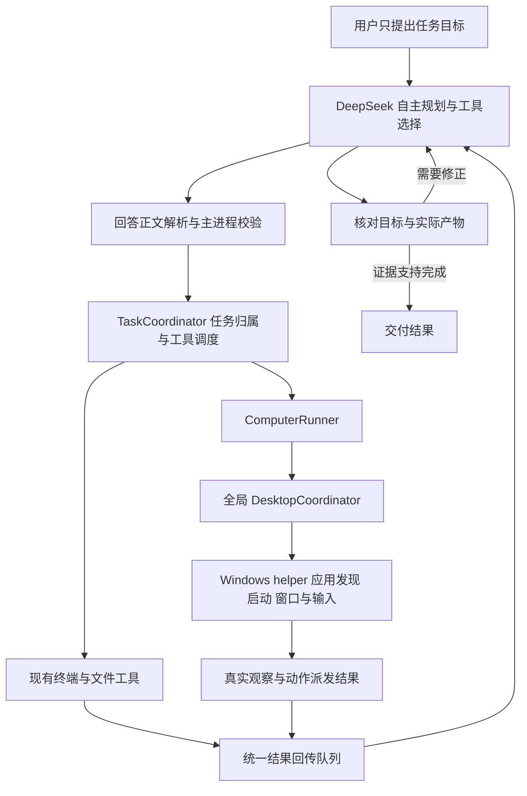

# DeepSeek Computer Use 实现调研

调研与修订日期：2026-10-25。依据：当前 Web2Term 仓库的静态代码、已安装插件的接口说明、公开技术文档，以及用户对 DeepSeek 网页视觉能力的确认。本文是设计建议，桌面操作功能尚未实现或验证。产品目标是用户布置任务、AI 自主执行全过程；本文中的开发验收仍遵守仓库“用户运行、智能体读日志”的分工。

## 1. 建议结论

实现任务级自主执行：用户用自然语言给出目标、必要条件和预期产物后，AI 自主规划、发现和启动应用、选择与切换窗口、处理菜单与对话框、操作界面、调用终端和文件工具、验证结果、修正失败，最后交付实际结果。用户不需要提前打开软件、选择窗口、拆解步骤或逐步确认普通操作。

沿用 Web2Term 的模型网页账号和 JSON 工具协议。DeepSeek 是任务决策主体，Electron 主进程负责可靠调度、执行和结果回传，Windows helper 提供桌面能力；不要求用户新增模型 API Key，也不额外增加一个规划模型。AI 按任务选择终端、文件、浏览器界面或其他桌面应用，工具之间可以连续切换。

首个发布目标建议为 Windows x64、本机执行环境、DeepSeek 网页，范围覆盖当前交互桌面的多个应用和窗口。应用发现、启动、窗口定位、焦点切换及弹窗处理属于首版必需能力。操作系统和模型平台可以分期适配；第一版必须保留“一个目标驱动跨应用完整流程”的产品契约。SSH／Web2Term 远程终端暂不暴露桌面工具，后续应分别表达 terminal_host 和 desktop_host，避免误操作机器。

桌面自主模式可在设置中预先开启，之后正常任务从用户发出目标开始。任务期间不以窗口选择、逐应用授权或每步点击确认作为常规流程。用户可以查看进度、补充要求、暂停和终止；只有确实无法由环境与工具取得的必要信息或操作系统／站点强制的人类步骤，才在明确阻塞位置请求介入，并在解决后继续原任务。

推荐桌面后端为 C# 独立进程：UIA3（可使用 FlaUI）读取和操作控件，Win32 SendInput 提供键鼠输入，Windows.Graphics.Capture 获取窗口图像。通过受父进程管理的 stdio 通信，不开放本地 HTTP 服务。模型只能请求固定动作，不向 helper 提交 JavaScript、PowerShell 或其他任意代码。

暂不依赖 Codex 的 @oai/sky：本机接口说明只能证明桌面产品的调用方式，不能建立一个供本项目独立分发和维护的公共 SDK 依赖。

## 2. 已有能力与实际接入点

| 代码位置 | 已有能力／约束 | 对新增功能的影响 |
| --- | --- | --- |
| `src/shared/types.ts`，`toolPromptForPlatform` | 注入平台工具协议；目前有 read_files 和后台任务 | 按平台、操作系统、连接类型、桌面开关注入 computer 协议 |
| `src/shared/types.ts`，`OUTPUT_FORMAT_SECTION`／`TASK_ROUTING_SECTION`／助手角色提示 | 当前围绕“一条命令→结果”组织，终端定位和任务路由有明确限制 | 自主模式重写为“目标→合适的工具→真实观察→验证／下一步”，允许跨工具连续执行；仅追加工具名称不足以完成适配 |
| `src/shared/types.ts`，`ParsedAction` | 目前仅 command／read_files | 为桌面请求定义独立的严格联合类型 |
| `src/main/injected/send-interceptor.js`，`checkForCommand` | 从回答正文识别工具；排除 DeepSeek 思考内容、流式中间状态和历史自动执行 | 新增 computer 的独立识别分支；不能落入宽松 command 解析 |
| `src/main/embed.ts`，`handlePageReport` | 第三方网页通过 console-message 上报；网页没有 Node 或 preload 桥 | 主进程重新校验请求、来源和当前任务；不能把网页事件视为授权证明 |
| `src/main/session-runtime.ts` | 平台切换、会话归属、任务结束、结果发送的生命周期 | 接入任务级协调器和 ComputerRunner；区别模型会话切换与外部目标应用切换 |
| `src/main/commands.ts`，`handleDetected` | 当前任何带 type 的 ParsedAction 都直接按 read_files 处理 | 必须明确分流；只把旧类型交给 CommandRunner，未知类型拒绝 |
| `src/main/commands.ts`，`runFileRecord` | 文件执行与回传分离；上传结果 unknown 不自动重发 | 复用其交付原则，桌面动作与结果回传进一步独立 |
| `src/main/page-files.ts`，`sendPageFiles` | 原生附件入口、CDP 选文件、可选 caption、提交一次及发送确认 | 可以承载“观察文字＋一张截图”的同一条消息 |
| `src/main/embed.ts`，`sendFileResult` | 当前面向 read_files 的封装没有传入自定义 caption | 应增加通用工具结果封装，不能假定 result.text 已随截图发给模型 |
| `src/main/background-task-results.ts` | 原会话绑定、取消代次、等待可发送状态 | 参考其归属管理，并统一协调同一输入框的多类自动回传 |
| `src/main/commands.ts`，`hasInFlightWork`／`canSendAutomaticResult`／`onTaskCompleted` | 当前忙碌判断只覆盖命令和文件；命令流程可以触发完成 | 聚合桌面执行、后台依赖、观察和交付状态；由任务级协调器处理完成，避免一个工具结束就结束整个任务 |
| `src/main/db.ts`，`toExecutionRecord` | 未知 kind 会降为 command；createExecution 只区分文件与命令 | 避免把 computer JSON 塞进 command 字段，以免恢复或重放走 Shell |
| `src/shared/platforms.ts`，`DEEPSEEK_PAGE` | 虚拟列表位置会复用，messageIdAttr 故意为空 | 桌面步骤不能只用虚拟行号去重 |
| `src/main/focus-chat.ts`、`src/shared/focus-chat.ts`、`FocusChatView.tsx` | 专注对话有命令／文件执行卡片和回传状态 | 新增桌面记录与观察卡片，工具回传不应被误当成一次新用户目标 |
| `electron-builder.yml`、`.github/workflows/desktop-release.yml` | Windows x64、asar、extraResources；尚无 helper 构建 | 增加 helper 构建和 Windows 资源打包；macOS 构建不能依赖 Windows helper |

## 3. DeepSeek 网页的视觉能力已确认

用户已于 2026-10-25 在本次对话中确认，DeepSeek 网页具备视觉理解能力。本项目以该能力已可用为实现前提，直接推进截图反馈与桌面操作闭环，不再将“确认是否支持视觉”列为开工前置条件。

默认采用 UIA 控件信息与截图结合的观察方式：AI 根据任务读取界面内容、判断布局与目标位置，并自主选择控件操作或视觉坐标操作。继续使用现有网页账号和附件通道，无需为本方案新增视觉模型 API。

移除首版必需的自动视觉资格自检、校准图片问答和专用校准报告解析分支。位置校准可在开发诊断或出现坐标偏差时按需使用，重点检查实际上传图像尺寸、窗口边界、DPI 和坐标变换，不作为每次任务启动时的固定步骤。

实现后的验收重点是截图能否完整送达当前对话、目标位置能否正确映射到实际桌面、操作后的状态是否符合任务目标，以及无文字图标／画布等具体场景的表现。网页视觉能力的确认与本软件桌面操作链路的验收分别记录。

运行中若实际出现附件发送失败、图像信息不足或定位不准，AI 根据真实错误重新观察、调整截图区域，或改用 UIA、文件和终端继续完成任务；按具体步骤恢复，不重复要求用户确认平台是否支持视觉。

参考：[DeepSeek Vision 官方文档](https://api-docs.deepseek.com/guides/vision/)。该链接提供公开 API 的技术背景；本项目网页视觉能力的确认依据是用户反馈。

## 4. 建议架构



建议新增目录／模块：

```text
src/shared/computer-use.ts           请求、结果、能力和错误码
src/shared/task-runtime.ts           任务目标、阶段、产物和验证信息
src/main/task-coordinator.ts         任务生命周期和跨工具调度
src/main/computer/runner.ts          每个会话的桌面动作与交付流程
src/main/computer/coordinator.ts     全应用共用的桌面控制租约
src/main/computer/app-catalog.ts     应用目录、启动引用和窗口关联
src/main/computer/windows-driver.ts  helper 生命周期、协议和超时
src/main/computer/observations.ts    观察编号、坐标变换、临时图像
src/main/tool-result-delivery.ts     统一协调文字／图片回传
native/computer-use/windows/         C# helper 源码
```

这些路径是建议，尚未创建。TaskCoordinator 保存目标、工具能力、执行归属、产物索引和可观察的进度，负责可靠性，不另建一套替模型决策的业务工作流。DeepSeek 保持规划和下一步选择权；终端与 read_files 继续复用现有执行器，由薄的分发和调度层接入任务。软件不需要读取或持久化模型的内部思考过程。

自主模式的系统提示词必须同时调整角色、任务路由、输出格式和结束条件。每轮只执行一个可观察工具步骤是协议的串行性要求，整轮结果回传后由 AI 自动继续；用户只提交一次原始目标。澄清问题限于真正缺失的必要信息，普通窗口定位、启动路径查找、格式选择和失败修复先由 AI 使用工具完成。

### 后端选型

| 方案 | 适用性 | 判断 |
| --- | --- | --- |
| C# + UIA3/FlaUI + Win32 + WGC | Windows 控件、窗口、输入和截图放在一个独立进程；可自包含发布 | 推荐作为正式实现起点 |
| Python + pywinauto/PyAutoGUI 等 | 原型开发方便，但安装包还要处理 Python 和图像／自动化依赖 | 可用于独立原型，不作为产品默认运行前提 |
| Node 原生键鼠库 + Electron 截图 | 容易先接通坐标操作；控件语义还需额外组件，原生模块要处理 Electron 打包适配 | 不单独承担完整桌面后端 |
| Rust/C++ + Windows API | 能统一实现底层能力，但 UIA、COM、截图和资源管理的开发工作较多 | 有现成团队经验时可选 |

选 C# 是本项目的工程判断，并非平台要求。FlaUI 提供 UIA2／UIA3 封装，采用 MIT 许可；实际接入应固定正式包版本，而不是直接依赖主分支。

来源：[FlaUI 官方仓库](https://github.com/FlaUI/FlaUI)、[微软 UI Automation 客户端说明](https://learn.microsoft.com/en-us/windows/win32/winauto/uiauto-clientsoverview)、[.NET 自包含单文件发布](https://learn.microsoft.com/en-us/dotnet/core/deploying/single-file/overview)。

代价是开发和 Windows CI 增加 .NET 构建链，自包含产物也会增加安装包体积；终端用户不需要另外安装 Python 或 .NET。helper 放在 Windows 专属 extraResources 中、位于 asar 外，主进程通过 process.resourcesPath 定位并核对协议版本。依赖恢复与离线构建分开，不能让 npm run build 隐式联网下载运行时；开发启动继续使用 npm run dev，由应用按需管理 helper，不新增用于拉起 Electron 的启动脚本。

### helper 的运行约束

- 用非管理员普通子进程，继承的专用管道传 JSON 请求，stdout 只传协议、stderr 传不含界面正文的诊断信息；指定隐藏窗口启动，关闭父进程或管道时退出。
- 协议需要版本握手、request ID、操作超时、最大消息／图片尺寸、取消代次和错误码。
- UIA 放在独立 MTA 工作线程；限制控件树深度、数量、单次耗时，不能无限遍历桌面。UIA 阻塞时由监督层终止工作进程并使当前输入结果进入未知状态，不能仅用 Promise 超时后继续复用它。
- 急停路径不能排在普通 UIA 调用后面；输入要拆成可中断的小段，并在退出和异常时释放本次按下的键、鼠标按钮。已经发生的点击无法撤销。
- 只支持当前交互桌面；锁屏、UAC 安全桌面、失效窗口、无法取得目标前台时返回具体错误，不自行提权。

微软说明 UIA 的线程使用不当可能导致卡顿／失去响应，建议无窗口的 MTA 线程。SendInput 受 UIPI 约束，只能向相同或更低完整性级别的应用注入输入，且不能仅靠错误码证明失败原因。

来源：[UIA 线程说明](https://learn.microsoft.com/en-us/windows/win32/winauto/uiauto-threading)、[SendInput 官方文档](https://learn.microsoft.com/en-us/windows/win32/api/winuser/nf-winuser-sendinput)。

### AI 自主发现、启动和定位应用

应用目录和运行窗口需要分别建模。`list_apps` 返回可启动应用的显示名称、app_id、启动引用及关联窗口；`list_windows` 返回当前交互桌面的窗口、标题、可见／最小化状态、前台状态、进程身份、所属应用和 owner 关系。AI 根据任务和这些结果自己选择，无需用户点选。

应用发现优先组合 Windows Shell 的 Applications 虚拟目录、开始菜单快捷方式、App Paths 注册信息和现有运行进程。目录不保证覆盖便携应用；找不到时由 AI 用现有文件／终端工具继续定位真实安装路径，再交由主进程核实并登记可启动引用，不能凭空编造 exe 路径。

来源：[Applications 已知文件夹](https://learn.microsoft.com/en-us/windows/win32/shell/knownfolderid)、[IShellFolder 枚举接口](https://learn.microsoft.com/en-us/windows/win32/api/shobjidl_core/nn-shobjidl_core-ishellfolder)、[应用注册与 App Paths](https://learn.microsoft.com/en-us/windows/win32/shell/app-registration)。

启动按实际应用类型适配：传统桌面应用通过已解析的可执行文件／快捷方式或 Shell 激活；打包应用使用其 AUMID 等启动身份；文件和 http(s) URL 通过系统关联应用打开。app_id 对应的是软件核实过的启动描述，参数使用结构化数据，不把模型文字拼成 helper 内的 Shell 脚本。需要执行脚本的任务继续走已有 command 工具。

`launch_app` 和 `open` 返回启动是否派发、候选窗口及后续观察。单实例应用可能复用已有进程、打开新标签或通过代理进程转交请求；必须通过窗口清单变化、应用身份、文档／URL 等可观察信息重新关联，不能把启动 API 返回的 PID 当成最终窗口，更不能看到进程启动就宣布任务完成。

来源：[ShellExecute 应用与文件打开](https://learn.microsoft.com/en-us/windows/win32/shell/launch)、[打包应用激活接口](https://learn.microsoft.com/en-us/windows/win32/api/shobjidl_core/nn-shobjidl_core-iapplicationactivationmanager)、[Shell 激活可能不返回进程句柄](https://learn.microsoft.com/en-us/windows/win32/api/shellapi/ns-shellapi-shellexecuteinfoa)。

窗口登记基于当前桌面的枚举和 UIA，并处理同应用多个文档窗口、文件对话框、独立进程弹窗及浏览器标签页。同名候选先观察和核对文档内容，由 AI 解决可从环境判断的歧义；不把“窗口名称相似”直接转成向用户提问。目标切换由 `focus_window` 显式执行，再检查真实前台窗口和焦点，输入前再次核对。

Windows 对 SetForegroundWindow 有明确限制，即使满足部分条件也可能拒绝激活。产品需要在任务开始时建立前台交接，随后由 helper 自动恢复／激活目标、核对结果；失败时有界重试和重新观察。不能通过绕过限制来保证任何时候都能抢到焦点，也不能把一次激活失败伪装成成功继续输入。

来源：[当前桌面窗口枚举](https://learn.microsoft.com/en-us/windows/win32/api/winuser/nf-winuser-enumdesktopwindows)、[SetForegroundWindow 限制](https://learn.microsoft.com/en-us/windows/win32/api/winuser/nf-winuser-setforegroundwindow)。

### 自动等待与操作后的验证

通过 UIA 窗口／结构／属性事件触发观察，并保留有上限的条件轮询作为后备。事件或画面稳定只能作为重新检查的时机，不能证明目标已完成。`wait_for` 接受固定条件类型、目标和超时，例如窗口出现、文字出现、元素可用；不执行模型提供的任意判断代码。超时后返回当前观察，由 AI 自主判断是继续等待、换路径还是修复。

工具结果区分“输入／控件调用已派发”和“业务后置条件已成立”。例如点击下载按钮只证明动作已请求，文件下载完成还需文件存在、临时下载结束、大小／内容等证据；点击保存后还需核对实际文件、界面提示或回读结果。UIA Invoke 和窗口事件都不能单独代替业务验证。

来源：[UIA 事件说明](https://learn.microsoft.com/en-us/windows/win32/winauto/uiauto-eventsoverview)、[Invoke 控件模式](https://learn.microsoft.com/en-us/windows/win32/winauto/uiauto-implementinginvoke)。

## 5. 工具协议和观察结果

建议单一 type=computer，以 action 区分操作；每个模型回答最多一个工具请求。观察为独立动作，输入后由软件自动返回下一次观察，避免模型再多问一轮截图。

首版动作范围如下。它们共同构成从任务到跨应用完成的最小能力，应用启动和窗口切换不能延后到“扩展阶段”。

| 动作 | 职责 |
| --- | --- |
| `list_apps` | 查询可启动应用，返回软件登记的 app_id／启动引用及运行窗口 |
| `list_windows` | 发现当前桌面的窗口、弹窗和前台状态 |
| `launch_app` | 根据 app_id／已核实启动引用启动或激活应用，回传候选窗口 |
| `open` | 打开任务相关文件、目录或网页，回传关联应用／窗口线索 |
| `focus_window` | 激活或恢复 AI 自主选择的窗口，并确认实际前台状态 |
| `observe` | 按需查看桌面概览、指定窗口或裁剪区域，提供截图／控件信息 |
| `click` | 根据控件 id 或当前图像坐标操作，支持双击和鼠标按钮 |
| `type_text` | 向已核对焦点的输入区域输入 Unicode 文字 |
| `press_key` | 执行按键或组合键，异常与结束时释放按键状态 |
| `scroll` | 在已观察的指定区域滚动 |
| `drag` | 对拖动、调整范围和画布等流程提供基础输入能力 |
| `wait_for` | 在有界时间内等待可观察条件，并返回最新状态 |

较复杂的 UIA 模式（例如 set_value、select、expand/collapse）可通过明确的类型动作逐步增加。首版通用输入与键盘导航仍应能覆盖相应基础流程。应用缺少某个控制模式时，把支持能力和实际错误返回模型，由 AI 选择替代方式。

AI 自主发现和启动应用的一个协议步骤示例：

```json
{
  "type": "computer",
  "version": 1,
  "action": "launch_app",
  "step_token": "step_A3",
  "app_id": "app_7",
  "description": "打开已发现的表格处理应用"
}
```

应用启动后软件回传真实窗口列表，AI 再调用 focus_window／observe。整个过程自动衔接；window_id 是 AI 动作的定位参数，用户无需填写或选择。

点击请求示例（示意值由当前结果提供，不能猜测）：

```json
{
  "type": "computer",
  "version": 1,
  "action": "click",
  "step_token": "step_A7",
  "window_id": "w_3",
  "observation_id": "obs_18",
  "target": { "element_id": "e_12" },
  "description": "点击另存为按钮"
}
```

`step_token` 由客户端生成，并在初始工具提示／每次结果中提供；不把 token 当成对第三方页面的安全认证，它用于把动作关联到本次已知循环。执行 ID 由客户端基于会话、任务代次、回答身份和完整请求确定，不能只采信模型给出的动作 ID。所有工具结果都带 task_id、step_id 和原始请求关联信息，终端与桌面往返后仍接续同一个目标。

请求解析使用严格 JSON 和逐 action 的字段校验：拒绝未知动作、重复字段、混入 command/questions/read_files、冲突定位方式、NaN/越界坐标、超长输入及多请求歧义。即使 type=computer 格式错误，也只报告桌面协议错误，不能回落到宽松命令解析。保留现有仅扫描最终回答正文、历史基线、生成结束判断和主进程二次校验。

每次观察至少包含：

- `observation_id`、生成时间、任务代次、当前窗口和进程身份；窗口句柄之外还需进程创建身份，避免句柄复用。
- 窗口／客户端区域的物理边界、DPI、截图原始像素尺寸、实际上传尺寸、裁剪区域与变换数据。
- 当前焦点、选中文字（按需）、有上限的可见控件列表：id、role、name、enabled、focused、bounds、支持的 UIA 模式。
- 截图附件；可以附加编号标记，编号与控件列表对应，避免模型只靠自由坐标定位。
- 本次动作是否派发、派发是否完整／确定、后置条件的已知与未知部分、结果回传状态，以及可判定的错误。
- 桌面概览中的可用屏幕和窗口摘要、弹窗／owner 关系、窗口出现／消失／切换等与当前任务有关的变化。全桌面可被发现，不意味着每轮都上传全部屏幕内容。

先尝试控件语义操作；无可用 UIA 模式时，再用控件边界计算点击点或接受视觉坐标。`target` 的 element_id 与坐标形式互斥。输入前重新校验元素、窗口、前台和点的归属；界面已变化时返回 `stale_observation` 并重新观察。

窗口截图和 UIA 树不是系统提供的一次原子快照。应在捕获前后校验窗口边界、焦点、弹窗等可用状态，记录两个采集时刻；检测到变化时重抓或标记不一致，不能宣称 observation_id 能杜绝所有竞争条件。

### 坐标处理

模型坐标统一约定为“当前上传图像的像素坐标”，helper 负责转换到实际窗口／桌面物理坐标。若图像经过等比例缩放且无填充，转换可以写为：

```text
physical_x = capture_origin_x + image_x * captured_width / uploaded_width
physical_y = capture_origin_y + image_y * captured_height / uploaded_height
```

存在裁剪、留边或非等比变换时使用完整变换数据，不能只乘 Windows 缩放比例。覆盖 100%／125%／150%／200% 缩放、不同 DPI 的双屏和负桌面坐标；窗口移动／缩放后旧坐标失效。helper 需要明确 DPI awareness。

Electron 的 desktopCapturer 可用于早期截图备选，但默认只是缩略图；官方明确其真实尺寸不保证等于请求尺寸。若采用它，必须读实际图像尺寸，和 helper 窗口身份／坐标进行一致性校验。正式后端尽量统一窗口观察来源。

来源：[Electron desktopCapturer](https://www.electronjs.org/docs/latest/api/desktop-capturer)、[DesktopCapturerSource 尺寸说明](https://www.electronjs.org/docs/latest/api/structures/desktop-capturer-source)、[Windows.Graphics.Capture](https://learn.microsoft.com/en-us/windows/apps/develop/media-authoring-processing/screen-capture)。

## 6. 最关键的生命周期与恢复设计

### 桌面控制归属

DesktopCoordinator 在应用级创建，而不是每个 SessionRuntime 各建一个锁。同一 Windows 桌面同时只允许一个任务持有控制租约；归属包括 sessionId、platformId、conversationId、taskGeneration、desktop_host、当前目标及本任务已发现的窗口／进程引用。任务范围允许 AI 在多个应用之间动态切换，不维护要求用户逐个批准的窗口集合。

必须区分三类切换：

1. AI 正常启动／激活业务应用、打开文件对话框或进入新窗口：更新目标和观察，继续任务。这些操作不会改变 DeepSeek 任务归属。
2. 用户在 Web2Term 中主动切换驱动任务的会话／平台、结束任务或关闭自主模式：暂停／取消相应自动执行和排队输入；恢复后重新观察，不把结果发进另一个对话。
3. 检测到人工键鼠接管或无法解释的前台变化：停止旧坐标输入并核对。预期内的应用／弹窗焦点事件直接继续；可自动恢复的异常由 AI 处理；明确人工接管时暂停并保留原任务。

不能以“Web2Term 不是 Windows 前台窗口”为理由暂停，AI 操作其他软件时这正是正常状态。现有 SessionRuntime 的平台活动状态与操作系统前台状态含义不同，新增调度不能混用。区分输入来源时识别本 helper 注入的事件，不能让 AI 自己的点击不断触发人工接管。

首版同一任务的终端、桌面输入和附件操作按依赖串行调度；后台进程可以继续运行，但涉及同一业务应用或产物的后续步骤必须等待其真实结果。普通 command 也能间接启动或控制 GUI，不能靠命令词表可靠区分；桌面租约期间，其他自主任务的新本机 command 默认排队，归属同一任务的命令正常推进。已在运行的后台程序和用户独立终端仍可能影响桌面，租约无法阻止软件外部的任意程序操作，仍须实时校验。

### 动作与交付分开记录

桌面动作状态至少区分 `pending / dispatching / completed / failed / cancelled / unknown`；交付另外记录 `pending / uploading / sent / failed / unknown / cancelled`。

- 点击已经执行，截图上传失败：重试的是同一份结果／观察，不能再次点击。
- 页面提交未确认：进入交付 unknown，不自动再次提交。
- helper 在派发输入后崩溃、应用在保存结果前退出：动作结果 unknown，恢复后只重新观察并说明不确定，不自动重放。
- 两条真正不同的回答可能输出相同 JSON：不能只按 JSON 内容全局去重；用任务代次、当前 step_token、回答身份和持久化派发记录区分。
- `dispatching` 在重启时必须按 unknown 恢复。GUI 动作和数据库不能作为一个事务提交，因此不能承诺崩溃情况下严格 exactly-once；采取禁止自动重放的策略。

建议单独建 `computer_actions` 与 `computer_observations` 表，不借用 command 文本存储桌面 JSON。已有 executions 的未知 kind 会降级成 command，因此如果选择扩展同一张表，必须先把所有读取、恢复、重放和 UI 分支改成显式区分、未知类型拒绝；不能只加一个 kind 字符串。

### 回传与上下文

- 优先把动作结果文字、控件树和截图作为同一条用户消息提交，调用 sendPageFiles 的 caption 能力，避免“先发文字，模型已开始推理，图片还没到”。
- 工具结果使用独立来源标记，在专注视图挂到原任务，避免进入新的用户目标／重新注入提示词分支。
- 同一网页输入框需要单一发送队列，协调终端结果、read_files、后台任务通知、桌面观察；生成中、有人类草稿或会话变化时保留待发送结果。
- 结果回传优先使用现有页面脚本、CDP 与 webContents 定向输入，避免占用 AI 正在操作的系统鼠标／键盘。DeepSeek 网页和业务浏览器的角色分开，业务任务不导航掉控制对话。外部应用置前时的发送／附件确认是否可用，需要真实验收；如必须临时激活 Web2Term，由软件自动切回并重新观察业务窗口，不要求用户回到客户端点发送。
- 等待期间外部桌面可能变化。结果可以保留为历史观察，但下一次输入必须通过 freshness 和窗口状态检查；过期时重新观察，不能执行旧坐标。
- 当前 DeepSeek 终端回传有固定 4 秒等待。桌面步骤应单独考虑交付节奏和网页额度，记录真实耗时后决定配置，不承诺高频实时操控。
- 图片／控件树会积累在第三方会话中，不能通过本地删除撤回。仅回传当前步骤必要的概览／窗口／裁剪区域，限制树大小与图片体积。维护任务检查点：原始目标、已完成步骤、产物路径、验证信息、未决问题；历史观察只作为历史信息，不再用来定位点击。
- 首版先在同一对话中完成有界任务；接近上下文／站点限制时，先自动压缩任务摘要并保留检查点。摘要不能清除网站既有上下文，因此遇到硬限制应明确保留未完成状态；如增加自动新建会话接续，必须迁移任务归属、去重记录并重新观察，不能只靠新对话里一段模型总结保证动作不重做。

### 任务级自主推进、纠错与完成

TaskCoordinator 至少持有原始目标、用户约束、执行机器、工具能力、任务代次、当前步骤、产物索引、观察引用和可验证进度。可用状态包括 running、waiting_model、executing、verifying、recovering、waiting_user、paused、completed、failed、cancelled；等待模型或工具属于正常运行，无需用户点击继续。

每次真实结果回传后，DeepSeek 自主决定下一工具步骤。客户端记录可观察的阶段说明和验证证据，不强制模型在开工前提交完整工作流图。某个 UI 不好操作时，AI 可以改用键盘导航、UIA、文件处理或终端，完成目标的有效方式优先，不为了展示鼠标操作而绕远路。

| 情况 | 默认自主处理 |
| --- | --- |
| 找不到应用／目标窗口 | 刷新应用与窗口目录，搜索真实安装位置，核对同等能力替代工具 |
| 启动成功但窗口没出现 | 等待窗口事件并有界轮询，检查单实例复用、启动器、已有标签／文档 |
| stale_observation／元素失效 | 自动重新观察并将新结果交给模型选择动作；不重放旧坐标 |
| 弹窗、菜单、未保存文档提示 | 观察其内容和归属，按用户目标决定下一步并继续 |
| 图片上传／文本回传失败 | 保留已执行动作和交付记录，只修复／重试可证明未提交的结果发送 |
| 动作结果 unknown | 先重新观察或核对产物，再决定补救；不能自动重做可能已生效的动作 |
| 工具协议格式错误 | 返回具体解析错误，由模型修正；恢复过程有次数上限，不执行猜测出来的参数 |
| 连续相同步骤没有状态进展 | 记录无进展证据，触发换路径或诊断；超出配置上限后以未完成状态报告原因 |
| 缺少无法从环境获得的必要信息，或外部强制人类步骤 | 通过现有 questions 机制一次说明阻塞和所需最少信息；保留任务，解决后继续 |

设置任务时限、单动作超时、重复动作和无进展检测用于终止失控循环。重试次数必须结合操作是否幂等：观察可以重试，已派发的点击、发送、保存等先查真实后状态。一般操作失败进入 recovering，不能直接转为“请用户自己操作”。

完成至少需要模型明确报告目标满足、说明对应证据／产物，并且调度器确认没有属于本任务的待执行步骤、未决交付或完成所依赖的后台工作。保留现有完成标记的兼容性，但统一在任务层处理；空 command、一次 Shell 退出码 0、一次 UIA Invoke 返回或截图上传成功，都不能直接结束跨工具任务。

证据应匹配用户目标：保存文件需实际路径与回读结果，下载需核对文件状态，表格整理需核对结构／数据，界面操作需核对目标后状态。客户端能检查文件存在等确定条件，不能通用证明模型对内容质量的判断，因此记录具体证据和尚未确认的部分，不能只展示“已完成”。

## 7. 用户可控范围

提供预先可配置的“AI 自主执行／桌面能力”设置。自主模式中的日常入口是用户输入目标并发送，随后 AI 自动推进；不增加目标窗口选择、手动打开软件、确认每一步或点击每条“运行”等必要步骤。现有手动执行方式可继续作为用户主动选择的调试方式，但不能成为自主任务的默认工作流。

任务输入授权执行目标所需的普通应用发现、启动、窗口切换、观察和操作；跨到另一个业务应用时自动继续。设置中说明 Windows 前台键鼠会被使用，以及必要截图／控件内容会回传 DeepSeek。用户预先设置的应用或数据限制应被尊重，但产品不默认增加按应用逐个批准的门槛。

软件展示当前任务、正在操作的应用、最近观察、当前步骤、实际产物和恢复进度。这些是可查看的执行信息，用户不必阅读或操作它们才能继续。范围选择可以作为用户显式限制任务时的可选设置，整个系统的实现不得依赖用户先提供窗口句柄。

至少提供独立于普通任务队列的暂停／结束入口及全局急停快捷键；若快捷键注册失败必须显示可用替代入口。暂停后不继续派发新输入，恢复后重新观察。点击自身 Web2Term 主窗口、模型对话窗口或控制按钮不能由模型自行授权，以免影响控制和回传通道。

沿用用户明确给出的任务范围和既有执行约束；不能因为新增桌面工具就给普通步骤附加一套反复确认流程。范围明确的任务内动作自主推进；真正超出目标、缺失不可推断信息或受系统强制限制时才请求必要介入。支付、发送、删除等业务语义不能仅靠坐标或危险词表可靠识别，文档与界面不得承诺所有敏感动作均可自动识别。桌面和既有终端共同作用于用户机器，任务归属检查也不构成操作系统级安全隔离。

诊断日志只记录动作类型、归属、耗时、尺寸、状态、错误码和散列，不默认记录截图、控件正文、输入文本或密码字段；日志落在用户临时目录。截图先存受限的临时目录供附件上传，按保留策略清理。需要本地操作历史的图片另行显式保存，不能把所有桌面截图无上限写入会话数据库。

## 8. 实施顺序与验收

以下是内部开发顺序，各阶段不要求用户承担缺失的应用发现／窗口选择工作。首个可交付自主版本必须打通 A～D 的主要闭环；只会操作用户已打开窗口的阶段性原型不满足本需求。

| 阶段 | 实现内容 | 交付判据 |
| --- | --- | --- |
| A：任务和环境接入 | 自主模式提示词、任务归属、严格协议、应用／窗口目录、已确认的视觉输入能力声明 | 一次输入目标能自行选择下一工具；无需再次确认视觉能力或选择窗口 |
| B：应用生命周期与观察 | launch_app/open/focus_window、桌面概览、UIA、截图、弹窗关联、自动等待和同消息回传 | 从目标应用未打开的状态出发，自主启动并定位实际可操作界面 |
| C：跨应用操作与交付 | click/type_text/press_key/scroll/drag、全局租约、统一终端与文件调度、结果队列、急停 | 多个应用之间自主往返，工具结果持续回到原 DeepSeek 任务 |
| D：完成与恢复 | 产物验证、任务完成判据、DPI／双屏、人工接管、上传失败、崩溃恢复、无进展检测 | 一次目标完成正常流程；故障先自主修复；结果重试不重复输入；未知状态不重放 |
| E：覆盖扩展 | 更多控件模式、应用兼容、可选专用浏览器 driver、任务跨对话接续、其他模型网页／操作系统 | 复用任务协议和调度；应用发现、启动、多窗口能力已经属于首版 |

### 首版端到端验收

场景一，应用均未预先打开。用户仅发送：

> 打开记事本，把这段文字保存为指定测试目录中的说明.txt，再打开该目录确认文件已经保存。

AI 必须自行发现并启动记事本、定位窗口、输入内容、处理另存为和可能出现的提示、保存文件、自主打开文件管理器，并通过终端／文件或界面回读核对路径和文字，最后返回产物位置。用户不选择窗口、不提供 app_id、不点击运行或发送中间结果。

场景二，在可重复的受控测试站点和已安装表格应用环境下，用户仅发送：

> 从给定网址下载本月测试报表，合并整理为 Excel，保存到指定目录，用表格应用打开检查后告诉我结果。

AI 自主选择浏览器并打开 URL，完成网页操作，确认下载真正结束，使用文件／终端完成数据处理，启动或复用表格应用核对产物，最后报告结果。验收数据预先有已知行数、排序与汇总值，检查不能只看扩展名和文件存在。使用终端生成文件、再用 GUI 核对是合格路线，具体工具路线由 AI 选择。

场景三，在前两个流程中加入故障：同名多个窗口、启动复用已有实例、慢加载、未保存提示、失效控件、焦点被其他程序改变、不同 DPI 的双屏、截图上传失败、发送结果未确认、helper 退出。能通过观察解决的情况由 AI 继续修复；确实不能完成时，保留已完成部分和准确的未完成原因，不要求用户代替它定位窗口或执行常规步骤。

无文字图标／画布场景单独评估视觉定位和拖动，覆盖到的流程与尚未覆盖的应用分别记录；有限验收样本不能证明通用桌面操作永远成功。正常可执行的验收目标要求从单次任务输入到交付全流程自动完成。

测试与检查遵守仓库分工：智能体编写有意义的协议、状态机和驱动模拟测试，由用户运行；智能体不运行测试或启动 Electron。真实登录、页面结构、上传和桌面动作均由用户操作验收，智能体读日志定位。若后续确实需要在 tools/diag 中新增探针，必须先取得用户对编辑 tools 的明确授权并阅读其 README。

实现阶段至少覆盖：JSON 类型互斥和重复字段、旧消息不执行、相同请求重复上报、不同步骤相同动作、启动路径与应用身份关联、单实例复用、AI 正常焦点切换不触发暂停、人工接管识别、跨会话租约、过期观察拒绝、坐标变换、动作成功但回传失败、提交未确认、helper 超时／退出、任务结束释放输入、重启 unknown 不重放、工具结果不生成新用户目标、跨工具完成判据、无进展恢复，以及命令／附件原流程的回归用例。

代码实现后由智能体完成 `npm run build`，交付措辞为“构建通过，等待用户测试”。只做本文档调研不需要启动项目或运行构建，本文不能作为功能已经可用的证据。
