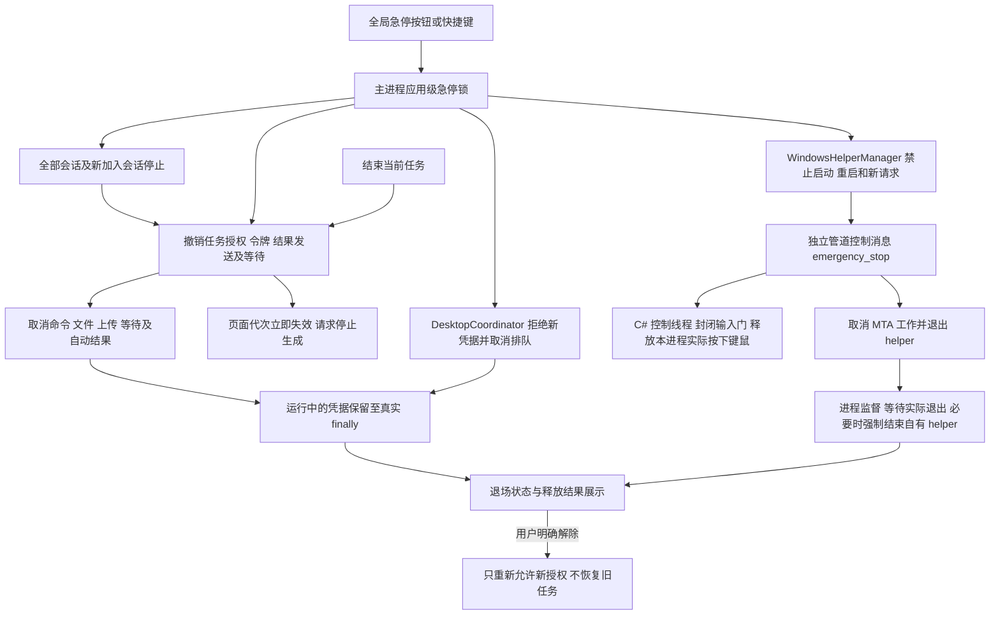

# 第 37 项：结束任务与全局急停

本项提供两种用户控制：当前会话的“结束任务”，以及所有会话共享的“全局急停”。它们都先撤销后续自动执行和回传资格，再请求页面、终端和 helper 取消工作，不等待 UIA 返回后才接纳停止请求。

保持原系统提示词、助手角色、工具请求格式与确认模式不变。急停属于客户端控制，不是模型可自行调用、解除的 computer 动作。

## 使用入口

| 入口 | 作用范围 | 后续行为 |
| --- | --- | --- |
| 原“结束任务”按钮／专注对话停止入口 | 当前会话的活动平台、当前模型命令及相关自动回传 | 旧目标停止，原执行事实和产物保留；下一次确认的用户发送或显式恢复可建立新的任务授权 |
| 工作区底栏“全局急停” | 应用内所有会话，包括其他平台、非活动会话和急停期间新建的会话 | 主进程持续锁住派发；不会因切换会话、改确认模式、恢复自动执行或 helper 重启而自行解除 |
| `Ctrl+Alt+Shift+F12` | 同全局急停 | 使用 Electron `globalShortcut`，Web2Term 不在前台时仍可接收已成功注册的快捷键 |
| 底栏“解除急停” | 解除应用级派发锁 | 只有旧 helper 已确认退出、运行凭据和命令已退场、停止请求已收敛时才可解除；旧目标、令牌、回传队列和动作不会自动恢复 |

快捷键注册失败或异常时，底栏直接显示“快捷键注册失败，请使用此按钮”，全局急停按钮始终保留。应用退出只注销本快捷键，不注销其他模块的快捷键。解除急停后可以提交新目标、显式恢复原目标，或按既有规则发起新的手动操作。

## 先阻断，再取消



`EmergencyStopController` 在主线程同步设置急停锁，先关闭 `DesktopCoordinator`、helper 接纳入口，再遍历会话。一个会话的取消异常不阻止其他会话收到请求。新加入的会话会继承急停锁并执行停止，计入待收敛请求。

任务协调器在锁定期间不接受新目标、旧令牌或工具步骤。普通模型命令、手动运行入口和自动结果的执行门同样检查全局锁；解除后保留原有手动确认规则。局部结束还保留会话内的自动检测停止边界，旧模型回答不能重新启动已结束任务，新的确认用户发送才清除此边界。

结束任务同时清空待接纳命令、computer 请求、迟到回答缓存、恢复发送授权和延期命令，取消截图／文件上传、已有工具文字发送、后台条件等待及后台自动通知。全局取消有独立通知代次，使跨会话的、尚未产生的旧后台回调也不能在解除后重新发出。

## 页面与终端

页面停止先在主进程递增原提示边界代次、清除步骤令牌，立即使原代次的发送、请求和迟到事件失效，再调用原页面 `endTask`。等待页面确认最多两秒；页面无响应不会阻止终端和 helper 收到取消。页面确认只代表停止请求已被页面处理，不代表已经证明远端生成结束。未取得请求确认时，当前会话显示停止未完全确认，全局状态记录对应失败数，后续自动执行仍被撤销。

终端取消先中断排队和文件准备，并立刻请求已有 shell 中断，再处理本地记录和清理，避免数据库异常挡住中断请求。已执行命令输出不会被删除。原 shell 的停止确认和实际退场继续沿用现有实现；持有的全局凭据必须等实际 `finally`／`whenQuiescent` 后释放。

任务保存 `stop.reason`（`user-ended`／`global-emergency`）和请求时间；当前任务记录进入停止状态。已完成目标保留既有完成事实，不把历史完成改成未执行。存储失败时仍先阻断内存授权和执行，不能因此继续派发。

## helper 独立释放路径

内部控制帧 `emergency_stop` 包含本进程关联 ID 和 helper 代次，经自有 stdin 管道直接送到 `HelperHost` 的控制读取循环；不进入 MTA／UIA 工作队列，也不是模型动作。控制线程先封闭输入门，再尝试释放本 helper 的按下状态，取消活动工作并返回 `emergency_stopped`，随后退出。

`OwnedInputTracker` 统一包住真实 `SendInput`，只记录 API 实际接受前缀中的键盘、Unicode 和鼠标 down／up。移动、滚轮和已平衡的序列不会制造按下状态。停止时仅对记录中仍归本 helper 持有的项发送 up，不扫描或释放用户原本按住的键；正常 `finally` 与急停竞争时不会重复释放已经清除的项。输入门只包住短暂的 `SendInput` 提交，不包住 UIA、截图或进程等待。UIA 的后续检查与语义输入边界也检查停止标志。

释放回执只包含 attempted／released／remaining 计数，不回传键值、输入文字或密码。主进程分别显示：

- `not-needed`：停止时没有 helper 进程；延迟的启动检查也不能再启动它。
- `pending`：已请求释放，尚无可信回执。
- `released`：收到本 helper、代次和请求 ID 一致的回执，剩余持有项为零。
- `unconfirmed`：释放失败、回执异常／缺失，或进程退场前未取得可信确认。不能把进程已退出解释为键鼠已释放。

主进程给独立控制消息 250 ms 的确认机会；未确认就进入原进程监督退场流程，再给自有 helper 500 ms 退出宽限，必要时对该子进程句柄请求强制结束。宽限到期只表示请求已发出，必须收到实际 `close` 后才认为旧进程退出；失败的 kill 不允许新 helper 并行启动。局部工具取消同样走独立 cancel 路径并封闭该 native 进程的输入门，保留实际回执后退场，由新的进程提供后续能力。

已经进入 OS／UIA 的调用或一批 `SendInput` 可能已生效；无法用取消假装回滚。无法抢断第三方 COM 调用时由进程监督处理，实际效果按原执行事实保存为 executed／unknown，必要时新任务重新观察。强制终止或 OS 拒绝释放时，界面保留“键鼠释放结果未确认”，用户明确解除也不会改写这条事实。

## 后台工作与交付历史

停止不额外遍历、杀死已登记的后台进程，不关闭被操作的应用，也不删除输出文件。后台监控、进程身份、日志和真实结束状态继续保留，可在后台任务面板查看并按原入口独立停止。正在启动、尚未确认登记的工作仍按真实启动回执和监控结果处理，不能提前承诺已退出或继续运行。

只取消旧任务的自动回传。明确未提交的结果可标记 cancelled；发送／上传中则保留提交未确认。晚到的明确成功回执只修正原历史为 sent，不触发新的任务推进或恢复令牌。原 computer 执行／交付分离、动作去重、未知结果恢复和完成报告门槛继续生效。

第 36 项的完整暂停控制仍独立实现；第 38 项已另行接入 [人工输入来源与异常焦点处理](deepseek-computer-use-takeover.md)，复用本项取消／执行事实留存链路。急停是用户明确触发的停止，不用普通窗口切换、AI 自己的输入或查看进度来推断人工接管；明确结束／急停优先于同次按钮输入产生的人工接管事件。

## 测试与交付

已编写 `tests/emergency-stop.test.mjs`，使用真实主进程协调代码、提取的实际停止方法、内存 SQLite 和合成执行器覆盖同步阻断、队列取消、凭据退场、重复急停、新会话、未知释放、页面无响应、局部转全局和迟到回执。补充 helper 合成管道测试，以及后台通知跨会话取消／迟到确认用例。

`tests/native-app-catalog/InputSafetyTests.cs` 用注入的假 `SendInput` 验证按下归属、部分提交、Unicode、释放失败、重复清理和输入门；不调用键鼠或 UIA API。按仓库规定，测试由用户运行，智能体没有执行测试或启动真实 helper／页面／桌面。

```powershell
node --test tests/emergency-stop.test.mjs tests/windows-helper.test.mjs tests/desktop-coordinator.test.mjs tests/background-task-results.test.mjs tests/task-progression.test.mjs tests/task-tool-collaboration.test.mjs tests/task-completion.test.mjs tests/computer-recovery.test.mjs tests/computer-progress.test.mjs tests/recent-command-run.test.mjs
dotnet run --project tests/native-app-catalog/Web2Term.AppCatalog.Tests.csproj
```

实际验收还需用户确认快捷键冲突提示、原生网页停止生成、拖拽／组合键过程急停、阻塞 UIA 的退出及后台进程保持运行。智能体交付标准为 **构建通过，等待测试**；构建不等于真实急停效果已验证。
