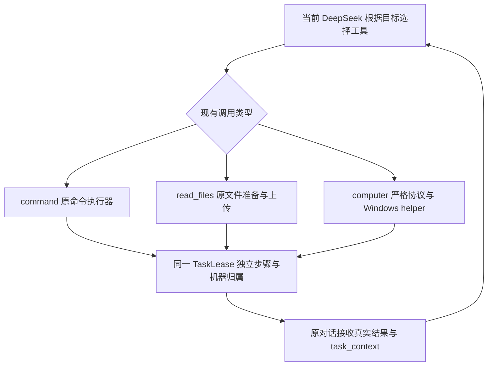

# 第 24 项：终端与文件工具协作

用户在一个 DeepSeek 目标中可以先让模型用现有命令生成文件，再用 `read_files` 读取实际文件，随后选择 `list_apps`、`open`、`observe` 等 computer use 动作打开应用核对。软件为这些步骤保存同一个任务和机器归属，模型继续根据真实结果选工具。自动模式按既有规则推进；手动模式保留每条命令／文件请求的运行确认。

## 接入方式

现有系统提示词正文、助手角色、终端／文件工具说明和模型 JSON 调用格式保持原样。脚本继续通过 CommandRunner 和 ConversationShell 执行，文件继续通过现有 prepareFiles、文件暂存和网页附件上传链路处理；computer 请求仍由严格 computer 协议识别，不转换为终端命令。本项没有新增 helper 动作。

DeepSeek 页面在原有新回复扫描中复用 computer use 的确认发送编号、页面代次、会话路径和虚拟消息基线，为真实新回答附加主进程事件元数据。该元数据独立于模型 JSON；历史回答、旧基线及缺失真实发送来源的回答不获得当前任务关联。原有无任务关联的命令和文件行为保持原有规则。

主进程桥接层先复核当前 DeepSeek 来源页面、路径及代次，SessionRuntime 再检查当前目标发送编号、TaskLease、会话和本机执行环境，签发 TaskToolContext。模型 JSON 中的任务、机器或步骤字段不能覆盖它。命令、文件及桌面步骤共用 TaskCoordinator 的步骤计数、消息去重及进度，执行与交付状态先保存，再产生相应副作用。



## 归属和持久化

每个关联保存 sessionId、platformId、conversationId、taskId、generation、stepId、sourceMessageId、tool 和 machine。tool 为 command 或 read_files；computer 步骤也保存明确的工具类型与机器快照。machine 包含本机持久编号、标签、操作系统、架构、local 连接及接纳请求时的目录。目录是当时的快照，后续命令结果正文中的 cwd 才是执行后实际目录；本项不会把远端路径解释成本机路径。

SQLite executions 表增加可重复迁移的 task_context 字段，执行记录和关联一起写入。旧记录缺省不含关联；关联格式、工具类型或会话冲突时返回显式不可用关联，执行入口拒绝把它降级为普通命令。关联保留为历史；重新载入任务仍按原规则标为中断，不恢复授权、重新执行或补发。用户明确进行历史命令重放时仍沿用原入口，新执行不复制旧任务的关联。

CommandRunner 在执行前和终端准备完成后复核当前任务／步骤及真正的本机 shell，不让已绑定本机的请求随着 SSH 后端切换执行。文件使用已保存的 scope、hostId、cwd 准备路径，并在读取、上传前及上传过程中复核任务。换目标、会话、平台、机器或停止任务后，旧文件准备不继续上传，暂存结果清理；已开始命令的真实输出仍记入原执行记录，不声明回滚。

## 结果与连续推进

命令正文保留实际输出、退出状态和 cwd，在末尾附加任务工具上下文；文件沿用原附件字节及 caption，并附加同样的上下文。computer_result 保留现有字段，增加相同含义的 task_context：

```json
{
  "task_context": {
    "session_id": "原客户端会话",
    "platform_id": "deepseek",
    "conversation_id": "原模型对话",
    "task_id": "同一任务",
    "task_generation": 1,
    "step_id": "本次步骤",
    "source_message_id": "真实请求来源",
    "tool": "command / read_files / computer",
    "machine": {
      "id": "本机持久编号",
      "label": "本机",
      "platform": "win32",
      "arch": "x64",
      "connection": "local",
      "working_directory": "接纳时的目录快照"
    }
  }
}
```

任务上下文由软件写入，不是新增模型参数。读取失败且没有附件时，关联任务会收到真实错误文字；不会据此生成替代文件或声明读取成功。命令退出码为零、文件附件交付、窗口打开及模型自述都不能证明产物内容正确或整体目标完成，后续验证仍由模型选择工具完成。

模型的新工具请求可能在上一条结果的发送确认返回之前到达。软件最多暂存一个后续请求，并同时保留提前到达的普通答复／澄清；原结果明确发送成功后才接续。发送未知时保持阻塞，后续请求不执行；换目标会作废旧候选。

带任务关联的文字结果在 busy／no-composer 时保存原文，使用可取消的本地调度仅重试交付。带任务关联的文件结果遇同类阻塞时复用已经准备的附件字节、原上传令牌和步骤，不重新读取文件，也不刷新原读取的开始／结束时间。输入框草稿、生成中及暂停仍由现有发送入口检查。unknown、stuck 或其他提交不确定状态停止自动重发，不重跑命令，不把未确认发送说成成功。进程结束后不恢复这些内存重试。

后台命令关联仍记录启动步骤及机器，启动通知、完成通知继续沿用既有后台任务机制；启动登记不表示目标完成。后台结果依赖与后续业务等待已由第 25 项接入，参见 [后台任务依赖与业务等待](deepseek-computer-use-background-wait.md)；跨所有入口的完整统一发送队列仍由第 29 项完成。第 26 项已增加实际读取／打开资源及应用／窗口线索索引，参见 [跨应用任务连续性](deepseek-computer-use-continuity.md)；文件内容与业务产物仍由模型按真实工具结果验证。

## 测试与交付

智能体只做语法检查与项目构建。交付状态为“构建通过，等待测试”，未运行测试、启动 Electron／helper、执行真实命令或读取真实文件／桌面。

用户可在仓库根目录运行：

```powershell
node --test tests/task-tool-collaboration.test.mjs tests/deepseek-computer-requests.test.mjs tests/task-progression.test.mjs tests/autonomous-task-entry.test.mjs tests/background-execution-storage.test.mjs tests/recent-command-run.test.mjs
```

用例采用合成终端、文件结果、网页基线、发送回执和内存 SQLite，覆盖同任务命令→文件→桌面接续、重复与过期来源、手动确认、本机／SSH 切换、旧任务迟到结果、快速回复、未知交付、忙碌交付不重执行／重读以及持久化迁移／损坏关联。

真实流程只使用 npm run dev 启动，由用户测试：自动模式布置一个生成报表、读取文件并打开检查的目标；确认任务及机器一致且步骤连续；再检查手动模式、暂停／恢复、草稿占用、读取失败、切换目标／会话及 SSH 连接时的归属处理。结果发送成功只表示消息已交付，实际文件内容和应用效果仍需核对。
